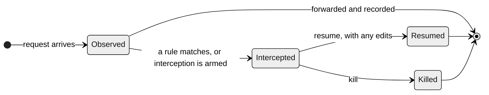
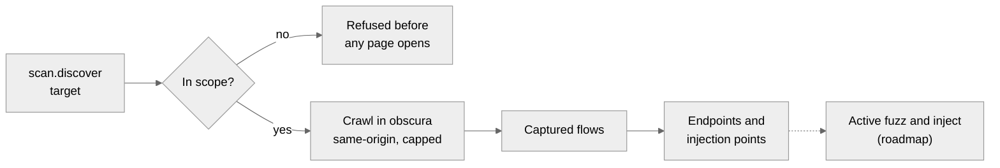
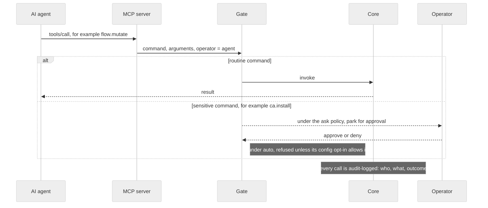

# aitmproxy

**Intercept anything — by hand or by agent.**

aitmproxy is an intercepting-proxy platform for authorized security testing. It
captures, intercepts, edits, replays and reproduces traffic across four layers of
the wire — HTTP/1.1, HTTP/2, WebSocket and raw L4 (TCP/UDP) — from one core that
an operator and an AI agent drive with the same commands. Written in memory-safe
Rust; runs on macOS and Linux.

**Website: [mrbrutti.github.io/aitmproxy](https://mrbrutti.github.io/aitmproxy/)**
— features, documentation, demos and downloads.


> **Authorized engagements only.** aitmproxy is deny-by-default and strictly
> scope-bound — it will not touch a host you have not explicitly put in scope —
> and its active tools send real traffic. Operate it solely against systems you
> own or are covered by a written engagement to test.

[Install](#install) · [Quick start](#quick-start) · [Surfaces](#the-three-surfaces) ·
[Capabilities](#capabilities) · [Agents](#agents-over-mcp) ·
[Reference](#reference) · [Documentation](#documentation)

Elsewhere: [Docs](https://mrbrutti.github.io/aitmproxy/docs.html) ·
[Features](https://mrbrutti.github.io/aitmproxy/features.html) ·
[Scripting](https://mrbrutti.github.io/aitmproxy/scripting.html) ·
[PoC format](https://mrbrutti.github.io/aitmproxy/poc.html) ·
[Demos](https://mrbrutti.github.io/aitmproxy/demos/) ·
[Download](https://mrbrutti.github.io/aitmproxy/download.html)

---

## Overview

Every action in aitmproxy is a registered command. A person drives a running core
from the web UI, the terminal UI or the macOS app; an AI agent calls the very
same commands over MCP. There is no second API for agents and no hidden menu for
humans, and every call lands in one audit log with the operator named.


### At a glance

| | |
|---|---|
| **Four layers of the wire** | HTTP/1.1, HTTP/2, WebSocket and raw L4, under one flow model. → [Capabilities](#four-layers-of-the-wire) |
| **Three surfaces** | A web UI, a terminal UI and a native macOS app, all clients of one core. → [Surfaces](#the-three-surfaces) |
| **Agent-ready** | Every command is an MCP tool, gated by scope and sensitivity. → [Agents](#agents-over-mcp) |
| **Embedded browser** | A headless engine that already trusts the proxy. → [Browser](#embedded-browser) |
| **Attack-surface scanner** | Crawl an in-scope target and map its injection points. → [Scanner](#attack-surface-scanner) |
| **Scripting and PoCs** | Rhai plugins and declarative YAML reproductions. → [Scripting](#scripting-and-pocs) |

### Anatomy of a flow

Everything aitmproxy sees is a flow with a short lifecycle. Observed flows are
recorded and forwarded untouched. A rule can intercept one: the request pauses,
readable and editable, until you resume it or kill it.



Here is what an agent sends to hold a request, edit it and let it go. Flow ids are
UUIDs; `flow.list` returns them.

```text
flow.intercept({ rules: [{ method: "POST", url: "*/api/cart/*" }] })   // hold matching requests
flow.mutate({ id: "<flow-id>", edits: { body: "{\"qty\":999}" } })     // edit the held request
flow.resume({ id: "<flow-id>" })                                       // release it, as edited
```

Arming interception is a sensitive call, so an agent can make it only under the
`ask` policy, with the operator approving; `flow.mutate` and `flow.resume` are
ordinary write calls. An operator does the same three moves in a UI: arm
interception, edit the held row, press Resume.

---

## Install

aitmproxy supports macOS (Apple Silicon) and Linux (x86_64 and aarch64). **Windows
is not supported.** The Homebrew tap and the release binaries are public; no
account or token is needed.

**macOS**

```bash
brew tap mrbrutti/aitmproxy
brew install aitm                  # CLI, web UI, terminal UI, MCP server
brew install --cask aitmproxy      # the native macOS app (self-contained)
```

The formula is the `aitm` core; the cask is the app, which bundles its own core,
does not need the formula, and requires macOS 26 or later.

**Linux**

Download a package from the
[release page](https://github.com/mrbrutti/homebrew-aitmproxy/releases/latest),
then install it. Packages place `aitm` and `aitm-tui` on your `PATH` with obscura
beside them.

```bash
sudo apt install ./aitm-0.5.9-amd64.deb     # Debian / Ubuntu
sudo dnf install ./aitm-0.5.9-x86_64.rpm    # Fedora / RHEL
```

The release also ships `aitm-<version>-<target>.tar.gz` for Linux and macOS, and
a signed, notarized `Aitmproxy-<version>.dmg`.

**Cargo**

```bash
cargo install --git https://github.com/mrbrutti/aitmproxy aitm
```

Cargo builds only `aitm`; see [Build](#build) for obscura. The source repository
is private, so this needs git credentials with access to it.

To point the app at an external core, or to see how `aitm` finds obscura, read
[INSTALL.md](INSTALL.md). The website's
[download page](https://mrbrutti.github.io/aitmproxy/download.html) lists every
asset with its checksum.

## Quick start

```bash
# 1. Trust the local CA. It asks first; `aitm ca export` writes a PEM for other devices.
aitm ca install

# 2. Run the proxy with a UI.
aitm web          # proxy on 127.0.0.1:8080, web UI on 127.0.0.1:8082
aitm tui          # or the terminal UI
aitm              # or headless: proxy plus the stdio MCP server
```

`aitm web` prints a one-time `web UI (agent): http://127.0.0.1:8082/#t=…` link on
stdout; open it in a browser. Nothing is opened for you.

Point a browser, simulator or client at `127.0.0.1:8080` and flows appear in
whichever UI you launched. Active tools — replay, `request.send`, the browser,
the scanner and PoC runs — only reach hosts in scope, so list your targets in the
config file (`~/Library/Application Support/aitmproxy/config.yaml` on macOS,
`~/.config/aitmproxy/config.yaml` on Linux):

```yaml
scope:
  entries: ["example.test", "*.staging.example.test"]
```

Instead of pointing every client at the port by hand, the core can set itself as
the system HTTP/HTTPS proxy. The `system_proxy:` block in the same file controls
it:

```yaml
system_proxy:
  auto: false       # set the system proxy at startup, restore it at exit
  bypass: []        # extra hosts that skip the proxy, merged with the defaults
  state_file: ~     # where the previous setting is saved; default: beside the CA audit log
```

The same thing is available live over the bus and in every UI: `proxy.system.status`
reads the current system proxy and whether this core set it; `proxy.system.set`
(optional `bypass` list; operator-only) saves the previous setting and points the
system at the core; `proxy.system.unset` (operator-only) puts the previous setting
back. The previous setting is
restored on quit, after a crash by a watchdog, and at the next start; `aitm proxy system unset` restores by hand.
On a headless Linux box with no GNOME or KDE session there is no system proxy to
set; export the variables instead:

```bash
export http_proxy=http://127.0.0.1:8080 https_proxy=http://127.0.0.1:8080 no_proxy=localhost,127.0.0.1,::1
```

A running core can also have scope changed live from a UI. From there, hold and
edit a flow, discover the attack surface, build a PoC from a captured request, or
hand the whole thing to an agent. The website's
[getting-started guide](https://mrbrutti.github.io/aitmproxy/docs.html) walks the
same path step by step.

---

## The three surfaces

The web UI, the terminal UI and the native macOS app are all clients of the core.
They show the same flows, scope, scanner results and commands, and each has a
**Scan** view that launches `scan.discover`. None of them is the core.

### Web UI

`aitm web` serves the embedded SolidJS UI on `127.0.0.1:8082` and prints the link
to open. The flow list filters by protocol and content type; the inspector shows
the request and response side by side, with headers, cookies, query, body and
timing.


### Terminal UI

`aitm tui` runs the proxy and a ratatui interface in one process, and it works
over SSH. `aitm-tui` is the standalone UI that attaches to a running core. It is
keyboard-complete: held flows, editing, replay, compose and PoC building all have
keys.


### macOS app

A native SwiftUI app, signed and notarized, that bundles and manages its own core
and obscura, or attaches to an external core you run. See
[INSTALL.md](INSTALL.md#pointing-the-app-at-an-external-core).


---

## Capabilities

### Four layers of the wire

| Layer | What you can do |
|---|---|
| **HTTP/1.1** | Hold requests and responses, edit method, URL, headers and body, replay, craft requests, and map to a local file or another upstream. |
| **HTTP/2** | Negotiated over ALPN and decrypted with the local CA. Each multiplexed stream is an ordinary flow you can hold and edit. |
| **WebSocket** | Every frame in both directions. Hold one, change it, or inject a frame toward either side. |
| **Raw L4 (TCP/UDP)** | Capture segments, craft and inject packets, send and receive, and — where the host allows — hold and edit bytes in the path. |

All four share one flow model, one command surface and one scripting API, so a
new protocol needs no new language. TLS is terminated with a CA generated on your
machine; hosts that pin certificates can be excluded with TLS passthrough.

**L4 platform support, stated plainly.** Live-wire L4 runs today on a privileged
`aitm` core, Linux first: capture and inject need `CAP_NET_RAW`, and in-path
hold-and-edit uses NFQUEUE with `CAP_NET_ADMIN`. `l4.enabled` defaults to off, and
without privilege the wire commands return a typed `L4Unavailable` rather than
failing silently. The macOS app's embedded core degrades the same way; since
v0.5.2 the app ships a Network Extension capture path, off by default behind an
operator toggle.

### Embedded browser

aitmproxy bundles a headless browser engine, **obscura** — a Rust engine
embedding V8 and speaking CDP — behind the same `browser.*` commands. It starts
with aitmproxy as its upstream and the MITM CA already trusted, so an agent or an
operator can log in, click through a flow, take the screenshot that proves a
finding, and capture the resulting traffic, all in scope and all through the
proxy. An optional **scope-confined egress mode** (`confine_egress_to_scope`)
refuses out-of-scope public hosts rather than relaying them, which keeps a crawl
or browser-driven campaign inside the engagement.

obscura is a separate artifact, not produced by `cargo build`. The macOS app, the
Linux `.deb`/`.rpm` and the release tarballs bundle it; see [Build](#build) for a
source checkout.

### Attack-surface scanner

`scan.discover` drives the embedded browser to crawl an authorized, in-scope
target breadth-first, then reads the captured flows back to enumerate **injection
points** — query and body parameters, headers, cookies, path segments. It is
deterministic and AI-free, and every step is bounded by scope and by depth, page
and time caps.



```text
scan.discover({ target: "https://staging.example.com/", max_depth: 2, max_pages: 50 })
```

Run it from the **Scan** view in any UI, or have an agent call it over MCP; it
needs a running core with the embedded browser, so the one-shot CLI cannot crawl.
It returns the endpoints found, the injection points, pages crawled and why the
crawl stopped. Endpoint and injection-point rows link back to the flow they came
from. **What shipped in v0.5.0 is discovery.** It reads and enumerates; it never
injects or mutates. Active fuzzing, injection and campaigns build on the same
seam and are roadmap, not present features. Details in
[docs/scanner.md](docs/scanner.md).

### Scripting and PoCs

**Rhai plugins** see each flow as it passes and can edit it, answer it, or record
a finding. Scripts run in a deny-by-default sandbox: they reach the network only
through gated host calls such as `http.send`, held to the same scope, SSRF and
rate guards as the commands; they run under time and operation limits; and they
cannot widen scope unless the operator turns on `allow_scope_add`. A hook that
fails or is refused is discarded and the flow carries on unchanged.

**PoCs** are declarative YAML — a few steps, a few matchers and a success
condition — so a finding can be re-run later and diffed like code. Steps can
drive HTTP, the browser, scripting and native L4. `poc.run` executes a PoC with
no agent in the loop and writes its artifacts; a **finding** (`findings.record`)
links back to the PoC that proves it.

```yaml
id: reflected-xss-search-q
info:
  name: Reflected XSS in search 'q' parameter
  severity: high

variables:
  - name: target
    required: true

steps:
  - http:
      method: GET
      url: "{{target}}/search?q=x"
      matchers:
        - type: status
          status: 200

success:
  all:
    - type: status
      status: 200
```

Both languages are written to be read and written by people first and agents
second. Their canonical, machine-checked catalogs — `rhai.api.json` and
`poc-yaml.schema.json` — live in [`docs/design/languages/`](docs/design/languages)
and the shipped engine is asserted against them in CI. The website has the full
[scripting reference](https://mrbrutti.github.io/aitmproxy/scripting.html) and
[PoC format](https://mrbrutti.github.io/aitmproxy/poc.html).

### And the rest of the proxy

- **Intercept rules** by method, host and URL, at the request, response or
  WebSocket-frame phase; arm and disarm live.
- **Replay and compose** — resend any captured request, or craft one from scratch
  with `request.send`; the result is captured as a new flow.
- **Map rules** to answer a request from a file or redirect it to another
  upstream.
- **Sessions and HAR** — save and reload a capture; import and export HAR.
- **Certificate management** — export, inspect, install and uninstall the CA
  (`ca.*`). An agent can export and check status; installing is gated behind a
  human.

---

## Agents over MCP

aitmproxy is an MCP server (`aitm-mcp`): every command is exposed to an agent
under the same name and shape, over **stdio**, **loopback TCP** or **streamable
HTTP**. Launching `aitm` with no arguments serves MCP over stdio.

```bash
claude mcp add aitmproxy -- aitm
```

For Claude Desktop, add `{"mcpServers": {"aitmproxy": {"command": "aitm"}}}` to
`claude_desktop_config.json`. Hosts that reach a URL rather than launch a command
use the token-guarded loopback or streamable-HTTP transport.

The operator governs the agent with a policy — `all`, `auto`, `ask`, `readonly`
or `paused` — that the agent cannot change. Sensitive verbs (installing the CA,
widening scope, TLS passthrough, running a PoC) also sit behind their own config
opt-ins, such as `scope.allow_agent_widen` and `poc.allow_agent_run`. Under `ask`,
a sensitive call waits for the operator's approval; under `auto`, it is refused
unless its opt-in allows it. The operator token (`aitm operator-token generate`)
is CLI-only: no agent can run it.



The macOS app's **Agent** view shows that traffic live: each call with its
operator, the agent policy, and a pending sensitive command waiting for you to
approve or deny it.


The [`aitmproxy-plugin/`](aitmproxy-plugin/) package wires the server into AI
hosts, with rich MCP Apps widgets in ChatGPT and Claude Desktop / claude.ai and
clean text in Claude Code. Start at
[`aitmproxy-plugin/README.md`](aitmproxy-plugin/README.md); the transport threat
model is in [`aitmproxy-plugin/docs/security.md`](aitmproxy-plugin/docs/security.md).

---

## Reference

### Architecture

One spine throughout: **a thin core, and everything else is a plugin or a
client.**

- **Thin core (`aitm-core`).** Accepts connections, runs sans-IO protocol state
  machines, holds the flow store, and emits typed events to an ordered plugin
  chain with halt and short-circuit semantics. It owns the deny-by-default
  **scope and rate guard** that every action passes through.
- **Protocol modules are plugins.** `aitm-proto-http` (HTTP/1.1 and HTTP/2),
  `aitm-proto-ws` and `aitm-proto-l4` plug in behind one `ProtocolModule` seam.
  The seam is protocol-extensible: new protocols register through the same
  guards with no change to the core.
- **Features are plugins.** Scripting, map rules, session I/O, WebSocket control,
  findings, the PoC engine and the scanner each register commands.
- **Frontends are clients.** The MCP server, the web UI, the TUI and the macOS
  app all drive the core by invoking registered commands. The one-shot CLI
  (`aitm <family> <verb> --flag value`) runs a single command in its own process,
  which makes it the right tool for self-contained commands such as
  `aitm ca status` or `aitm ca export`; it does not steer a proxy that is already
  running.

Adding a command to the core exposes it over MCP and in every UI at once, under
the same scope, sensitivity and confirmation rules.

### The command surface

A representative selection, grouped by family. Any connected MCP client can list
every tool with its parameters, and the generated catalog is in
[`aitmproxy-plugin/docs/tool-reference.md`](aitmproxy-plugin/docs/tool-reference.md).

| Family | Commands | What it covers |
|---|---|---|
| Flows | `flow.list` `flow.detail` `flow.intercept` `flow.mutate` `flow.replay` `flow.resume` `flow.kill` `flow.mark` `flow.comment` `flow.export` `flow.import` `flow.subscribe` | Inspect, pause, modify, replay and stream HTTP and WebSocket flows |
| Requests | `request.send` | Craft and send an arbitrary request |
| WebSocket | `ws.intercept` `ws.frame` `ws.send` | Intercept and inject frames |
| Proxy | `proxy.status` `proxy.pause` `proxy.resume` | Control the accept loop |
| Scope | `scope.add` `scope.list` `scope.remove` | The in-scope allow-list (deny-by-default) |
| TLS | `tls.passthrough.add` `tls.passthrough.list` `tls.passthrough.remove` | Bypass MITM for named hosts |
| CA | `ca.export` `ca.status` `ca.install` `ca.uninstall` | Manage the MITM CA (agent install is gated) |
| Browser | `browser.navigate` `browser.click` `browser.type` `browser.get_dom` `browser.screenshot` `browser.eval` | Drive the embedded browser |
| Mapping | `map.add` `map.list` `map.remove` | Map and redirect rules |
| Scripting | `script.list` `script.validate` `script.save` `script.reload` | Manage Rhai scripts |
| PoC and findings | `poc.build` `poc.run` `poc.get` `poc.list` `poc.artifact` `findings.list` | Build, run and record reproducible checks |
| Scanner | `scan.discover` | Crawl an in-scope target and discover injection points |
| Agent | `agent.set` `agent.status` `agent.activity` `agent.approve` | Agent policy, the audit view and the operator approval gate |
| Session | `session.save` `session.load` | Persist and restore a working session |
| L4 | `l4.capture.start` `l4.intercept.start` `l4.craft` `l4.inject` `l4.send_recv` `l4.flow.list` `l4.scope.add` … | Raw TCP and UDP capture, interception and packet crafting |

### Repository layout

A Cargo workspace of focused crates under `crates/`, operator UIs under `apps/`,
and the MCP plugin package at the root.

- **Core and proxy** — `aitm-core`, the protocol crates `aitm-proto-http`,
  `aitm-proto-ws`, `aitm-proto-l4` and `aitm-proto-test`, plus `aitm-rules` and
  `aitm-ca`.
- **Plugins and scripting** — `aitm-plugin`, `aitm-plugins`, and
  `aitm-plugin-rhai`, `-maprules`, `-passthrough`, `-wsctl`, `-sessionio` and
  `-scanner`.
- **Findings and PoC** — `aitm-poc`, `aitm-findings`.
- **MCP** — `aitm-mcp`: the tool registry, the MCP Apps widgets and the stdio,
  loopback-TCP and streamable-HTTP transports.
- **Binary and UIs** — `aitm`, `aitm-cli`, `aitm-tui`, `aitm-browser`,
  `aitm-bus-client`, `aitm-testtarget`; the macOS and web UIs live in `apps/mac`
  and `apps/web`.

### Built to be trusted on the wire

- **No `unsafe` Rust** anywhere in the workspace.
- **~31,000 requests per second**, sustained on a single instance with flat
  memory.
- **Deny-by-default** at every layer: scope, scripting, agent privileges and the
  scanner each refuse before they act.
- **One audit log** of every command, its arguments and its effect, whichever
  operator issued it.

## Build

```bash
cargo build                                        # whole workspace
cargo build --release                              # release binary
cargo fmt --check && cargo clippy --all-targets -- -D warnings && cargo test
```

The release binary is `target/release/aitm`, or `cargo install --path crates/aitm`.
A bare `cargo build` produces **only** `aitm`, not obscura. The proxy runs
without it, but the browser commands (and so the scanner) need obscura reachable.
In a dev checkout, `scripts/fetch-obscura-dev.sh` downloads the matching build
beside `target/debug` and `target/release`; `scripts/package.sh` builds a release
`aitm` and bundles obscura next to it. The discovery order is in
[INSTALL.md](INSTALL.md#building-from-source-cargo--bare-binary).

## Documentation

- **[Website](https://mrbrutti.github.io/aitmproxy/)** — features, getting
  started, scripting and PoC references, demos, downloads.
- [INSTALL.md](INSTALL.md) — install on macOS and Linux, build from source, point
  the app at an external core.
- [docs/scanner.md](docs/scanner.md) — the automated scanner (`scan.discover`).
- [`aitmproxy-plugin/README.md`](aitmproxy-plugin/README.md) — the MCP plugin for
  ChatGPT, Claude Desktop / claude.ai and Claude Code.
- [docs/design/languages/](docs/design/languages) — the canonical Rhai and
  PoC-YAML catalogs.
- [docs/RELEASE.md](docs/RELEASE.md) — the release runbook.
- Research, design and process live in [`docs/`](docs/) — start with
  `docs/research/05-synthesis.md` and `docs/research/MEMORY.md`. Contributor
  conventions are in [CLAUDE.md](CLAUDE.md).

## License

Licensed under either of MIT or the Apache License, Version 2.0
(`MIT OR Apache-2.0`) at your option.
