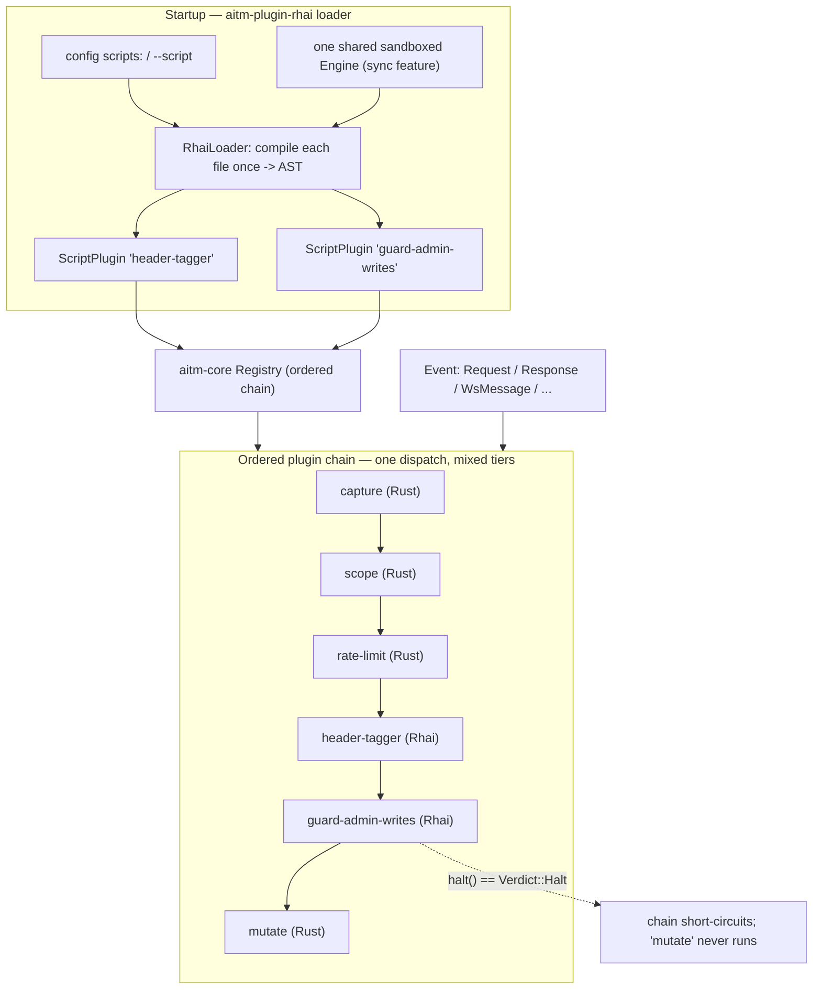
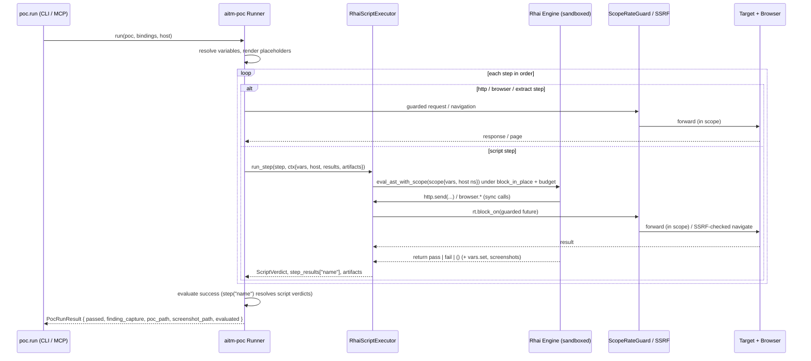

# aitmproxy M3 — Rhai scripting tier design

**Status:** draft
**Research inputs:** `docs/research/07-rhai-embedding.md`, `docs/research/01-mitmproxy.md`, `docs/research/02-nuclei.md`, `docs/research/05-synthesis.md`
**Companion specs:** platform — `docs/superpowers/specs/2026-10-27-aitmproxy-platform-design.md`; plugin system — `docs/superpowers/specs/2026-10-27-aitmproxy-plugin-system-design.md`; PoC language — `docs/superpowers/specs/2026-10-27-aitmproxy-poc-language-design.md`; M2 browser/config — `docs/superpowers/specs/2026-10-27-aitmproxy-m2-obscura-browser-design.md`

## Intent

Milestone 3 builds the **Rhai scripting tier** whose API shape the approved M1
specs already fixed: the human-usability and flexibility half of aitmproxy's
two-tier plugin model. It has two linked parts, both of which are *runtime*
layers over seams that already exist on `main`:

1. **Scripted plugins.** An operator or contributor drops a `.rhai` file beside a
   config line and gets a real plugin — same ordered chain, same typed `Event`s,
   same `Flow`s, same `Verdict::Halt` semantics as a compiled Rust plugin, with no
   recompile of the core. "Everything is a plugin" stays literally true: a script
   is **its own registration in the chain**, not a passenger inside one.
2. **The PoC `script` step.** The declarative YAML PoC language reserved a Rhai
   escape hatch for logic its matcher/extractor DSL cannot express. M3 makes it
   execute, reusing the *identical* script surface so a person learns one language
   once.

**The governing requirement for this milestone is human authoring ergonomics.**
aitmproxy is agent-first, but the scripting surface and the PoC YAML must be
pleasant for a person to read and write by hand — operators under time pressure
during an engagement, and future open-source contributors. Legible syntax,
sensible defaults, minimal ceremony, and error messages that say what broke,
where, and what to do about it are **acceptance-bearing design goals here**, not
polish. A surface optimized for agent generation at the cost of human
readability is a failed milestone (see Anti-goals).

### Milestone label reconciliation (read this first)

The plugin-system and PoC-language specs were written when the Rhai runtime was
slated for "Milestone 2" and label it so (AC-P6–AC-P11, AC-L8, `Step::Script` as
"the M2 addition"). **M2 was subsequently re-scoped** to the embedded obscura
browser + `ca.*` trust-store commands + YAML config. The Rhai runtime is
therefore **Milestone 3 — this spec**. Those companion ACs are inherited verbatim
by M3 and are restated in the Acceptance criteria below; no behaviour or API
shape changes, only the milestone label. This is a reconciliation within the
design, not a new decision.

## Goals

- **A `.rhai` file is a first-class plugin.** It registers into the platform
  `Registry` as its own `Plugin`, takes its own position in the ordered chain,
  sees every M1 `Event`, mutates the same `Flow`, and its `halt()` short-circuits
  the chain exactly as a Rust plugin's `Verdict::Halt` does.
- **Hand-writable in minutes.** A useful script is a handful of lines with no
  imports, no boilerplate, no registration ceremony; every hook is optional.
- **One scripting surface, reused.** The PoC `script` step runs the same engine,
  the same host functions, and the same DSL helpers as a scripted plugin.
- **Script-authored commands are first-class.** A command registered from a
  script appears in MCP `tools/list` and as a CLI subcommand, indistinguishable
  from a Rust-registered one.
- **Sandboxed by construction.** No ambient filesystem, network, process, env, or
  clock authority; every network/browser capability routed through the existing
  scope, rate-limit, and SSRF guards; bounded operations and a wall-clock budget
  so no script can stall or OOM the proxy.
- **Errors a human can act on.** Compile and runtime failures name the script,
  line, column, and the likely fix; one bad script never takes the proxy down.
- **No core redesign.** M3 adds crates and registrations; it does not restructure
  `aitm-core`.

## Non-goals

- **No new capabilities reachable only from scripts.** Scripts expose the
  deterministic machinery the tool already has; they do not add a second way to
  reach the network that bypasses the command surface or the guards.
- **No hot-reload requirement.** The reload seam is designed (the compiled `AST`
  is swappable) but startup loading is what M3 ships and gates on.
- **No script signing or verification.** Deferred and shared with the PoC signing
  mechanism (platform + PoC-language specs). M3 treats scripts as
  trusted-by-operator but sandboxed.
- **No WASM tier.** Roadmap only, behind the same seam (plugin-system spec).
- **No script marketplace, dependency resolution, or remote fetching.**
- **No scanner logic.** M3 ships the tier, not checks built on it. aitmproxy
  finds and reproduces; it never fixes.
- This spec does not redefine `Plugin`, `Event`, `FlowCtx`, `Verdict`, `Registry`,
  `Command`, `ParamSchema`, `FlowStore`, `CommandHost`, `ScopeRateGuard`, or the
  `aitm-poc` model — they are the platform spec's and are referenced here.

## Anti-goals

- **A surface only an agent would love.** Cryptic names, mandatory scaffolding,
  positional magic, or errors that read like a Rust backtrace. If a competent
  tester cannot read an example script and write their own in ten minutes, this
  milestone failed its top requirement.
- **A script tier that is second-class.** If a script cannot do what a Rust plugin
  can on the chain — mutate, short-circuit, intercept, register a command — the
  "one model, two tiers" goal has failed.
- **A guard bypass.** A script that reaches an out-of-scope or private host, the
  filesystem, or a process is a security failure, full stop.
- **A hook that can wedge the proxy.** An infinite loop, a huge allocation, or a
  slow host call must be bounded and surface as an error, never a stall or OOM.
- **A divergent second scripting surface for PoCs.** The `script` step must reuse
  the plugin surface verbatim.
- **Core edits to add a hook or host function.** Both must be additive inside
  `aitm-plugin-rhai`.

## Constraints

- **Language/gate:** Rust; `cargo fmt --check && cargo clippy --all-targets -- -D warnings && cargo test`
  must pass before any review. `unsafe` requires a `// SAFETY:` comment and a
  signed-off Security-reviewer entry. **The M3 design is deliberately
  `unsafe`-free** (see the marshalling decision).
- **Engine:** `rhai` 1.27.x with the **`sync` feature** (`Engine`/`Scope`/`AST`
  become `Send + Sync`, required to share the engine across the proxy's tasks).
  The **`unchecked` feature must never be enabled** — it disables the operation,
  stack, module, and data-size limits this design depends on. The `internals`
  feature stays off.
- **Runtime:** script hooks block; they run under `tokio::task::block_in_place`,
  which **requires the multi-threaded tokio runtime flavour** the proxy already
  uses. Async host functions bridge with a stored `tokio::runtime::Handle`.
- **Security:** every `http.*` / `browser.*` / `scope.*` host call passes the same
  `ScopeRateGuard` and SSRF guard as Rust plugins and commands. Deny-by-default
  scope remains the authorization mechanism.
- **Stability:** the script-facing API is a documented, versioned contract
  (`const API = "1"`); the Rust trait surface it bridges onto is semver-stable
  (plugin-system spec's external-authoring policy).
- **Targets `main` (M1).** M2 (browser + `ca.*` + YAML config) is in flight; M3's
  config additions are additive sections that land against whichever config form
  is merged (see Configuration).
- **Workflow:** every change travels the seven stages in `docs/superpowers/WORKFLOW.md`.

## Design

### 1. Where the tier sits

One new crate, **`aitm-plugin-rhai`**, depending on `aitm-core` (via the
`aitm-plugin` re-exports), `aitm-poc`, and `rhai`. Nothing depends on it except
the `aitm` binary, which wires it like any other first-party plugin. `aitm-core`
is untouched.

| Crate | Role in M3 |
|---|---|
| `aitm-plugin-rhai` | **new** — the engine, the script-facing object model, the loader, one `ScriptPlugin` per script, script-registered commands, and the PoC `ScriptStepExecutor` impl |
| `aitm-poc` | **additive** — `Step::Script(ScriptStep)` variant + the `ScriptStepExecutor` seam the runner calls |
| `aitm-core` | **unchanged** |

Each script becomes its **own** `Plugin`, registered individually, so it holds a
real position in the ordered chain and its `halt()` stops plugins *after* it —
native ones included.



### 2. Authoring ergonomics (the top requirement, made concrete)

These are binding design rules, not aspirations. Each is testable.

1. **Zero ceremony.** No imports, no `main`, no struct, no registration call. A
   file containing only `fn on_request(flow) { flow.request.headers.set("X", "1"); }`
   is a complete, valid plugin. `NAME` and `API` are optional (`NAME` defaults to
   the file stem; a missing `API` is treated as the current version with a
   one-line warning).
2. **Every hook is optional.** An absent hook is a no-op. A script never has to
   acknowledge events it does not care about.
3. **Names say what they do, in the reader's vocabulary.** `on_request`,
   `flow.request.headers.set(...)`, `flow.mark("...")`, `http.send(...)`,
   `browser.screenshot()`. Hook names mirror mitmproxy's, which the audience
   already knows; the flow object mirrors what a tester sees in the UI.
4. **The obvious spelling works.** Headers are settable by index *and* by method
   (`flow.request.headers["X-Api"] = "1"` and `.set("X-Api", "1")` both work);
   bodies read as text when they are text and as bytes when asked
   (`.body` / `.bytes`); `flow.request.url` is the whole URL, not three fields a
   reader has to reassemble.
5. **Sensible defaults over configuration.** Limits, timeouts, and ordering all
   have defaults that are right for an engagement; a script that sets nothing
   behaves well.
6. **Errors are a feature.** Every compile and runtime failure names the script,
   line, column, the offending construct, and — where the cause is a known class
   (sandbox denial, timeout, unknown hook name, wrong argument count) — the fix.
   Format pinned in §8.
7. **Fail loudly, never silently.** A hook that errors does not quietly alter a
   flow; it is reported and the flow proceeds as if the hook returned
   `Continue` (§8).
8. **Examples are part of the deliverable.** The worked examples below are
   normative reference shapes and ship as runnable fixtures.

### 3. The script-facing surface (pinned)

The hook set, flow object, and host functions were decided in the plugin-system
spec and are **adopted verbatim**. Restated minimally for reference; the
plugin-system spec is authoritative for the surface, this spec for how it is
implemented and marshalled.

| Hook | Fires on `Event` | Arguments |
|---|---|---|
| `load(reg)` | startup | registration handle |
| `configure()` | after options change | — |
| `on_request_headers(flow)` | `RequestHeaders` | flow |
| `on_request(flow)` | `Request` | flow |
| `on_response_headers(flow)` | `ResponseHeaders` | flow |
| `on_response(flow)` | `Response` | flow |
| `on_ws_start(flow)` | `WsStart` | flow |
| `on_ws_message(flow, msg)` | `WsMessage` | flow, message |
| `on_ws_end(flow)` | `WsEnd` | flow |
| `on_error(flow, err)` | `Error` | flow, error |

Host-function namespaces: `log`, `http`, `browser`, `store`, `scope`, plus the
shared DSL helpers (`b64_encode`, `url_encode`, `sha256`, `rand_text_alpha`,
`regex_match`, …) and `option(name)`. Verdict control: `halt()` / `continue()`.

**M3 addition (Architect's call): `finding(...)`.** The brief requires scripts to
be able to *emit findings*. The M1 surface had no verb for it, so M3 adds one
host function rather than overloading `log`:

```
finding(#{ name, severity, flow_id?, detail?, tags? })   // record an observation
```

It records a structured observation against the run (and, when `flow_id` is
given, marks that flow), surfaced through the existing command surface for the
agent to collect. It is **reporting only** — it never triggers an action, and it
carries no remediation prose (platform Non-goal).

### 4. Rust interfaces — `aitm-plugin-rhai`

Shapes are binding; bodies, private fields (`/* … */`), and file layout are the
builder's.

```rust
// aitm-plugin-rhai — the loader: builds one sandboxed Engine, compiles each
// script once, and yields one Plugin per script.

pub struct RhaiLoader { /* engine + services + config */ }

impl RhaiLoader {
    /// Build the shared sandboxed Engine and register the whole host surface.
    pub fn new(cfg: RhaiConfig, services: ScriptServices) -> Result<Self, ScriptError>;

    /// Compile every enabled entry in `cfg.scripts`. Returns one ScriptPlugin per
    /// script that compiled, plus a report of the ones that did not (never fails
    /// the whole load unless `cfg.strict` is set).
    pub fn load_all(&self) -> (Vec<ScriptPlugin>, Vec<ScriptError>);

    /// Compile one file (used by load_all, by `--script`, and by reload).
    pub fn load_one(&self, entry: &ScriptEntry) -> Result<ScriptPlugin, ScriptError>;

    /// Parse + compile only; no registration. Backs `script.validate`.
    pub fn validate(&self, path: &Path) -> Result<ScriptMeta, ScriptError>;
}

/// Declared metadata read from a compiled script (`NAME`, `API`, hooks present).
pub struct ScriptMeta {
    pub name: String,
    pub api: String,
    pub path: PathBuf,
    pub hooks: Vec<String>,
}
```

```rust
// aitm-plugin-rhai — one script == one Plugin in the ordered chain.

pub struct ScriptPlugin { /* name, Arc<Engine>, ArcSwap<AST>, services, options */ }

impl ScriptPlugin {
    pub fn meta(&self) -> &ScriptMeta;
    /// Swap in a freshly compiled AST (the hot-reload seam; keeps the old AST on error).
    pub fn reload(&self, ast: rhai::AST);
}

impl aitm_core::Plugin for ScriptPlugin {
    fn name(&self) -> &str;                                      // == ScriptMeta.name
    fn load(&mut self, reg: &mut aitm_core::Registry);           // runs the script's `load(reg)`
    fn on_event(&mut self, ev: &aitm_core::Event,
                ctx: &mut aitm_core::FlowCtx<'_>) -> aitm_core::Verdict;
}
```

```rust
// aitm-plugin-rhai — the host services a script may reach. Exactly the handles
// CommandHost already exposes, plus the runtime handle for the async bridge.

#[derive(Clone)]
pub struct ScriptServices {
    pub store:   Arc<dyn aitm_core::FlowStore>,
    pub client:  Arc<dyn aitm_core::ProxyClient>,
    pub browser: Option<Arc<dyn aitm_core::BrowserDriver>>,
    pub guard:   Arc<dyn aitm_core::ScopeRateGuard>,
    pub findings: Arc<dyn FindingSink>,
    pub rt:      tokio::runtime::Handle,
}

/// Where `finding(...)` deposits observations; the command surface reads them back.
pub trait FindingSink: Send + Sync {
    fn record(&self, f: Finding);
    fn list(&self) -> Vec<Finding>;
}

pub struct Finding {
    pub name: String,
    pub severity: aitm_poc::Severity,
    pub flow: Option<aitm_core::FlowId>,
    pub detail: Option<String>,
    pub tags: Vec<String>,
    pub source: String,          // the script that emitted it
    pub at: SystemTime,
}
```

### 5. Flow marshalling — shared-state handles (Architect's call)

**The problem.** Rhai custom types must be `Clone + Send + Sync + 'static`, and
Rhai copies values into a function's parameters. A `&mut FlowCtx<'_>` is neither
`'static` nor copyable, and mutations a script makes to a *copied* parameter
would be discarded on return.

**The decision.** The script never holds a borrow of the real flow. Each hook
call builds an owned `FlowState` — a snapshot of the flow's mutable surface plus
a list of pending control effects — behind an `Arc<Mutex<…>>`. The handle types
handed to Rhai are thin `Clone` wrappers **sharing that one `Arc`**, so every
copy Rhai makes writes through to the same state. When the hook returns, the host
applies the state back to the real `FlowCtx`.

This is sound with **no `unsafe` and no lifetime gymnastics**, it keeps
`ScriptPlugin: Send`, and it makes the apply step explicit and testable. Cost: a
per-event clone of the mutable surface (bodies bounded by the existing
`LimitConfig::max_body_bytes`). Acceptable — this is the flexibility tier, not
the hot path. Zero-copy handles remain a later optimization (Open question 1).

```rust
// aitm-plugin-rhai — the script-facing object model.
// Every handle is a cheap Arc clone over one shared FlowState.

#[derive(Clone)] pub struct ScriptFlow(Arc<Mutex<FlowState>>);
#[derive(Clone)] pub struct ScriptRequest(Arc<Mutex<FlowState>>);
#[derive(Clone)] pub struct ScriptResponse(Arc<Mutex<FlowState>>);
#[derive(Clone)] pub struct ScriptHeaders(Arc<Mutex<FlowState>>, HeaderSide);
#[derive(Clone)] pub struct ScriptWsMessage(Arc<Mutex<FlowState>>);

enum HeaderSide { Request, Response }

/// Owned mirror of the flow's mutable surface + what the script asked for.
pub struct FlowState {
    pub id: aitm_core::FlowId,
    pub kind: aitm_core::FlowKind,
    pub request: Option<RequestState>,
    pub response: Option<ResponseState>,
    pub ws_message: Option<WsMessageState>,
    pub marks: Vec<String>,
    pub comment: Option<String>,
    pub is_replay: bool,
    pub effects: Vec<FlowEffect>,     // ordered control actions the script requested
}

/// Control actions a script may request; applied to FlowCtx after the hook returns.
pub enum FlowEffect {
    SetResponse { status: u16, headers: Vec<(String, String)>, body: Vec<u8> },
    Intercept,
    Resume,
    Kill,
    Backup,
    Revert,
    Halt,
    DropWsMessage,
}

impl FlowState {
    /// Snapshot the mutable surface of a live flow before a hook runs.
    pub fn snapshot(flow: &aitm_core::Flow, ev: &aitm_core::Event, max_body: usize) -> Self;
    /// Apply field edits and effects back to the live flow; returns the chain verdict.
    pub fn apply_to(self, ctx: &mut aitm_core::FlowCtx<'_>) -> aitm_core::Verdict;
}
```

The Rhai-visible API registered over those handles (`register_type_with_name`,
`register_get_set`, `register_fn`, `register_indexer_get_set`). Both the indexed
and the method spelling are registered deliberately, per ergonomics rule 4:

```rust
// aitm-plugin-rhai — registration surface (signatures as Rhai sees them)

// flow
fn id(&mut ScriptFlow) -> ImmutableString;              // flow.id
fn kind(&mut ScriptFlow) -> ImmutableString;            // "http" | "ws"
fn is_replay(&mut ScriptFlow) -> bool;
fn marks(&mut ScriptFlow) -> rhai::Array;
fn comment(&mut ScriptFlow) -> ImmutableString;         // + setter
fn request(&mut ScriptFlow) -> ScriptRequest;
fn response(&mut ScriptFlow) -> ScriptResponse;
fn mark(&mut ScriptFlow, tag: &str);
fn set_response(&mut ScriptFlow, status: i64, headers: rhai::Map, body: &str);
fn intercept(&mut ScriptFlow);
fn resume(&mut ScriptFlow);
fn kill(&mut ScriptFlow);
fn backup(&mut ScriptFlow);
fn revert(&mut ScriptFlow);

// request / response
fn method(&mut ScriptRequest) -> ImmutableString;       // + setter
fn url(&mut ScriptRequest) -> ImmutableString;          // + setter (whole URL)
fn path(&mut ScriptRequest) -> ImmutableString;         // + setter
fn query(&mut ScriptRequest) -> ScriptHeaders;          // map-like over query params
fn headers(&mut ScriptRequest) -> ScriptHeaders;
fn body(&mut ScriptRequest) -> ImmutableString;         // + setter (text view)
fn bytes(&mut ScriptRequest) -> rhai::Blob;             // + setter (raw view)
fn set_json(&mut ScriptRequest, value: rhai::Map);
fn status(&mut ScriptResponse) -> i64;                  // + setter
fn headers(&mut ScriptResponse) -> ScriptHeaders;
fn body(&mut ScriptResponse) -> ImmutableString;        // + setter
fn bytes(&mut ScriptResponse) -> rhai::Blob;            // + setter

// headers — method form and index form both registered
fn get(&mut ScriptHeaders, k: &str) -> ImmutableString;
fn set(&mut ScriptHeaders, k: &str, v: &str);
fn remove(&mut ScriptHeaders, k: &str);
fn has(&mut ScriptHeaders, k: &str) -> bool;
fn keys(&mut ScriptHeaders) -> rhai::Array;
// register_indexer_get_set -> headers["X-Api"] and headers["X-Api"] = "1"

// websocket message
fn direction(&mut ScriptWsMessage) -> ImmutableString;  // "c2s" | "s2c"
fn opcode(&mut ScriptWsMessage) -> ImmutableString;
fn text(&mut ScriptWsMessage) -> ImmutableString;       // + setter / set_text
fn data(&mut ScriptWsMessage) -> rhai::Blob;            // + set_bytes
fn drop(&mut ScriptWsMessage);
```

**Verdict mapping.** `halt()` records `FlowEffect::Halt`; `continue()` is a no-op.
The hook's *return value is not used for the verdict*, so `return halt();`,
`halt();`, and falling off the end all behave the way a reader expects.
`apply_to` returns `Verdict::Halt` iff a `Halt` effect was recorded.

### 6. Host functions and the sync/async bridge

Rhai is **entirely synchronous**; aitmproxy's guarded capabilities are async. The
bridge is the one structural subtlety in this milestone.

- Each namespace (`log`, `http`, `browser`, `store`, `scope`) is a small `Clone`
  marker type holding `ScriptServices`, injected as a global constant so
  `http.send(...)` reads naturally.
- `ScriptPlugin::on_event` wraps the **entire** hook dispatch in
  `tokio::task::block_in_place(...)`, which tells tokio this worker is about to
  block and lets it move other tasks elsewhere. A CPU-heavy or slow script
  therefore cannot starve other flows — mitmproxy's `@concurrent` lesson,
  realized.
- Inside that closure, an async host function drives its guarded future with the
  stored handle: `services.rt.block_on(fut)`. The guards run inside the future, so
  **every script-initiated network or browser action is scope/rate/SSRF checked
  on exactly the same path as a Rust plugin's** (no second code path to audit).

```rust
// aitm-plugin-rhai — host-function signatures as Rhai sees them.
// The async ones block on their guarded future; a GuardError becomes a
// catchable Rhai error naming the host and the refusal.

fn send(&mut Http, req: rhai::Map) -> Result<rhai::Map, Box<EvalAltResult>>;
//   http.send(#{ method, url, headers, body }) -> #{ status, headers, body, flow_id }

fn navigate(&mut Browser, url: &str)                 -> Result<(), Box<EvalAltResult>>;
fn click(&mut Browser, target: &str)                 -> Result<(), Box<EvalAltResult>>;
fn type_text(&mut Browser, sel: &str, text: &str)    -> Result<(), Box<EvalAltResult>>;
fn screenshot(&mut Browser)                          -> Result<rhai::Blob, Box<EvalAltResult>>;
fn eval(&mut Browser, expr: &str)                    -> Result<rhai::Dynamic, Box<EvalAltResult>>;
fn get_dom(&mut Browser)                             -> Result<ImmutableString, Box<EvalAltResult>>;

fn get(&mut Store, id: &str)        -> Result<rhai::Map, Box<EvalAltResult>>;
fn query(&mut Store, q: rhai::Map)  -> Result<rhai::Array, Box<EvalAltResult>>;

fn add(&mut ScopeNs, host: &str)    -> Result<(), Box<EvalAltResult>>;
fn list(&mut ScopeNs)               -> rhai::Array;

fn info(&mut Log, msg: &str);  fn warn(&mut Log, msg: &str);  fn error(&mut Log, msg: &str);

// globals
fn finding(f: rhai::Map) -> Result<(), Box<EvalAltResult>>;
fn option(name: &str) -> rhai::Dynamic;
fn halt();  fn r#continue();
```

### 7. Sandbox, capability model, and the trust boundary

**Trust boundary — stated plainly.** Scripts are **provided by the operator** who
is running an authorized assessment. The sandbox is *not* a defence against a
hostile operator: anyone who can place a `.rhai` file can usually also run native
code on that host. The sandbox exists to guarantee three things that matter during
a real engagement:

1. **Containment of mistakes.** A buggy or runaway script cannot stall, crash, or
   exhaust the proxy that an engagement depends on.
2. **Scope integrity.** A script cannot — even accidentally — act outside the
   authorized scope, because it has no network path that skips the guards.
   Deny-by-default scope remains the authorization mechanism.
3. **A bounded blast radius.** A script's reach is exactly the host functions
   enumerated in §6, and nothing else on the machine.

Third-party or shared scripts are **not** covered by this boundary; signing and
verification are deferred and shared with the PoC signing mechanism.

**Capability model.** Default-deny by construction: Rhai's core language has no
filesystem, network, process, env, or clock access, and `print`/`debug` are routed
to the host logger via `on_print`/`on_debug` rather than stdout. Capabilities are
*only* the registered host functions.

```rust
// aitm-plugin-rhai — sandbox configuration, all enforced on the shared Engine.

pub struct RhaiLimits {
    pub max_operations: u64,            // default 2_000_000   -> set_max_operations
    pub max_call_levels: usize,         // default 64          -> set_max_call_levels
    pub max_expr_depth: usize,          // default 128         -> set_max_expr_depths
    pub max_function_expr_depth: usize, // default 64          -> set_max_expr_depths
    pub max_string_size: usize,         // default 64 KiB      -> set_max_string_size
    pub max_array_size: usize,          // default 16_384      -> set_max_array_size
    pub max_map_size: usize,            // default 16_384      -> set_max_map_size
    pub max_modules: usize,             // default 0 (imports forbidden) -> set_max_modules
}

impl Default for RhaiLimits { /* the values above */ }

/// Applied once when the shared Engine is built.
pub fn harden(engine: &mut rhai::Engine, limits: &RhaiLimits, hook_timeout: Duration);
```

`harden` additionally:

- calls `disable_symbol("eval")` so a script cannot build and run code at runtime;
- installs `on_progress(|ops| …)` which enforces **both** budgets — it aborts when
  `ops > max_operations` and, since Rhai has no built-in timer, checks elapsed
  wall-clock against `hook_timeout` and returns `Some(token)` to terminate. The
  token distinguishes "operation limit" from "timeout" so the error message can
  say which (ergonomics rule 6);
- routes `on_print` / `on_debug` to the host log.

**Guard enforcement is structural, not advisory:** the only way out of the
sandbox is a host function in §6, and each network/browser one awaits a future
that already contains the `ScopeRateGuard` / SSRF check. There is no second path.

### 8. Loading, validation, ordering, errors, reload

**Where scripts live.** Declared explicitly — a `scripts:` list in the config file
and/or repeatable `--script path.rhai` on the CLI. **No directory auto-scan**
(Architect's call): for a security tool, "what is loaded" should be something an
operator reads off one list, not something that depends on what is on disk.

**Ordering (Architect's call).** Registration order is: native first-party
plugins (capture, scope, rate-limit, intercept, mutate, replay) → **script
plugins in declaration order** (config entries, then `--script` flags) → any
remaining native plugins. Scripts therefore see flows after the first-party
features have done their work, and a script's `halt()` short-circuits everything
after it. This is deterministic and readable off the config file; no per-script
priority knob in M3 (Open question 6).

**Validation.** `RhaiLoader::validate` parses and compiles without registering,
backing a `script.validate` command (and therefore an MCP tool and CLI
subcommand) so an author can check a file before loading it.

**Error policy (Architect's call).** A script that fails to compile is **skipped
with a logged error; the proxy still starts** and other scripts load. Losing a
whole engagement's proxy to one typo is the wrong trade. `strict: true` in config
(or `--strict-scripts`) flips this to fail-fast for CI.

A hook that errors at runtime is logged, surfaces an `Event::Error`, and the flow
**proceeds as if the hook returned `Continue`** — an errored hook never silently
drops, kills, or mutates a flow. For M3 the error reaches the bus as
`FlowError::Protocol("script: …")`, which needs **no `aitm-core` edit**; a typed
`FlowError::Script` variant is the cleaner long-term shape (Open question 2).

```rust
// aitm-plugin-rhai — one error type, carrying everything a human needs.

pub enum ScriptError {
    Compile   { script: String, path: PathBuf, line: usize, column: usize,
                message: String, hint: Option<String> },
    Runtime   { script: String, hook: String, line: usize, message: String },
    Timeout   { script: String, hook: String, elapsed: Duration },
    OpLimit   { script: String, hook: String, operations: u64 },
    Denied    { script: String, hook: String, capability: String,
                reason: aitm_core::GuardError },
    ApiVersion{ script: String, declared: String, supported: String },
}

impl std::fmt::Display for ScriptError { /* the format pinned below */ }
```

**Pinned error format** (ergonomics rule 6) — script, position, what, then the fix:

```
error: header-tagger.rhai:7:21 — unknown function 'set_hdr'
  7 |     flow.request.set_hdr("X-Aitm", "1");
    |                  ^^^^^^^ did you mean 'headers.set'?
  help: headers are reached via flow.request.headers.set(name, value)

error: slow-loop.rhai — hook 'on_response' exceeded its 2s time budget
  help: the flow was forwarded unchanged. Move long work to a command, or
        reduce the loop; limits are set under `rhai:` in the config.

error: nosy.rhai — hook 'on_request' was denied capability 'browser.navigate'
  reason: PrivateAddressBlocked("127.0.0.1")
  help: scripts reach the network only through scope-approved hosts.
        Add the host with `scope.add(...)` or the `scope:` config if it is in scope.
```

**Reload.** `ScriptPlugin` holds its `AST` behind an atomic swap, so
`reload(ast)` is a live replacement and a failed recompile keeps the previous good
`AST`. M3 ships the seam and a `script.reload` command; a file watcher is roadmap
(Open question 7).

### 9. Script-registered commands and options

`load(reg)` receives a registration handle; `reg.add_option(name, default, desc)`
and `reg.add_command(name, desc, fn)` install into the platform `Registry`. A
script command is wrapped as a native `Command`, so MCP `tools/list` and the CLI
pick it up with no special casing.

```rust
// aitm-plugin-rhai — a script-registered command, bridged onto the native trait.

pub struct ScriptCommand { /* name, desc, Arc<Engine>, AST, FnPtr, services */ }

impl aitm_core::Command for ScriptCommand {
    fn name(&self) -> &str;
    fn schema(&self) -> aitm_core::ParamSchema;   // one `args` object param, Any result
    fn invoke(&self, args: aitm_core::Params,
              host: &aitm_core::CommandHost) -> Result<aitm_core::Value>;
}

/// Value <-> Dynamic marshalling, shared by commands, host fns, and PoC vars.
pub fn value_to_dynamic(v: &aitm_core::Value) -> rhai::Dynamic;
pub fn dynamic_to_value(d: &rhai::Dynamic) -> Result<aitm_core::Value, ScriptError>;
```

`Command::invoke` is already synchronous, which matches Rhai exactly. M3 gives
script commands a **single `args` object parameter and an `Any` result**
(Architect's call) — enough to be a real MCP tool and a real CLI subcommand with
no schema ceremony in the script. Richer per-parameter schemas are Open question 4.

### 10. The PoC `script` step contract

`aitm-poc` gains the additive `Step::Script(ScriptStep)` variant the PoC-language
spec reserved, plus a seam the runner calls. The seam keeps `aitm-poc` free of a
Rhai dependency (and keeps the M1 declarative subset runnable without the
scripting tier): the runner holds an optional executor, and a PoC containing a
script step without one fails with a clear message rather than a silent skip.

```rust
// aitm-poc — additive: the step, the seam, and what the step may touch.

pub struct ScriptStep {
    pub script: String,            // Rhai body (not a function; a top-level block)
    pub name: Option<String>,      // labels the step so `success` can reference it
}

/// Implemented by aitm-plugin-rhai; wired into the runner by the binary.
pub trait ScriptStepExecutor: Send + Sync {
    fn run_step(&self, step: &ScriptStep, ctx: &mut ScriptStepCtx<'_>)
        -> Result<ScriptVerdict, ScriptStepError>;
}

pub struct ScriptStepCtx<'a> {
    pub vars: &'a mut VarBindings,                      // read + write; later steps see writes
    pub host: &'a CommandHost<'a>,                      // store / client / browser / guard
    pub step_results: &'a mut BTreeMap<String, StepOutcome>,
    pub artifacts: &'a mut Vec<PathBuf>,                // screenshots a script takes land here
}

pub enum ScriptVerdict { Pass, Fail, Neutral }

/// What `step("name")` resolves to in the success DSL.
pub enum StepOutcome { Matched, NotMatched, Pass, Fail, Error }
```

**Inputs** available to the step: `vars` (every PoC variable, caller `--var`
overrides, runtime placeholders like `{{BaseURL}}`, and anything earlier
extractors bound) via `vars.get(name)` / `vars.set(name, value)`; the full host
surface of §6 (`log`, `http.send`, `browser.*`, `store.*`, `scope.*`) and the DSL
helpers. Nothing else — no filesystem, no OS.

**Outputs:** (1) a verdict — `return pass` / `return fail` recorded under the
step's `name` and readable from `success` as `step("name") == "pass"`, matching
the PoC-language spec's Example 4; falling off the end is `Neutral`; (2)
variables bound with `vars.set(...)`, visible to later steps; (3) side effects —
`http.send` calls are captured as ordinary flows and `browser.screenshot()`
contributes to the same artifact set a declarative `screenshot` step does.

**Failure reporting:** a runtime error, sandbox denial, timeout, or operation-limit
abort records `StepOutcome::Error` for the step, adds a failed `AssertionOutcome`
to `PocRunResult.evaluated`, and surfaces the `ScriptError` text. The run fails if
`success` depends on that step. Execution is `eval_ast_with_scope` over a `Scope`
carrying `vars`, under the same `block_in_place` + budget regime as hooks.



## Worked examples (normative reference shapes)

These ship as runnable fixtures and are written to be read. Examples 1–2 are
scripted plugins; Example 3 is a YAML PoC with a Rhai `script` step. Each ends
with a one-line note on what it shows.

### Example 1 — a readable plugin: tag requests, flag slow errors, expose a command

```rhai
// addons/tagger.rhai — add a header to every request, flag 5xx responses,
// and expose a liveness command. Nothing here is required but the hooks you want.
const NAME = "tagger";
const API  = "1";

fn load(reg) {
    reg.add_option("tag", "seen-by-aitm", "value for the X-Aitm header");
    reg.add_command("tagger.ping", "liveness check", |args| "pong");
}

fn on_request(flow) {
    flow.request.headers.set("X-Aitm", option("tag"));
}

fn on_response(flow) {
    if flow.response.status >= 500 {
        flow.mark("server-error");
        log.warn("5xx on " + flow.request.path);
    }
}
```

```yaml
# config that loads it (equivalently: aitm --script addons/tagger.rhai)
scripts:
  - path: addons/tagger.rhai
    options:
      tag: seen-by-aitm
```

Shows: the whole optional-hook surface, an option read with `option(...)`, a
response check, `flow.mark`, `log.warn`, and a command that is instantly an MCP
tool and a CLI subcommand — in sixteen lines a person can read top to bottom.

### Example 2 — real control flow: block unauthenticated admin writes, record a finding

```rhai
// addons/guard-admin-writes.rhai — short-circuit writes to /admin that lack a
// token, and note it as a finding for the agent to collect.
const NAME = "guard-admin-writes";
const API  = "1";

fn on_request(flow) {
    let req = flow.request;

    if req.path.starts_with("/admin") && req.method != "GET" {
        if !req.headers.has("X-Admin-Token") {
            flow.set_response(403, #{ "Content-Type": "text/plain" }, "blocked by aitm");
            finding(#{
                name: "unauthenticated admin write blocked",
                severity: "medium",
                flow_id: flow.id,
                detail: req.method + " " + req.path + " without X-Admin-Token",
                tags: ["access-control"],
            });
            return halt();                       // stop the chain; nothing forwarded
        }
        req.headers.set("X-Reviewed", "aitm");   // otherwise tag and continue
    }
}
```

Shows: a local binding for readability, conditional short-circuit via
`flow.set_response(...)` + `return halt()`, in-place mutation on the continue
path, and the new `finding(...)` verb — the flexibility tier reaching full parity
with a Rust plugin, still legible.

### Example 3 — YAML PoC with a Rhai `script` step (the escape hatch)

```yaml
id: authed-stored-xss-notes
info:
  name: Authenticated stored XSS in notes
  severity: high
  description: A note's body is stored and rendered unescaped on a later visit.
  tags: [xss, stored, authed]

variables:
  - name: target
    required: true
  - name: user
    default: tester
  - name: pass
    default: testpass
  - name: marker
    default: "{{rand_text_alpha(10)}}"

steps:
  # Declarative login; pull the CSRF token out for the script step.
  - http:
      method: GET
      url: "{{target}}/login"
      extract:
        - name: csrf
          type: regex
          from: body
          regex: 'name="csrf" value="([a-f0-9]+)"'
          group: 1
          internal: true

  # The escape hatch: logic the matcher DSL can't express, written plainly.
  - script:
      name: store-and-confirm
      script: |
        if vars.get("csrf") == () {
          log.error("no CSRF token — cannot continue");
          return fail;
        }

        let base = vars.get("target");
        let m    = vars.get("marker");

        // Authenticate, then store the payload. http.send is scope/rate-gated.
        http.send(#{ method: "POST", url: base + "/login",
                     headers: #{ "Content-Type": "application/x-www-form-urlencoded" },
                     body: "user=" + vars.get("user") + "&pass=" + vars.get("pass")
                          + "&csrf=" + vars.get("csrf") });

        http.send(#{ method: "POST", url: base + "/notes",
                     headers: #{ "Content-Type": "application/x-www-form-urlencoded" },
                     body: "note=<script>window.__aitm='" + m + "'</script>" });

        // Visit the rendered note and confirm the script ran (SSRF-gated).
        browser.navigate(base + "/notes");
        browser.screenshot();                      // becomes a run artifact
        if browser.eval("window.__aitm") == m { return pass; }
        return fail;

success:
  - dsl: 'step("store-and-confirm") == "pass"'
```

Shows: the `script` step using the plugin surface verbatim (`vars.get/set`, `log`,
`http.send`, `browser.*`), real control flow the declarative layer can't express,
`return pass`/`fail` recorded under the step name and read back by `success` —
`pass` against the vulnerable target, `fail` against the patched one.

## Acceptance criteria

Each is observable via `cargo test` (integration tests may register test plugins,
load `.rhai` fixtures, stand up local echo/vulnerable servers, and drive the
embedded browser). AC-M3-1…7 satisfy the plugin-system spec's AC-P6…P11; AC-M3-8
satisfies the PoC-language spec's AC-L8; the cross-reference is noted per item.

1. **AC-M3-1 — a script hook mutates a request (= AC-P6):** a `.rhai` `on_request`
   that adds a header causes an upstream echo server to receive it.
2. **AC-M3-2 — script halt short-circuits the chain (= AC-P1 parity):** a script
   that calls `flow.set_response(...)` + `return halt()` answers the client and a
   plugin registered *after* it never runs; a script that returns normally lets it
   run.
3. **AC-M3-3 — a script command is first-class (= AC-P7):** a script registers
   `tagger.ping` in `load`; it appears in MCP `tools/list` and returns the same
   result over MCP and over the CLI.
4. **AC-M3-4 — load without recompile (= AC-P8):** adding a script via config or
   `--script` changes proxy behaviour with no rebuild of the core binary.
5. **AC-M3-5 — sandbox denies ambient authority (= AC-P9):** a script attempting a
   filesystem read or process spawn fails with a clear `ScriptError`; the proxy
   keeps running and other scripts are unaffected.
6. **AC-M3-6 — the budget bounds a runaway (= AC-P10):** a hook with an infinite
   loop is aborted by `max_operations`/`hook_timeout`, surfaces an `Event::Error`,
   and the proxy neither stalls nor grows memory without bound.
7. **AC-M3-7 — script network calls are guarded (= AC-P11):** a script
   `http.send` / `browser.navigate` to an out-of-scope or private/loopback host is
   refused by the same scope/SSRF guards as Rust, and the refusal is a catchable
   Rhai error naming the host.
8. **AC-M3-8 — the PoC script step runs sandboxed (= AC-L8):** Example 3's `script`
   step executes, reads and sets `vars`, calls guarded `http`/`browser`,
   contributes `pass`/`fail` to `success`, and cannot touch the filesystem or
   bypass the guards; the PoC returns **pass** against the bundled vulnerable
   target and **fail** against the patched variant.
9. **AC-M3-9 — one bad script does not take down the load:** a script with a
   compile error is skipped with a logged `ScriptError` naming line and column;
   other scripts and the proxy start normally. With `strict: true`, startup fails
   fast instead.
10. **AC-M3-10 — chain order is declaration order across tiers:** a native plugin
    and a script plugin receive events in the order they were registered
    (natives-first, then scripts in declaration order), asserted by observed
    ordering and by a script `halt()` stopping a later native plugin.
11. **AC-M3-11 — a PoC with a script step round-trips (extends AC-L1):** Example 3
    deserializes from YAML into `aitm-poc::Poc` with a `Step::Script`, re-serializes
    equal, and a script step without a wired executor fails with a clear message.
12. **AC-M3-12 — an errored hook is safe:** a hook that throws at runtime leaves
    the flow unchanged (forwarded as if `Continue`), logs a positioned
    `ScriptError`, and emits an `Event::Error` — it never silently drops, kills, or
    mutates the flow.

## Left to the builder

- Exact Rhai registration mechanics: `register_type_with_name` names, which
  getters use `register_get_set` vs `register_indexer_get_set`, and whether the
  namespaces are Rhai `Module`s or injected marker constants.
- Default limit values may be tuned from the proposed defaults in `RhaiLimits`
  after a quick throughput check; the shape is fixed, the numbers are advisory.
- The `Value` ⇄ `Dynamic` mapping details (how a nested `Object`/`Array`
  round-trips, how `Bytes` maps to `Blob`).
- The `FindingSink` implementation and the command that reads findings back
  (`findings.list` or similar) — the trait is fixed, the storage is not.
- Internal file layout of `aitm-plugin-rhai`; whether the persistent per-script
  `Scope` (for cross-event script state) is exposed in M3 or deferred.
- Error-message rendering details beyond the pinned format (colour, source-line
  extraction).

## Open questions

Each carries my recommended default; I have designed to the default so Matt can
accept by silence or redirect any one.

1. **Flow marshalling — snapshot+apply vs zero-copy handles.** *Default: shared
   `Arc<Mutex<FlowState>>` snapshot+apply (§5).* `unsafe`-free and testable; the
   per-event clone is acceptable for the flexibility tier. Zero-copy handles stay a
   later optimization if profiling demands it.
2. **Script runtime errors on the bus — reuse `FlowError::Protocol` vs add a typed
   `FlowError::Script`.** *Default: reuse `Protocol("script: …")` for M3* (zero
   `aitm-core` edit). Add the typed variant later (additive, `#[non_exhaustive]`,
   minor) if the prefix proves noisy.
3. **Compile-error policy — skip-and-log vs fail-fast.** *Default: skip-and-log,
   proxy still starts; `strict: true` / `--strict-scripts` for CI.*
4. **Script command schemas — single `args` object vs typed per-parameter.**
   *Default: single `args` object + `Any` result* (still a real MCP tool / CLI
   subcommand). Typed schemas are a later, additive enrichment.
5. **Script discovery — explicit list/`--script` only vs directory auto-scan.**
   *Default: explicit only* — for a security tool, "what is loaded" should be
   readable off one list.
6. **Chain ordering — declaration order vs a per-script priority knob.** *Default:
   declaration order, natives-first* (§8). Add priority only if a real ordering
   need appears.
7. **Hot-reload in M3.** *Default: ship the swap seam + `script.reload` command, no
   file watcher* (watcher is roadmap).
8. **Config home for `scripts:` / `rhai:` given M2 owns the YAML config loader.**
   *Default: land them as additive sections against the merged M2 config; if M2 is
   unmerged when M3 builds, M3 defines them and the integration step reconciles.*
   (Coordination note for the orchestrator, not a design fork.)
9. **Research-note numbering.** `07-rhai-embedding.md` is the next free number on
   `main`; an `07-ca-install.md` may exist on the in-flight M2 branch. *Default:
   keep `07` here and renumber at integration if M2 lands an `07` first* — trivial.

## Summary

M3 adds one crate, `aitm-plugin-rhai`, that turns a `.rhai` file into a
first-class entry in the existing ordered plugin chain and makes the PoC
language's reserved Rhai `script` step execute — both over seams already on
`main`, with `aitm-core` untouched. Each script is its own `Plugin`, sharing one
sandboxed `sync`-feature `Engine`; flows cross into scripts as shared
`Arc<Mutex<FlowState>>` handles (snapshot before the hook, apply after — no
`unsafe`); the synchronous engine reaches aitmproxy's async guarded capabilities
through `block_in_place` + a stored runtime handle, so every network/browser
action rides the same scope/rate/SSRF guards as Rust with no second path to audit.
Human authoring ergonomics is treated as acceptance-bearing: zero-ceremony
scripts, optional hooks, both indexed and method spellings, sensible defaults, and
a pinned, fix-oriented error format. The PoC `script` step reuses the identical
surface via a `ScriptStepExecutor` seam that keeps `aitm-poc` Rhai-free for the M1
declarative subset. Twelve `cargo test`-observable exit criteria cover the
inherited AC-P6–P11 / AC-L8 plus M3's own ordering, error-isolation, and
round-trip guarantees. Nothing is built; this is a draft spec for approval.

**Architect's calls (approve or correct):**

1. **One crate, one `Plugin` per script.** New `aitm-plugin-rhai`; each `.rhai` is
   its own chain registration, not a passenger inside one host plugin.
2. **Snapshot+apply flow marshalling** over shared `Arc<Mutex<FlowState>>` —
   `unsafe`-free; zero-copy handles deferred (OQ1).
3. **`block_in_place` + stored `Handle::block_on`** for the sync→async bridge;
   requires the multi-threaded tokio runtime (already in use).
4. **New `finding(...)` host verb** for the brief's "emit findings" requirement —
   reporting only, no remediation.
5. **Ordering: natives-first, then scripts in declaration order**, no priority knob
   (OQ6).
6. **Skip-and-log compile errors** with an opt-in `strict` mode (OQ3); runtime
   hook errors are isolated and treated as `Continue` (AC-M3-12).
7. **Reuse `FlowError::Protocol` for script errors** → no `aitm-core` edit (OQ2).
8. **Explicit script declaration only**, no directory scan (OQ5).
9. **Single-`args` script command schema** for M3 (OQ4).
10. **Milestone label:** the Rhai runtime is **M3**, not the "M2" the older
    companion specs say (reconciled, no API change).
11. **Human ergonomics as an acceptance-bearing goal**, with a pinned error format
    and runnable, readable examples.