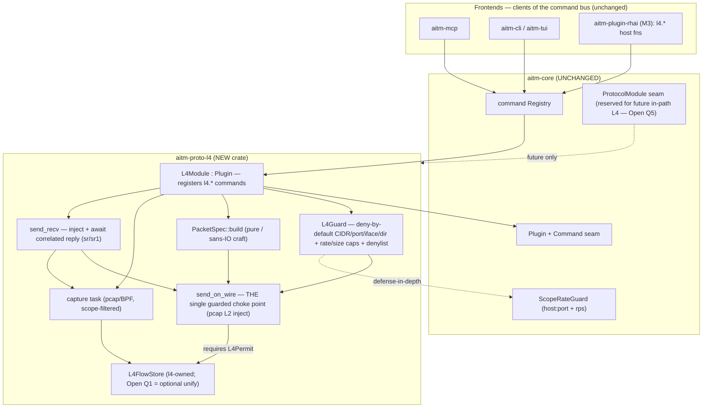
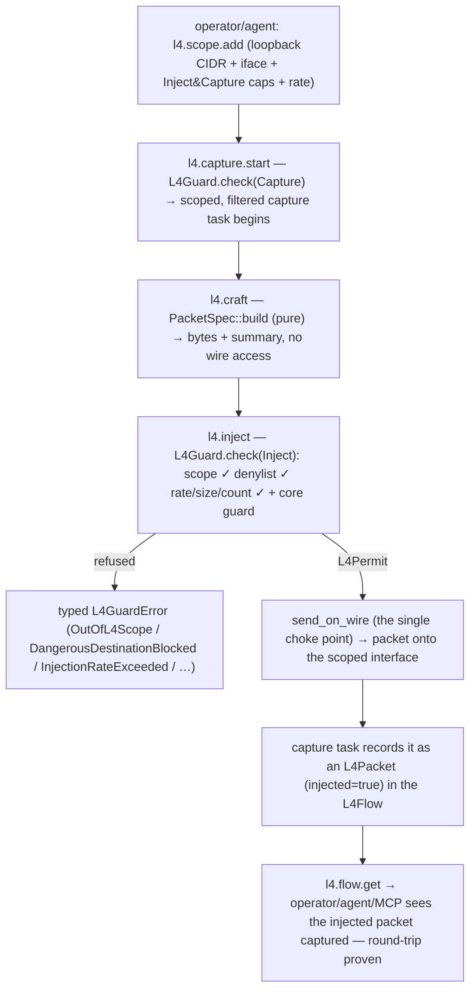
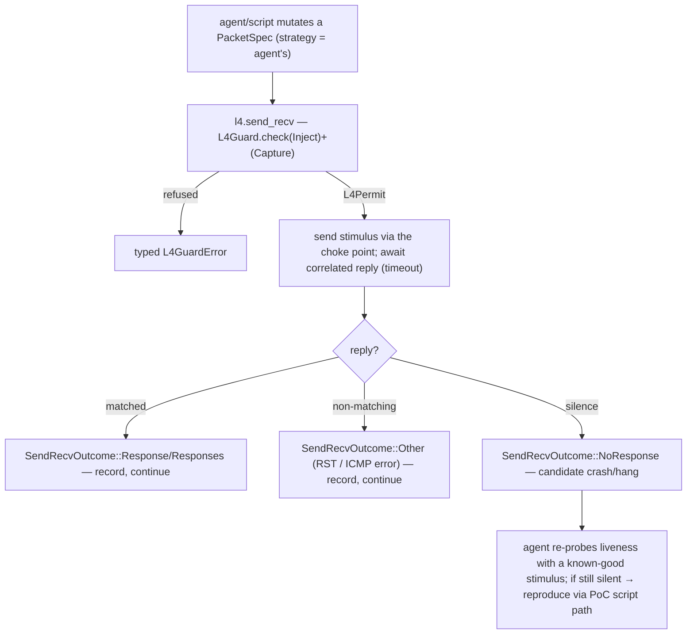

# aitmproxy Milestone 5 — raw L4 / packet MITM design

**Status:** approved (2026-10-28 by Matt) for the original scope — **amended
2026-10-28** with the send-and-receive (`sr`) primitive and the "same loop as
HTTP/S + WS, at L4" fuzzing / memory-safety framing (per Matt's follow-ups). These
amendments and **Open Question 5** (in-path L4 interception: in M5 or deferred?)
are pending Matt's confirmation before stage 3 (the plan).
**Research inputs:** `docs/research/08-l4-packet-rust.md` (L4 crate/privilege/OS
research — note its provenance caveat: registry versions are second-hand and must
be re-checked with `cargo info` before building), `docs/research/03-rust-proxy-stack.md`,
`docs/research/05-synthesis.md`
**Platform context:** `docs/superpowers/specs/2026-10-27-aitmproxy-platform-design.md`
(the `ProtocolModule`/`Plugin`/`Command` seams, the `Flow`/`Event` enums, the
`ScopeRateGuard`, and the `aitm-proto-l4` roadmap row), the plugin-system spec
(the Rhai scripting tier + sandbox/host-function model), and the PoC-language spec.

## Intent

Milestone 5 delivers the raw-L4 / packet-level capability the platform reserved
from day one: a new `aitm-proto-l4` crate that lets an operator (or the agent
driving aitmproxy) **capture raw packets** and **craft and inject arbitrary or
deliberately malformed packets** (scapy-style) against an **in-scope, authorized**
target during a sanctioned engagement — for example, robustness-testing a
server's TCP/IP stack by fuzzing it with malformed packets to find and reproduce
vulnerabilities. This is **authorized, defensive security testing**: aitmproxy
finds and reproduces weaknesses for someone with permission to test; it never
exploits maliciously, and the entire M5 design exists to make the most powerful
capability in the tool **structurally impossible to aim at anything the operator
has not explicitly authorized**.

**In one line: the same loop aitmproxy already runs at HTTP/S and WebSocket —
capture, inspect, mutate, replay/send, observe the response, reproduce — brought
down to the raw packet layer.** Where the HTTP layer sends a request and shows the
response (`request.send` / `flow.replay`), L4 crafts a packet for **any protocol**
and sends it to **see what comes back — a response, a wrong response, or nothing
at all** (scapy's `sr`/`sr1`). That makes M5 a **fuzzing + MITM hybrid aimed at
memory-safety and robustness vulnerabilities** in authorized **data-plane
targets** — a router, switch, or firewall's packet path; an nginx or other
server's TCP/IP stack. The operator (or agent) sends crafted/malformed stimuli and
watches the reply: an unexpected reply, or **silence where the target was
answering a moment ago, is a candidate crash to reproduce**. Per the tool/agent
split, *strategy* (what to mutate, when to re-probe liveness, how to triage) lives
in the agent or a Rhai script; the **tool** provides the deterministic,
guard-bounded machinery (craft, send, send-and-receive, capture, reproduce).

L4 is reachable from the same places everything else is — the command bus, MCP,
and the M3 Rhai scripting tier — and its flows are first-class and queryable, so
an operator can run L7 and L4 tests against the same target through one tool. The
authorization model is extended from "host:port" to the packet/address level
(CIDR, port ranges, interface + direction, injection-rate caps), still
**deny-by-default** and fully guarded, so a raw-packet action against an
out-of-scope target is refused by construction.

## Goals

- A new crate `aitm-proto-l4` providing **raw-packet capture** and **scapy-style
  packet crafting + guard-gated injection**, added as new crates/plugins only —
  **no behavioral or structural edits to `aitm-core`** (see Constraints and Open
  Question 1 for the single, optional, pre-blessed additive enum variant).
- **The L4 analog of the L7 active loop:** a guarded **send-and-receive** primitive
  (`l4.send_recv`, scapy `sr`/`sr1`) that injects a crafted packet for **any
  protocol** and returns the **correlated response — or a typed "no response /
  other"** — so an operator can send a stimulus and see what the target does. This
  is the heart of the fuzzing / memory-safety-hunting use.
- An **extended, deny-by-default authorization model for L4**: scope expressed as
  CIDR + port-range + interface + direction + capability (capture vs inject) +
  per-entry injection-rate cap, enforced at one choke point. An out-of-scope or
  unauthorized packet action is refused with a typed error, observably in tests.
- **L4 flows first-class**: captured, injected, and stimulus/response packets are
  recorded as queryable L4 flows, reachable over the command bus, MCP, and Rhai
  exactly like HTTP/WS flows.
- **L4 verbs in the M3 Rhai tier**, injected as sandboxed host functions that
  route through the same L4 guard — a script cannot exceed scope, rate, or size.
- **Fail-closed privilege handling**: L4 is opt-in and disabled by default;
  without the required OS privilege every L4 command returns a typed
  "unavailable" error instead of crashing.
- A self-contained, deterministic **exit test**: craft → inject on an
  explicitly-scoped loopback interface → capture observes the injected packet, and
  a scoped-loopback **send-and-receive** returns a response (and a typed
  no-response on silence), plus a suite proving the guard is airtight.

## Non-goals

- **No transparent / in-path L4 interception in M5 (see Open Question 5).**
  Parking a *live, in-flight* packet to mutate-and-forward it — the direct analog
  of `flow.intercept` / `flow.mutate` on a live connection — requires a
  TPROXY/nfqueue-style in-path position that presents connection-like byte streams
  to the acceptor (the `ProtocolModule::spawn` seam). M5 instead delivers the
  active/stimulus side of the same loop: capture, craft, inject, **send-and-receive**,
  and reproduce. Whether to pull in-path interception into M5 is Open Question 5
  (recommended: keep it the deferred mode).
- **No L7 stream reassembly** from captured packets (no TCP-stream reconstruction
  into HTTP flows) in M5.
- **No native PoC step type for L4.** L4 reproduction inside a PoC is expressible
  through the existing PoC `script` step calling `l4.*` verbs; a first-class `L4`
  `Step` variant is a deferred, additive `aitm-poc` change (not an `aitm-core`
  change) and is out of M5 scope.
- **No automated fuzzing/crash-triage engine in the tool.** The tool provides the
  primitives (craft, inject, send-and-receive, capture) and the raw signal
  (response / wrong response / no response); the *mutation and triage strategy*
  lives in the agent or a Rhai script (tool/agent split), the same way discovery
  intelligence lives in the agent for L7.
- **No new remote/authenticated transport.** L4 is driven over the existing MCP
  (stdio / loopback-token) and CLI surfaces.
- **No privilege-escalation or OS-trust machinery.** M5 documents the least
  privilege required and fails closed without it; it does not grant itself
  privilege.

## Anti-goals

- **An unbounded packet-flooding primitive.** A capability that could emit
  high-volume uncontrolled traffic — i.e. a denial-of-service tool — is a design
  failure. The purpose is to find a crash with **bounded, controlled** traffic and
  reproduce it, not to flood. Rate caps, bounded per-call counts, and
  deny-by-default scope must make uncontrolled sending impossible, not merely
  discouraged.
- **Weaponizing a crash.** A discovered crash/hang is a **finding to reproduce**
  for the authorized operator (via the PoC/script path), never an exploit the tool
  develops or delivers.
- **Any path by which a raw-packet action reaches an out-of-scope, private, or
  non-consented destination.** If injection, send-and-receive, or capture can touch
  something the operator did not explicitly scope, the guard has failed by design.
- **A guard that can be bypassed.** If any code path writes to the wire without
  passing the single guarded choke point, the design has failed.
- **Editing `aitm-core` to add L4.** If adding L4 forces changes to core logic,
  the protocol/plugin seam has failed (the one bounded exception — an additive,
  `#[non_exhaustive]` enum variant the platform already reserved — is Open
  Question 1, and is behavior-neutral).
- **Detection-evasion tooling.** M5 is for finding and reproducing vulnerabilities
  for an authorized operator, not for evading defenders.

## Constraints

- **No `aitm-core` edits (hard).** Everything new lives in `aitm-proto-l4` (plus
  binary wiring and config). The crate rides the existing `Plugin` + `Command`
  seams. The *only* core touch considered is the optional, additive
  `Flow::L4`/`Event::L4*` variant in Open Question 1, which the platform spec
  pre-blessed as a minor additive change and which the default M5 design does
  **not** require.
- **`forbid(unsafe_code)` must hold.** The workspace forbids `unsafe`. This rules
  out hand-rolled raw `AF_PACKET`/`AF_INET` sockets via `socket2`/`nix` (their
  `SockAddr` construction is `unsafe`). The capture/inject backend must expose a
  safe API (research note 08: `pcap`'s and `pnet`'s public surfaces are safe;
  their `unsafe` is internal).
- **Cross-platform: macOS + Linux** (matching the platform target). The design
  must degrade honestly, not silently, where an OS restricts L4 (research note 08:
  macOS raw sockets never receive TCP/UDP, so capture must use BPF; Linux raw
  IPv4 sockets rewrite the IP checksum/length, so malformed IP headers require L2
  injection; loopback framing differs per OS).
- **Privilege** (research note 08): Linux needs `CAP_NET_RAW`; macOS needs
  read (`/dev/bpf*`) for capture and write for injection; unprivileged L4 is not
  possible on either OS. M5 must fail closed when privilege is absent.
- **Dependencies:** prefer `pcap` (capture + L2 injection), `pnet_packet`
  (field-level, including malformed, construction), and `etherparse` (well-formed
  build + decode/summarize), with `pnet`'s `datalink` as a documented fallback if
  a libpcap C dependency is unacceptable. Exact versions/MSRV are re-verified with
  `cargo info` at build time (research-note provenance caveat).
- **Human-friendly authoring** (project rule): the packet-craft model and its
  YAML/Rhai surfaces must be readable and writable by a human, not agent-only.
- **Gate:** `cargo fmt --check && cargo clippy --all-targets -- -D warnings && cargo test`
  passes before any review; the seven-stage workflow applies.

## Design

### Where L4 sits — the seam call (Architect's call)

Raw capture, injection, and send-and-receive are **command-driven, not
acceptor-driven**. A NIC sniffer and a packet sender are not connections the core
acceptor hands off via `NextLayerHint`, so `ProtocolModule::spawn(io: ByteStream,
…)` — which is shaped for a duplex byte stream the acceptor already owns — is the
wrong driver for raw L4 (research note 08 reaches the same conclusion). Therefore:

- **`aitm-proto-l4` rides the `Plugin` + `Command` seams.** `L4Module` implements
  `Plugin`; its `load(&mut Registry)` registers the `l4.*` commands and options.
  Capture runs as a background task the module owns. No `aitm-core` edit: the
  `Plugin` and `Command` traits already accept new implementors in new crates.
- **The `ProtocolModule` seam stays reserved** for the *future* transparent /
  in-path L4 interception mode (TPROXY/nfqueue), which genuinely does present
  connection-like byte streams — the mode that would add live packet
  intercept/mutate/forward (Open Question 5). M5 does not build it.



### The authorization model (the heart of M5)

The core `ScopeRateGuard` is host-string + requests-per-second only — it has no
notion of CIDR, interface, packets-per-second, or frame size (research note 08).
L4 therefore adds its own **deny-by-default** guard, `L4Guard`, living entirely in
`aitm-proto-l4`, and **composes it with** the core guard for defense in depth.

**Invariant — one choke point.** There is exactly one function in the crate that
writes bytes to the wire, and it takes an `L4Permit` that can only be produced by
`L4Guard::check`. Crafting produces bytes but cannot send them; only the guarded
choke point sends, and **send-and-receive sends through that same choke point**.
Capture is likewise started only behind `L4Guard::check`. This is the structural
guarantee behind every anti-goal.

```rust
// aitm-proto-l4 — the L4 authorization guard (deny-by-default)

pub struct L4Guard { /* scope entries, per-scope + global rate buckets, caps, denylist */ }

impl L4Guard {
    pub fn new(cfg: &L4Config) -> Self;

    /// The ONLY gate. Called before a capture starts and before any packet is
    /// written to the wire (inject and send-and-receive alike). Returns a permit
    /// (an RAII send/rate budget) or a typed refusal. There is no unchecked path.
    pub fn check(&self, action: L4Action, target: &L4Target) -> Result<L4Permit, L4GuardError>;

    pub fn add_scope(&self, entry: L4ScopeEntry) -> Result<L4ScopeId, L4GuardError>;
    pub fn remove_scope(&self, id: L4ScopeId) -> bool;
    pub fn list_scope(&self) -> Vec<L4ScopeEntry>;
}

/// SendRecv needs BOTH Inject (to send) and Capture (to receive the reply); the
/// command checks the guard for each capability.
pub enum L4Action { Capture, Inject }

/// What a check is about — resolved from a capture bind or the packet being sent.
pub struct L4Target {
    pub interface: String,
    pub direction: L4Direction,
    pub dst: Option<IpAddr>,          // inject: the packet's destination address
    pub dst_port: Option<u16>,
    pub proto: L4Proto,
}

pub enum L4Direction { Inbound, Outbound }
pub enum L4Proto { Tcp, Udp, Icmp, IcmpV6, Other(u8), Raw }

/// Deny-by-default scope entry. Nothing captures or injects until one exists and
/// matches. Capture and inject are SEPARATE capabilities, granted independently.
pub struct L4ScopeEntry {
    pub id: L4ScopeId,
    pub cidr: IpCidr,                 // the address range this entry authorizes
    pub ports: PortRange,             // Any == 0..=65535; matched for Tcp/Udp
    pub interface: String,            // the NIC this entry binds to
    pub direction: L4Direction,
    pub capability: L4Capability,     // Capture | Inject
    pub inject_rate: RateCap,         // per-entry injection ceiling (pps + burst)
}

pub struct L4ScopeId(/* uuid-backed */);
pub enum L4Capability { Capture, Inject }
pub struct PortRange { pub lo: u16, pub hi: u16 }
pub struct IpCidr { pub addr: IpAddr, pub prefix: u8 }

/// pps == 0 ⇒ refuse (the per_host_rps "0 means refuse" convention, not "1 pps").
pub struct RateCap { pub pps: u32, pub burst: u32 }

/// RAII: carries the rate-bucket slot and the remaining bounded send budget for
/// this action; dropping it releases the slot.
pub struct L4Permit { /* bucket handle + remaining count */ }

pub enum L4GuardError {
    OutOfL4Scope(String),                 // no scope entry matches the target
    CapabilityNotGranted(L4Capability),   // e.g. inject attempted with only Capture granted
    DangerousDestinationBlocked(String),  // denylist hit, not explicitly scoped
    InjectionRateExceeded { retry_after: Duration },
    PacketTooLarge { max: usize },
    CountExceeded { max: u32 },
    L4Unavailable(String),                // disabled, no privilege, or libpcap absent
}
```

`L4Guard::check` applies, in order:

1. **Scope match (deny-by-default):** the target's interface + direction + address
   (CIDR) + port must match an enabled `L4ScopeEntry` whose `capability` equals the
   action. No match ⇒ `OutOfL4Scope` / `CapabilityNotGranted`.
2. **Dangerous-destination denylist (L4 SSRF-analog, deny-by-default):** loopback,
   link-local (`169.254.0.0/16`, `fe80::/10`), multicast, broadcast, cloud-metadata
   (`169.254.169.254`), and the host's own / control-plane addresses are blocked
   **unless** an explicit `L4ScopeEntry` covers them — the single deliberate escape
   hatch (mirroring the browser SSRF posture). `dangerous_dst_override` cannot
   globally disable this.
3. **Rate + size + count caps:** per-entry `inject_rate`, a tool-wide
   `global_inject_pps`, `max_packet_bytes`, and `max_packets_per_call` (token
   buckets + bounds) ⇒ `InjectionRateExceeded` / `PacketTooLarge` / `CountExceeded`.
4. **Defense in depth:** where the target resolves to an authority the core knows,
   the command layer also calls `CommandHost::guard().check_active(..)` so L4 shares
   the tool-wide scope/rate envelope and cannot bypass host-level deny-by-default.

**Capture is scoped too — deliberately stronger than L7 passive capture.** L7
passive capture records whatever already flows *through the proxy*; raw L4 capture
sniffs a NIC and is privileged and promiscuous, so it is **not** ungated. A
capture is bound to an interface and a filter **derived from the L4 scope**
(CIDR/ports), so only in-scope traffic is recorded and out-of-scope packets never
surface. Deny-by-default: no scope ⇒ no capture.

### The craft model (scapy-style, pure, human-friendly)

Crafting is **pure and sans-IO**: it turns a layered, human-readable spec into
on-wire bytes with no privilege and no guard (building bytes is not sending them).
It follows scapy's model — stack layers, auto-complete omitted fields, allow any
field to be overridden, **including with deliberately malformed values** (the
point of robustness fuzzing). **Any protocol** is expressible: known layers carry
named fields, and the `Raw(Vec<u8>)` layer (plus `L4Proto::Other(u8)` /
`Ipv4Spec.protocol`) lets an author place arbitrary bytes for a protocol the model
doesn't name. Because malformed IP headers require L2 injection on Linux (research
note 08), the model reaches down to the Ethernet layer. `etherparse`
builds/validates well-formed frames; `pnet_packet` is used where a field must be
set verbatim to a malformed value.

```rust
// aitm-proto-l4 — layered packet spec (pure / sans-IO)

pub struct PacketSpec { pub layers: Vec<Layer> }

pub enum Layer {
    Ether(EtherSpec),
    Ipv4(Ipv4Spec),
    Ipv6(Ipv6Spec),
    Tcp(TcpSpec),
    Udp(UdpSpec),
    Icmp(IcmpSpec),
    Raw(Vec<u8>),                     // arbitrary payload / any unnamed protocol
}

// Every *Spec field is an Option: None == auto-complete (scapy-style — checksum,
// length, next-protocol inferred); Some(v) == set verbatim, INCLUDING values that
// are deliberately wrong, so robustness tests can send malformed headers. The
// full field list per layer is the builder's; the shape is fixed here.
pub struct Ipv4Spec {
    pub src: Option<Ipv4Addr>,
    pub dst: Option<Ipv4Addr>,
    pub ttl: Option<u8>,
    pub protocol: Option<u8>,
    pub ihl: Option<u8>,              // None ⇒ computed; Some ⇒ verbatim (may be invalid)
    pub total_length: Option<u16>,    // None ⇒ computed; Some ⇒ verbatim (may be wrong)
    pub checksum: Option<u16>,        // None ⇒ computed; Some ⇒ verbatim (may be wrong)
    pub flags: Option<u8>,
    /* remaining IPv4 fields follow the same Option-per-field pattern */
}
// TcpSpec / UdpSpec / Ipv6Spec / EtherSpec / IcmpSpec mirror this Option-per-field shape.

impl PacketSpec {
    /// Pure: auto-complete `None` fields, preserve every `Some` verbatim, return
    /// the on-wire bytes. No I/O, no privilege, no guard. Size-capped by
    /// `CraftError::TooLarge`.
    pub fn build(&self) -> Result<Vec<u8>, CraftError>;

    /// Decode bytes into a human/agent-readable summary (for review and capture).
    pub fn summarize(bytes: &[u8]) -> PacketSummary;
}

pub struct PacketSummary { pub layers: Vec<String>, pub length: usize }
pub enum CraftError { TooLarge { max: usize }, BadLayerOrder(String) }
```

The same `PacketSpec` is the **YAML** form used in PoCs/scripts and the shape the
Rhai `l4.*` verbs build, so one layered model is learned once (consistent with the
PoC/plugin human-friendly rule).

### Send-and-receive — the L4 analog of replay/`request.send`

`l4.send_recv` is the stimulus/response primitive that makes M5 "the same loop at
L4": it injects a crafted packet and **waits for the correlated reply within a
timeout**, returning a typed outcome. It is the scapy `sr`/`sr1` verb, and the
basis of the fuzzing / memory-safety-hunting loop.

```rust
// aitm-proto-l4 — send-and-receive (scapy sr/sr1); sends through the same choke point

pub struct SendRecvSpec {
    pub packet: PacketSpec,           // the stimulus (any protocol, possibly malformed)
    pub dst: IpAddr,
    pub dst_port: Option<u16>,
    pub interface: String,
    pub timeout: Duration,            // how long to wait for a reply
    pub expect: ReplyMatch,           // how a reply is correlated to this stimulus
}

/// How an inbound packet is matched as "the reply" to the stimulus. Default
/// correlates on the 5-tuple (src/dst addr+port, proto) reversed.
pub enum ReplyMatch { FiveTuple, FromHost(IpAddr), Any }

pub enum SendRecvOutcome {
    Response(L4Packet),               // one correlated reply
    Responses(Vec<L4Packet>),         // several (e.g. fragments / multiple replies)
    Other(L4Packet),                  // a non-matching / error reply (ICMP unreachable, RST, …)
    NoResponse { waited: Duration },  // silence within the timeout — the candidate crash/hang signal
}
```

- **Both capabilities required.** `l4.send_recv` needs `Inject` (to send) **and**
  `Capture` (to receive) in the L4 scope for the target; the command checks the
  guard for each. The stimulus is sent through the one guarded choke point.
- **The fuzzing / memory-safety loop (strategy = agent/script):** the agent or a
  Rhai script mutates a `PacketSpec`, calls `l4.send_recv`, and reads the outcome.
  A `Response`/`Other` is normal behaviour to record; a **`NoResponse` where the
  target was responding a moment before is the candidate crash** — the agent
  confirms it (re-probe liveness with a known-good stimulus) and reproduces it via
  the PoC `script` path. The tool emits the raw signal; it does not decide what is
  a bug (tool/agent split).
- **Bounded, not a flood.** Every `l4.send_recv` is one guarded, rate-capped send;
  a fuzzing run is many such calls, each individually bounded — there is no uncapped
  path. Both the stimulus and any reply are recorded (linked) in the `L4Flow`.

### The flow model

L4 flows mirror `WsFlow` (a session holding an ordered packet vector with an
`injected` flag). A send-and-receive records the stimulus and its reply as two
linked packets in the same flow. **Default (zero `aitm-core` edits):** flows live
in an `aitm-proto-l4`-owned `L4FlowStore`, exposed via `l4.flow.*` commands so they
are first-class over MCP/CLI/Rhai. Open Question 1 offers the optional promotion to
a unified `Flow::L4` variant.

```rust
// aitm-proto-l4 — l4-owned flow model (see Open Question 1 for optional unify)

pub struct L4Flow {
    pub id: L4FlowId,
    pub kind: L4FlowKind,             // Capture session | Craft/inject session | SendRecv
    pub bind: L4Bind,                 // interface + derived filter, or target
    pub packets: Vec<L4Packet>,       // newest == packets.last()
    pub metadata: L4Meta,
}

pub enum L4FlowKind { Capture, Craft, SendRecv }
pub struct L4FlowId(/* uuid-backed */);

pub struct L4Packet {
    pub dir: L4Direction,
    pub timestamp: SystemTime,
    pub bytes: Vec<u8>,
    pub decoded: PacketSummary,
    pub injected: bool,               // true iff authored + sent by l4.inject / l4.send_recv
}

pub struct L4Bind { /* interface, optional scope-derived filter, optional target */ }
pub struct L4Meta { pub marks: Vec<String>, pub comment: Option<String>, pub created: SystemTime }

pub trait L4FlowStore: Send + Sync {
    fn insert(&self, flow: L4Flow) -> L4FlowId;
    fn get(&self, id: L4FlowId) -> Option<L4Flow>;
    fn list(&self) -> Vec<L4FlowId>;
    fn append_packet(&self, id: L4FlowId, pkt: L4Packet);
}
```

### The module, wiring, and config

```rust
// aitm-proto-l4 — the module (Plugin + Command seam; no aitm-core edits)

pub struct L4Module { /* Arc over: L4Guard, L4FlowStore, capture-task registry, L4Config */ }

impl L4Module {
    /// Constructed by the binary only when `L4Config.enabled` and privilege is
    /// present. Owns its guard + store so background capture tasks hold what they
    /// need; injection commands additionally reach the core guard via CommandHost.
    pub fn new(cfg: L4Config) -> Result<Self, L4GuardError>;
}

impl Plugin for L4Module {
    // name() == "l4"; load() registers the l4.* commands + options.
    // on_event() is the default pass-through — L4 is command-driven, not event-driven.
}

pub struct L4Config {
    pub enabled: bool,                // default FALSE — opt-in; module not registered if false
    pub capture_backend: L4Backend,   // Pcap (default) | PnetDatalink (fallback)
    pub scope: Vec<L4ScopeEntry>,     // deny-by-default: empty ⇒ nothing active
    pub global_inject_pps: u32,       // tool-wide injection ceiling (0 ⇒ refuse)
    pub max_packet_bytes: usize,      // hard frame-size cap
    pub max_packets_per_call: u32,    // bound on one l4.inject batch
    pub default_recv_timeout: Duration, // default wait for l4.send_recv
    pub dangerous_dst_override: bool, // default false; the denylist cannot be globally disabled
}

pub enum L4Backend { Pcap, PnetDatalink }
```

Wiring lives in the `aitm` binary (the composition root), exactly where the
platform already wires modules/plugins — so no `aitm-core` change. When
`L4Config.enabled` is false (the default) the module is not constructed; when it
is true but privilege is missing, construction fails and the binary logs a clear
"L4 unavailable" line and starts normally without L4.

### Command surface

Each is a registered `Command` with a `ParamSchema`, so MCP (`tools/list` /
`tools/call`), the CLI (`aitm l4 …`), and the Rhai tier get it automatically — no
command is transport-specific.

| Command | Guarded? | Purpose |
|---|---|---|
| `l4.interfaces` | read-only | List capture-capable interfaces (so an operator/agent can choose one). |
| `l4.scope.add` / `l4.scope.remove` / `l4.scope.list` | n/a (manages scope) | Manage the deny-by-default L4 scope (CIDR, ports, interface, direction, capability, rate). |
| `l4.capture.start` / `l4.capture.stop` / `l4.capture.status` | **yes** (`Capture`) | Start/stop a scoped, filtered capture on an interface; returns an `L4Flow` id. |
| `l4.flow.list` / `l4.flow.get` | read-only | Query L4 flows and their packets (stimulus + reply linked). |
| `l4.craft` | no (pure) | Build a `PacketSpec` into bytes + summary for review; no privilege, no wire access. |
| `l4.inject` | **yes** (`Inject`) | The gated send: inject a crafted spec (or raw bytes) to a target, as a bounded, rate-capped batch; every packet passes the choke point. |
| `l4.send_recv` | **yes** (`Inject` + `Capture`) | Scapy `sr`/`sr1`: inject a stimulus and return the correlated `SendRecvOutcome` (response / other / none) within a timeout — the L4 analog of `request.send`. |

There is **no** `l4.fuzz` verb: the tool owns the deterministic send and
send-and-receive (`l4.inject` / `l4.send_recv`, each guard-checked, rate-capped,
count-bounded); the *mutation and triage strategy* (what to mutate, when to
re-probe liveness, what counts as a crash) is the agent's or a Rhai script's job.
A fuzzing run is many guarded calls, each individually bounded — there is no
uncapped batch path and no in-tool crash-triage engine (tool/agent split).

### M3 Rhai scripting tier integration

L4 verbs are injected into the Rhai sandbox as host functions under an `l4.*`
namespace (`l4.craft`, `l4.inject`, `l4.send_recv`, `l4.capture_start`,
`l4.flow_get`, …), exactly as `http.*` / `browser.*` are injected today. Every host
function that touches the wire routes through the **same** `L4Guard` choke point,
so a script is bound by the same deny-by-default scope, rate, size, and denylist
rules — it cannot reach an out-of-scope or dangerous destination the guard would
refuse. The L4 host functions are present only when the L4 module is enabled; the
script-facing surface is versioned like the rest of the scripting contract.

### Privilege and cross-platform behaviour (fail-closed)

- **Opt-in + fail-closed.** `L4Config.enabled` defaults false. With it true but
  privilege absent, every `l4.*` guarded command returns `L4Unavailable` and the
  proxy keeps running; nothing panics.
- **Linux:** `CAP_NET_RAW` (granted via `setcap` on the binary) for capture and
  injection. Malformed IP headers use L2 injection (raw IPv4 sockets rewrite the
  checksum/length).
- **macOS:** read access to `/dev/bpf*` for capture, write for injection; capture
  uses BPF (raw sockets never receive TCP/UDP). Device permissions don't persist
  across boot without a helper (ChmodBPF-style) — documented, not shipped in M5.
- **Least privilege, documented.** Running the whole proxy as root is discouraged;
  M5 documents the minimal grant. A privilege-separated capture/inject helper
  (dumpcap-style) is recommended **future** hardening (Open Question 3), not M5.
- **Honest degradation.** OS-specific limits (loopback framing differs; crafted
  TCP handshakes may draw a host-kernel RST) are surfaced as typed results or
  documented test preconditions, never silent.

## Data-flow walkthroughs

### Craft → inject → capture (the baseline exit path)



### Send-and-receive (the fuzzing / memory-safety loop)



## Worked examples (normative usage shapes)

**1 — Scoped loopback round-trip (baseline exit test, over the CLI).** All on an
explicitly-scoped loopback interface, so it is self-contained and authorized:

```bash
aitm l4 scope add --cidr 127.0.0.1/32 --interface lo0 \
  --direction outbound --capability inject --inject-rate 5pps
aitm l4 scope add --cidr 127.0.0.1/32 --interface lo0 \
  --direction inbound  --capability capture
aitm l4 capture start --interface lo0            # -> l4flow:CAP id
aitm l4 craft --spec ./udp-probe.yaml            # pure build -> bytes + summary
aitm l4 inject --spec ./udp-probe.yaml --dst 127.0.0.1 --port 9  --count 1
aitm l4 flow get --id l4flow:CAP                 # shows the injected packet captured
```

**2 — A human-readable crafted packet (`udp-probe.yaml`), with one deliberately
malformed field** to show the override model (benign loopback discard port):

```yaml
layers:
  - ipv4:
      dst: 127.0.0.1
      checksum: 0x0000      # deliberately wrong — robustness test; None would auto-compute
  - udp:
      dst_port: 9           # discard
  - raw: "probe"
```

**3 — Send-and-receive (stimulus → response, the L7-parity verb).** Against a
scoped local responder; returns the reply or a typed no-response:

```bash
aitm l4 send-recv --spec ./udp-probe.yaml --dst 127.0.0.1 --port 5353 \
  --interface lo0 --timeout 1s
# -> SendRecvOutcome::Response { ... }       (a reply came back)
# -> SendRecvOutcome::NoResponse { waited }  (silence — candidate crash to confirm)
```

**4 — A refused action (deny-by-default proven).** With no scope entry for it,
injection to a metadata address is refused by the guard, not attempted:

```bash
aitm l4 inject --spec ./udp-probe.yaml --dst 169.254.169.254 --port 80 --count 1
# -> error: DangerousDestinationBlocked("169.254.169.254 not in L4 scope")
```

**5 — Rhai, guard-bound fuzzing loop.** Strategy in the script; each call guarded:

```rust
// each l4.send_recv is individually guard-checked, rate-capped, and bounded
for i in 0..50 {
    let spec = l4::craft_udp("127.0.0.1", 5353, mutate(i));   // strategy = script's job
    let out = l4::send_recv(spec, "127.0.0.1", 5353, "lo0", 1000);
    if out.is_no_response() { record_candidate(i); }          // triage = script's job
}
```

## Acceptance criteria

Each is observable via `cargo test` (integration tests may use a scoped loopback
interface; privilege-gated tests are marked and skip cleanly where privilege is
absent, asserting `L4Unavailable` rather than failing).

1. **M5-AC1 — Deny-by-default:** with an empty L4 scope, `l4.inject`,
   `l4.send_recv`, and `l4.capture.start` are refused with `OutOfL4Scope`; no packet
   is written and no capture starts.
2. **M5-AC2 — Out-of-scope inject refused:** with a scope entry for CIDR *A*,
   injecting to an address outside *A* returns `OutOfL4Scope`; injecting to an
   in-scope address (loopback) succeeds.
3. **M5-AC3 — Capability split:** with only a `Capture` entry for a target,
   `l4.inject` to it returns `CapabilityNotGranted(Inject)`; capture still works.
   `l4.send_recv` with only one of the two capabilities is refused.
4. **M5-AC4 — Dangerous-destination denylist:** injecting to `169.254.169.254`
   (or loopback/link-local/multicast) without an explicit scope entry returns
   `DangerousDestinationBlocked`; an explicit scope entry is the only way through.
5. **M5-AC5 — Injection rate cap:** with `inject_rate` of N pps, the (N+1)-th
   injection within the window returns `InjectionRateExceeded { retry_after }`.
6. **M5-AC6 — Size + count caps:** a packet over `max_packet_bytes` returns
   `PacketTooLarge`; an `l4.inject` batch over `max_packets_per_call` returns
   `CountExceeded`.
7. **M5-AC7 — Craft is pure and preserves malformed fields:** `PacketSpec::build`
   with `ipv4.checksum = Some(0x0000)` produces bytes whose IPv4 checksum field is
   exactly `0x0000` (literal), while a `None` checksum yields the correctly
   computed value — proving both auto-complete and verbatim override, with no
   privilege required.
8. **M5-AC8 — Scoped capture excludes out-of-scope traffic:** a capture bound to a
   scope for CIDR *A* records an in-scope packet and does **not** surface an
   out-of-scope packet generated on the same interface.
9. **M5-AC9 — Round-trip (headline):** on an explicitly-scoped loopback interface,
   craft → inject → capture results in an `L4Flow` containing the injected packet
   with `injected = true`, retrievable via `l4.flow.get`.
10. **M5-AC10 — Send-and-receive returns a response:** against a scoped local
    responder on loopback, `l4.send_recv` returns `SendRecvOutcome::Response` (or
    `Responses`) carrying the reply, recorded linked to the stimulus in the `L4Flow`.
11. **M5-AC11 — Send-and-receive reports silence:** with no responder (or a dropped
    stimulus), `l4.send_recv` returns `SendRecvOutcome::NoResponse { waited }` after
    the timeout — never hangs — giving the candidate-crash signal.
12. **M5-AC12 — Fail-closed without privilege:** with `enabled = true` but no
    privilege, guarded `l4.*` commands return `L4Unavailable` and the proxy does
    not panic; with `enabled = false`, the module is not registered.
13. **M5-AC13 — Reachable everywhere:** every `l4.*` command appears in MCP
    `tools/list`, is invocable over the CLI, and (for wire-touching verbs) is
    reachable from a Rhai script — and the Rhai path is refused by the **same**
    guard for an out-of-scope target (asserts the script cannot bypass the guard).
14. **M5-AC14 — Core untouched:** `git diff --stat` shows **no** changes under
    `aitm-core/` (default design), satisfying the roadmap gate "core untouched."
    If Open Question 1 is accepted, the only core change is the additive
    `Flow::L4`/`Event::L4*` variant with no changed core logic.
15. **M5-AC15 — No `unsafe`:** `aitm-proto-l4` compiles under the workspace
    `forbid(unsafe_code)`; the crate contains no `unsafe` block.
16. **M5-AC16 — One choke point:** a test (or a documented structural check)
    confirms the only wire-write function requires an `L4Permit`, which only
    `L4Guard::check` produces — `l4.inject` and `l4.send_recv` both go through it;
    there is no unguarded send path.

## Milestone exit criteria

M5 is done when **all M5-AC1–AC16 are green** — unit **and** functional (the AC9
loopback round-trip, the AC10/AC11 send-and-receive, and the AC1–AC6
guard-airtightness suite driving the real commands) — through the full Rust gate
(`cargo fmt --check && cargo clippy --all-targets -- -D warnings && cargo test`),
and the stage-6 panel review (security, quality, spec) passes with no open
findings. The headline functional proof is the scoped-loopback craft → inject →
capture round-trip and a scoped-loopback send-and-receive (response + no-response),
plus the guard-refusal suite; the "core untouched" (AC14) and "no unsafe" (AC15)
checks are hard gates.

## Left to the builder

- Exact per-layer field lists in each `*Spec` (the Option-per-field shape is
  fixed; the field set is the builder's), and the `etherparse`-vs-`pnet_packet`
  split per field.
- The reply-correlation details for `l4.send_recv` within the declared
  `ReplyMatch` shapes (5-tuple reversal, source-host match).
- Internal layout of `L4Guard` rate buckets, the capture-task registry, and the
  `L4FlowStore` implementation.
- The BPF filter string derived from an `L4ScopeEntry`, and interface enumeration
  per OS.
- Verifying crate versions/MSRV with `cargo info` (research-note provenance) and
  confirming `pcap` vs `pnet_datalink` against the `forbid(unsafe)` + libpcap-C-dep
  trade-off at build time.
- CLI flag spelling and the YAML/Rhai surface details, within the layered model.

## Open questions

Questions 1–4 are **decided** per Matt's approval of the recommended defaults
(2026-10-28). Question 5 is **open** (raised by Matt's "same as HTTP/S + WS"
follow-up) and should be answered before the plan.

1. **DECIDED — l4-owned flow store.** Ship M5 with the l4-owned `L4FlowStore`
   (zero `aitm-core` edits; flows first-class over MCP/CLI/Rhai via `l4.flow.*`).
   Promotion to a single additive `Flow::L4` + `Event::L4*` variant (behind
   `#[non_exhaustive]`, the one change the platform spec pre-blessed) is a blessed
   follow-up if a unified store is later wanted.
2. **DECIDED — capture stays scope-filtered.** Capture is deny-by-default and
   bound to a scope-derived filter; there is no looser "capture everything on the
   interface" mode.
3. **DECIDED — least privilege, helper deferred.** Require `setcap cap_net_raw`
   (Linux) / `/dev/bpf` group (macOS), discourage running as root, document the
   minimal grant; a privilege-separated helper (dumpcap-style) is deferred.
4. **DECIDED — conservative, configurable caps.** `global_inject_pps` low (tens of
   pps), small `burst`, modest `max_packets_per_call`, `max_packet_bytes` at a
   normal MTU, `pps == 0` ⇒ refuse. Exact numbers are the builder's within
   "conservative."
5. **OPEN — in-path L4 interception in M5, or deferred?** Matt asked for "the same
   we do with HTTP/S + WS, at L4." M5 as specced delivers the **active** half of
   that loop (capture, craft, inject, send-and-receive, reproduce). The **in-path**
   half — parking a *live, in-flight* packet to mutate-and-forward it, the direct
   analog of `flow.intercept` / `flow.mutate` — needs a transparent TPROXY
   (Linux) / `pf` divert (macOS) / nfqueue position and the `ProtocolModule::spawn`
   seam, and is a materially larger build (kernel hooks, per-OS routing setup,
   held-packet lifecycle). **Recommended default:** keep in-path interception the
   **deferred** transparent-L4 mode (its own later milestone), and ship M5 as the
   active capture/craft/send-receive/reproduce fuzzing-and-MITM capability — which
   already covers fuzzing an nginx/router/switch and reproducing a finding.
   Confirm, or tell me to pull in-path interception into M5 (the plan grows
   accordingly).

## Summary

M5 adds `aitm-proto-l4`: raw-packet **capture**, scapy-style **craft + guarded
inject**, and a guarded **send-and-receive** (`sr`/`sr1`) — the same
capture/inspect/mutate/replay/observe/reproduce loop aitmproxy runs at HTTP/S and
WebSocket, now at the packet layer, for **authorized** fuzzing and memory-safety /
robustness testing of data-plane targets (routers, switches, nginx). It is
reachable over the command bus, MCP, and the M3 Rhai tier, with L4 flows
first-class. It rides the existing `Plugin` + `Command` seams (raw send is
command-driven, so `ProtocolModule::spawn` — stream-shaped — stays reserved for a
future in-path mode; see Open Question 5), so it needs **no `aitm-core` edits** (the
one optional, pre-blessed additive enum variant is Open Question 1, decided as the
l4-owned store). The design's core is an **airtight, deny-by-default authorization
model**: a new in-crate `L4Guard` extends scope from host:port to CIDR + port +
interface + direction + capability + rate, composes with the core guard for
defense in depth, blocks dangerous destinations by default, and funnels **every**
wire write — inject and send-and-receive alike — through a **single guarded choke
point** that requires a permit only the guard can mint, making an out-of-scope,
private, or unbounded packet action impossible by construction. Crafting is
pure/sans-IO and human-readable (YAML + Rhai), any protocol is expressible, the
stimulus→response→`NoResponse` loop is the memory-safety signal (strategy in the
agent/script), privilege is opt-in and fail-closed, `forbid(unsafe)` holds via
`pcap`/`pnet_packet`/`etherparse`, and the exit test is a self-contained,
authorized scoped-loopback craft → inject → capture round-trip plus a
send-and-receive and a guard-refusal suite.

### Architect's calls (for Matt to check while reading)

1. **L7 parity, active half:** M5 is "the same loop at L4" for capture / craft /
   inject / send-and-receive / reproduce; live in-path intercept/mutate/forward is
   Open Question 5 (recommended deferred to the transparent-L4 mode).
2. **Send-and-receive:** `l4.send_recv` (scapy `sr`/`sr1`) returns a typed
   `SendRecvOutcome` (Response / Responses / Other / NoResponse); `NoResponse` is
   the candidate-crash signal; it sends through the one guarded choke point and
   needs both `Inject` and `Capture` scope.
3. **Seam:** L4 rides the `Plugin` + `Command` seams (command-driven), not
   `ProtocolModule::spawn` (stream-shaped).
4. **No core edits by default:** l4-owned `L4FlowStore` keeps `aitm-core`
   untouched; the unified `Flow::L4` variant is the optional follow-up (Open Q1).
5. **Authorization:** a new in-crate deny-by-default `L4Guard` (CIDR/port/iface/
   direction/capability/rate + dangerous-dst denylist), composed with the core
   guard; capture and inject are separate capabilities; capture is scope-filtered.
6. **One choke point:** a single wire-write function gated by an `L4Permit` only
   `L4Guard::check` can mint — inject and send-and-receive both go through it.
7. **Craft:** pure/sans-IO scapy-style layered `PacketSpec` (Option-per-field,
   auto-complete or verbatim/malformed), reaching to L2 (needed for malformed IP on
   Linux), **any protocol** via the `Raw` layer, human-readable in YAML and Rhai.
8. **Backend:** `pcap` (capture + L2 inject) + `pnet_packet` (malformed fields) +
   `etherparse` (well-formed build/decode), preserving `forbid(unsafe)`; `pnet`
   `datalink` as the documented fallback.
9. **Privilege:** opt-in (`enabled=false` default), fail-closed (`L4Unavailable`),
   least-privilege documented; privilege-separated helper deferred.
10. **No `l4.fuzz`/no in-tool triage:** mutation and triage strategy is the
    agent's/script's; the tool offers only bounded, guarded `l4.inject` /
    `l4.send_recv` — no uncapped batch path exists.
