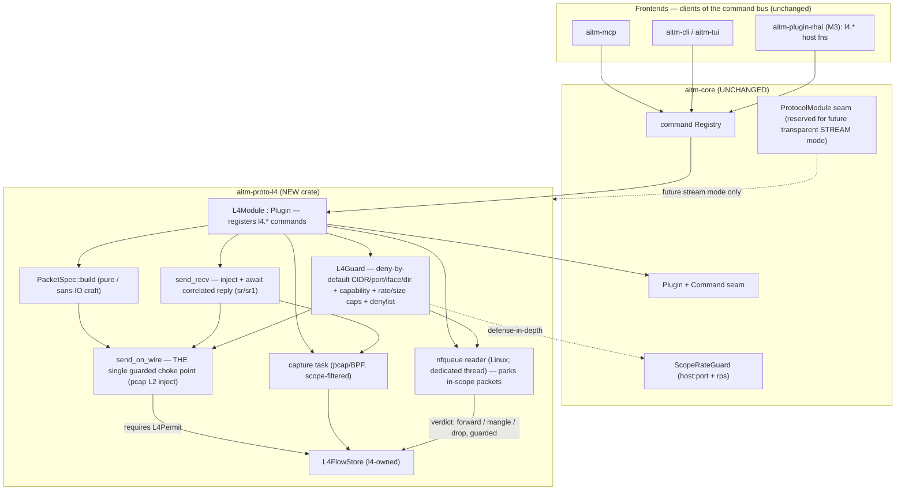
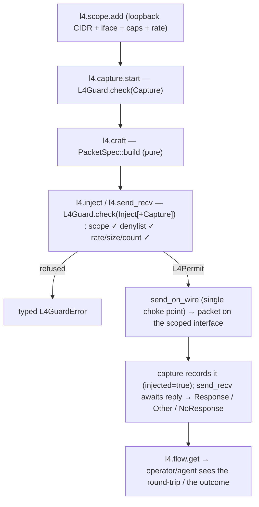
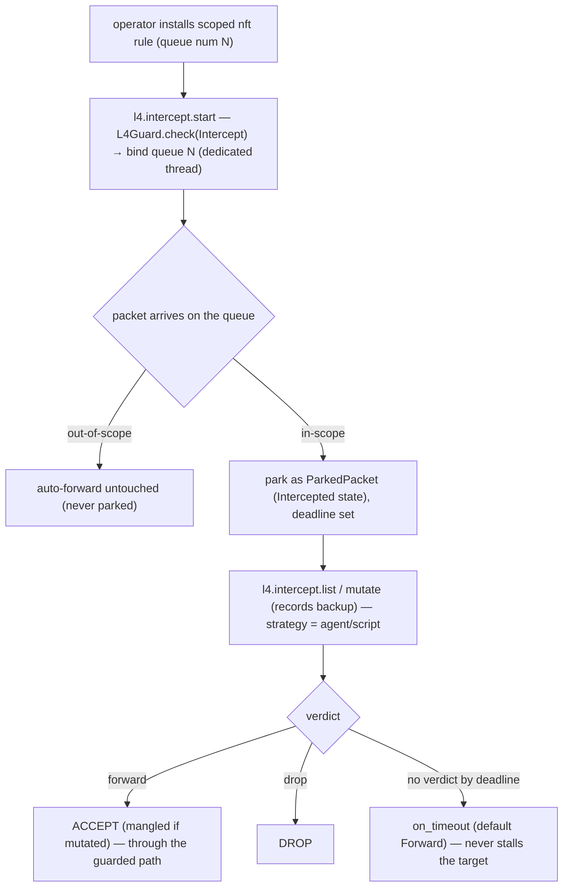

# aitmproxy Milestone 5 — raw L4 / packet MITM design

**Status:** approved (2026-10-28 by Matt) for the scope below — **amended
2026-10-28** with (a) the send-and-receive (`sr`) primitive and the "same loop as
HTTP/S + WS, at L4" fuzzing / memory-safety framing, and (b) **in-path live-packet
interception** (the `flow.intercept`/`flow.mutate` analog), pulled into M5 per Matt
(OQ5). The written form of these amendments is confirmed at the plan gate.
**Research inputs:** `docs/research/08-l4-packet-rust.md` (raw capture/inject
crates + privilege), `docs/research/09-l4-inpath-interception.md` (in-path
NFQUEUE/macOS feasibility), `docs/research/03-rust-proxy-stack.md`,
`docs/research/05-synthesis.md`. Both L4 notes carry a provenance caveat: registry
versions and kernel facts are second-hand and must be re-checked with `cargo info`
and on the target kernel before building.
**Platform context:** `docs/superpowers/specs/2026-10-27-aitmproxy-platform-design.md`
(the `ProtocolModule`/`Plugin`/`Command` seams, the `Flow`/`Event` enums, the
`ScopeRateGuard`, the `InterceptState` model, and the `aitm-proto-l4` roadmap row),
the plugin-system spec (the Rhai scripting tier + sandbox/host-function model), and
the PoC-language spec.

## Intent

Milestone 5 delivers the raw-L4 / packet-level capability the platform reserved
from day one: a new `aitm-proto-l4` crate that lets an operator (or the agent
driving aitmproxy) **capture raw packets**, **craft and inject arbitrary or
deliberately malformed packets** (scapy-style), **send a stimulus and see the
response**, and **intercept live packets in-path to mutate, forward, or drop them**
— all against an **in-scope, authorized** target during a sanctioned engagement.
This is **authorized, defensive security testing**: aitmproxy finds and reproduces
weaknesses for someone with permission to test; it never exploits maliciously, and
the entire M5 design exists to make the most powerful capability in the tool
**structurally impossible to aim at anything the operator has not explicitly
authorized**.

**In one line: the same loop aitmproxy already runs at HTTP/S and WebSocket —
capture, inspect, mutate, replay/send, observe the response, intercept, reproduce —
brought down to the raw packet layer.** Where the HTTP layer sends a request and
shows the response (`request.send` / `flow.replay`), L4 crafts a packet for **any
protocol** and sends it to **see what comes back — a response, a wrong response, or
nothing at all** (scapy's `sr`/`sr1`). Where the HTTP layer parks a flow to edit
and forward it (`flow.intercept` / `flow.mutate`), L4 parks a **live, in-flight
packet** to mutate, forward, or drop it. That makes M5 a **fuzzing + MITM hybrid
aimed at memory-safety and robustness vulnerabilities** in authorized **data-plane
targets** — a router, switch, or firewall's packet path; an nginx or other
server's TCP/IP stack. The operator (or agent) sends crafted/malformed stimuli and
watches the reply: an unexpected reply, or **silence where the target was
answering a moment ago, is a candidate crash to reproduce**. Per the tool/agent
split, *strategy* (what to mutate, when to re-probe liveness, how to triage) lives
in the agent or a Rhai script; the **tool** provides the deterministic,
guard-bounded machinery (craft, send, send-and-receive, capture, intercept,
reproduce).

L4 is reachable from the same places everything else is — the command bus, MCP,
and the M3 Rhai scripting tier — and its flows are first-class and queryable, so
an operator can run L7 and L4 tests against the same target through one tool. The
authorization model is extended from "host:port" to the packet/address level
(CIDR, port ranges, interface + direction, capture/inject/intercept capability,
injection-rate caps), still **deny-by-default** and fully guarded, so a raw-packet
action against an out-of-scope target is refused by construction.

## Goals

- A new crate `aitm-proto-l4` providing **raw-packet capture**, **scapy-style
  packet crafting + guard-gated injection**, **send-and-receive**, and **in-path
  packet interception** — added as new crates/plugins only, **no behavioral or
  structural edits to `aitm-core`** (Open Question 1, now decided: an l4-owned
  flow store keeps the core untouched).
- **The L4 analog of the full L7 loop:**
  - a guarded **send-and-receive** primitive (`l4.send_recv`, scapy `sr`/`sr1`)
    that injects a crafted packet for **any protocol** and returns the
    **correlated response — or a typed "no response / other"**;
  - **in-path interception** (`l4.intercept.*`, the `flow.intercept`/`mutate`
    analog) that parks a live packet and lets a command/agent **mutate, forward,
    or drop** it — Linux-first via NFQUEUE (see Design and OQ5).
- An **extended, deny-by-default authorization model for L4**: scope expressed as
  CIDR + port-range + interface + direction + capability (**Capture / Inject /
  Intercept**) + per-entry injection-rate cap, enforced at one choke point. Any
  out-of-scope or unauthorized packet action is refused with a typed error,
  observably in tests.
- **L4 flows first-class**: captured, injected, stimulus/response, and intercepted
  packets are recorded as queryable L4 flows, reachable over the command bus, MCP,
  and Rhai exactly like HTTP/WS flows.
- **L4 verbs in the M3 Rhai tier**, injected as sandboxed host functions that
  route through the same L4 guard — a script cannot exceed scope, rate, or size.
- **Fail-closed privilege handling**: L4 is opt-in and disabled by default;
  without the required OS privilege (or on an OS that can't do a given mode) every
  affected L4 command returns a typed "unavailable" error instead of crashing.
- A self-contained, deterministic **exit test**: the active round-trip (craft →
  inject → capture) and send-and-receive on a scoped loopback, the Linux-gated
  in-path park → mutate → forward (and drop), and a suite proving the guard is
  airtight.

## Non-goals

- **No macOS in-path packet interception (Linux-first; research note 09).** macOS
  has no userspace packet-mangle path: `pf` `divert-to`/`divert-packet` are gone,
  `IPPROTO_DIVERT` has no implementation, and `NEFilterPacketProvider` can only
  delay/allow/drop (not edit) and needs a signed system extension. On macOS,
  `l4.intercept.*` returns `L4Unavailable` with a clear reason; macOS keeps the
  active capabilities (capture / inject / send-and-receive via pcap + BPF).
- **No transparent stream redirection (TPROXY / `pf rdr`) in M5.** Handing a whole
  transparently-redirected TCP/UDP *connection* to a userspace listener is
  byte-stream-shaped (the `ProtocolModule::spawn` seam) and a *separate* future
  mode; M5's in-path is **per-packet** NFQUEUE verdict/mangle (the real
  `flow.intercept`/`mutate` analog).
- **No L7 stream reassembly** from captured packets (no TCP-stream reconstruction
  into HTTP flows) in M5.
- **No native PoC step type for L4.** L4 reproduction inside a PoC is expressible
  through the existing PoC `script` step calling `l4.*` verbs; a first-class `L4`
  `Step` variant is a deferred, additive `aitm-poc` change (not an `aitm-core`
  change) and is out of M5 scope.
- **No automated fuzzing/crash-triage engine in the tool.** The tool provides the
  primitives and the raw signal (response / wrong response / no response, parked
  packet); the *mutation and triage strategy* lives in the agent or a Rhai script
  (tool/agent split), the same way discovery intelligence lives in the agent for L7.
- **No new remote/authenticated transport**, and **no privilege-escalation or
  OS-trust machinery.** M5 documents the least privilege required and fails closed
  without it; it does not grant itself privilege.

## Anti-goals

- **An unbounded packet-flooding primitive.** A capability that could emit
  high-volume uncontrolled traffic — a denial-of-service tool — is a design
  failure. The purpose is to find a crash with **bounded, controlled** traffic and
  reproduce it. Rate caps, bounded per-call counts, and deny-by-default scope must
  make uncontrolled sending impossible, not merely discouraged.
- **Disrupting the target's unrelated traffic.** In-path interception must not
  stall or black-hole traffic it is not deliberately acting on: out-of-scope
  packets are auto-forwarded untouched, and a parked packet that gets no verdict in
  time fails **open** by default (forward), because the kernel provides no verdict
  timeout (research note 09).
- **Weaponizing a crash.** A discovered crash/hang is a **finding to reproduce**
  for the authorized operator (via the PoC/script path), never an exploit the tool
  develops or delivers.
- **Any path by which a raw-packet action reaches an out-of-scope, private, or
  non-consented destination**, or **mangles a packet the operator did not scope.**
  If injection, send-and-receive, capture, or interception can touch something not
  explicitly scoped, the guard has failed by design.
- **A guard that can be bypassed.** If any code path writes to the wire — inject,
  send-and-receive, or a mangling verdict — without passing the single guarded
  choke point, the design has failed.
- **Editing `aitm-core` to add L4**, and **detection-evasion tooling.** M5 is new
  crates + wiring only, for finding and reproducing vulnerabilities for an
  authorized operator, not for evading defenders.

## Constraints

- **No `aitm-core` edits (hard).** Everything new lives in `aitm-proto-l4` (plus
  binary wiring and config), on the existing `Plugin` + `Command` seams. The
  l4-owned flow store (OQ1, decided) keeps the core untouched.
- **`forbid(unsafe_code)` must hold.** The workspace forbids `unsafe`. This rules
  out hand-rolled raw sockets (`socket2`/`nix` `SockAddr` is `unsafe`). The
  capture/inject backend (`pcap`/`pnet`) and the NFQUEUE backend (`nfq`) expose
  safe APIs; their `unsafe` is internal (research notes 08, 09). `rustables` is
  GPL-3.0 and must **not** be used (licence conflict).
- **Cross-platform: macOS + Linux**, degrading honestly, not silently:
  - capture: macOS must use BPF (raw sockets never receive TCP/UDP); Linux raw
    IPv4 rewrites checksum/length, so malformed IP headers need L2 injection;
  - in-path interception: **Linux only** (NFQUEUE); **macOS → `L4Unavailable`**.
- **Privilege** (research notes 08, 09): capture + inject need `CAP_NET_RAW`
  (Linux) / `/dev/bpf*` (macOS); **in-path interception needs `CAP_NET_ADMIN`**
  (Linux). Unprivileged L4 is not possible. M5 fails closed when privilege is
  absent.
- **In-path: aitmproxy owns the parked-packet lifecycle.** The kernel gives no
  verdict timeout; the default NFQUEUE length is 1024; overflow / no-listener /
  crash / socket-close drop packets unless fail-open is set; rebuilding an nft
  table drops waiting packets (note 09). M5 therefore enforces its own verdict
  timeout, a parked-queue cap, and fail-open defaults.
- **Dependencies:** `pcap` + `pnet_packet` + `etherparse` (active path, note 08);
  `nfq` (in-path; stable 0.2.5 is blocking → dedicated owning thread; a git pin or
  `nfq-updated` only if an fd for async is needed — verified at build, note 09).
  Exact versions/MSRV re-verified with `cargo info` (provenance caveat).
- **Human-friendly authoring** (project rule): the packet-craft model and its
  YAML/Rhai surfaces must be readable and writable by a human, not agent-only.
- **Gate:** `cargo fmt --check && cargo clippy --all-targets -- -D warnings && cargo test`
  passes before any review; the seven-stage workflow applies.

## Design

### Where L4 sits — the seam call (Architect's call)

Raw capture, injection, send-and-receive, and NFQUEUE interception are all
**command-driven, not acceptor-driven**. None is a connection the core acceptor
hands off via `NextLayerHint`, so `ProtocolModule::spawn(io: ByteStream, …)` — shaped
for a duplex byte stream the acceptor already owns — is the wrong driver for raw L4
(research notes 08, 09 agree). Therefore:

- **`aitm-proto-l4` rides the `Plugin` + `Command` seams.** `L4Module` implements
  `Plugin`; its `load(&mut Registry)` registers the `l4.*` commands and options.
  Capture and the NFQUEUE reader run as background tasks/threads the module owns.
  No `aitm-core` edit: `Plugin` and `Command` accept new implementors in new crates.
- **The `ProtocolModule::spawn` seam stays reserved** for the *future* transparent
  **stream** redirection mode (TPROXY / `pf rdr`), which does present
  connection-like byte streams. M5's in-path is per-packet NFQUEUE, not that.



### The authorization model (the heart of M5)

The core `ScopeRateGuard` is host-string + requests-per-second only — no CIDR,
interface, packets-per-second, frame size, or capability notion (note 08). L4 adds
its own **deny-by-default** `L4Guard`, living entirely in `aitm-proto-l4`, and
**composes it with** the core guard for defense in depth.

**Invariant — one choke point.** Every action that puts bytes on the wire or
alters a live packet is gated by an `L4Permit` that only `L4Guard::check` can mint:
`l4.inject` and `l4.send_recv` send through the single `send_on_wire`; the NFQUEUE
reader parks only in-scope packets and a **mangling verdict** (mutate-and-forward)
is issued only through a guarded path. Crafting produces bytes but cannot send
them. There is no unchecked path.

```rust
// aitm-proto-l4 — the L4 authorization guard (deny-by-default)

pub struct L4Guard { /* scope entries, per-scope + global rate buckets, caps, denylist */ }

impl L4Guard {
    pub fn new(cfg: &L4Config) -> Self;

    /// The ONLY gate. Called before a capture/interception starts and before any
    /// packet is written to the wire or a mangling verdict is issued. Returns a
    /// permit (an RAII send/rate budget) or a typed refusal. No unchecked path.
    pub fn check(&self, action: L4Action, target: &L4Target) -> Result<L4Permit, L4GuardError>;

    pub fn add_scope(&self, entry: L4ScopeEntry) -> Result<L4ScopeId, L4GuardError>;
    pub fn remove_scope(&self, id: L4ScopeId) -> bool;
    pub fn list_scope(&self) -> Vec<L4ScopeEntry>;
}

pub enum L4Action { Capture, Inject, Intercept }

/// What a check is about — resolved from a capture/interception bind or the packet.
pub struct L4Target {
    pub interface: String,
    pub direction: L4Direction,
    pub dst: Option<IpAddr>,
    pub dst_port: Option<u16>,
    pub proto: L4Proto,
}

pub enum L4Direction { Inbound, Outbound }
pub enum L4Proto { Tcp, Udp, Icmp, IcmpV6, Other(u8), Raw }

/// Deny-by-default scope entry. Nothing captures, injects, or intercepts until one
/// exists and matches. Capture / Inject / Intercept are SEPARATE capabilities.
pub struct L4ScopeEntry {
    pub id: L4ScopeId,
    pub cidr: IpCidr,
    pub ports: PortRange,             // Any == 0..=65535; matched for Tcp/Udp
    pub interface: String,
    pub direction: L4Direction,
    pub capability: L4Capability,     // Capture | Inject | Intercept
    pub inject_rate: RateCap,         // per-entry injection ceiling (pps + burst)
}

pub struct L4ScopeId(/* uuid-backed */);
pub enum L4Capability { Capture, Inject, Intercept }
pub struct PortRange { pub lo: u16, pub hi: u16 }
pub struct IpCidr { pub addr: IpAddr, pub prefix: u8 }

/// pps == 0 ⇒ refuse (the per_host_rps "0 means refuse" convention, not "1 pps").
pub struct RateCap { pub pps: u32, pub burst: u32 }

/// RAII: carries the rate-bucket slot and remaining bounded send budget; dropping
/// it releases the slot.
pub struct L4Permit { /* bucket handle + remaining count */ }

pub enum L4GuardError {
    OutOfL4Scope(String),
    CapabilityNotGranted(L4Capability),
    DangerousDestinationBlocked(String),  // denylist hit, not explicitly scoped
    InjectionRateExceeded { retry_after: Duration },
    PacketTooLarge { max: usize },
    CountExceeded { max: u32 },
    L4Unavailable(String),                // disabled, no privilege, libpcap/nfq absent, or OS-unsupported
}
```

`L4Guard::check` applies, in order: **(1) scope match** (interface + direction +
CIDR + port must match an enabled entry whose `capability` equals the action, else
`OutOfL4Scope` / `CapabilityNotGranted`); **(2) dangerous-destination denylist**
(loopback, link-local, multicast/broadcast, cloud-metadata `169.254.169.254`, the
host's own/control addresses — blocked unless an explicit entry covers them;
`dangerous_dst_override` cannot globally disable it); **(3) rate + size + count
caps** (`inject_rate`, `global_inject_pps`, `max_packet_bytes`,
`max_packets_per_call`); **(4) defense in depth** (where the target resolves to a
known authority, also call `CommandHost::guard().check_active(..)`).

**Capture and interception are scoped too — deliberately stronger than L7 passive
capture.** Raw capture sniffs a NIC (promiscuous, privileged), so a capture is
bound to an interface + a filter derived from the L4 scope; only in-scope traffic
is recorded. NFQUEUE interception likewise parks only in-scope packets and
**auto-forwards out-of-scope packets untouched** — the operator's `nft` rule is the
first boundary and the `L4Guard` is the second. Deny-by-default throughout.

### The craft model (scapy-style, pure, human-friendly)

Crafting is **pure and sans-IO**: a layered, human-readable spec → on-wire bytes,
no privilege, no guard (building bytes is not sending them). It follows scapy —
stack layers, auto-complete omitted fields, override any field **including with
deliberately malformed values**. **Any protocol** is expressible: named layers
carry named fields, and `Raw(Vec<u8>)` (plus `L4Proto::Other(u8)` /
`Ipv4Spec.protocol`) places arbitrary bytes for an unnamed protocol. Because
malformed IP headers require L2 injection on Linux (note 08), the model reaches
down to the Ethernet layer. `etherparse` builds/validates well-formed frames;
`pnet_packet` sets fields verbatim (malformed).

```rust
// aitm-proto-l4 — layered packet spec (pure / sans-IO)

pub struct PacketSpec { pub layers: Vec<Layer> }

pub enum Layer {
    Ether(EtherSpec), Ipv4(Ipv4Spec), Ipv6(Ipv6Spec),
    Tcp(TcpSpec), Udp(UdpSpec), Icmp(IcmpSpec),
    Raw(Vec<u8>),                     // arbitrary payload / any unnamed protocol
}

// Every *Spec field is an Option: None == auto-complete (checksum/length/next-proto
// inferred); Some(v) == verbatim, INCLUDING deliberately-wrong values. Field lists
// are the builder's; the shape is fixed here.
pub struct Ipv4Spec {
    pub src: Option<Ipv4Addr>, pub dst: Option<Ipv4Addr>,
    pub ttl: Option<u8>, pub protocol: Option<u8>,
    pub ihl: Option<u8>,              // None ⇒ computed; Some ⇒ verbatim (may be invalid)
    pub total_length: Option<u16>,    // None ⇒ computed; Some ⇒ verbatim (may be wrong)
    pub checksum: Option<u16>,        // None ⇒ computed; Some ⇒ verbatim (may be wrong)
    pub flags: Option<u8>,
    /* remaining IPv4 fields follow the same Option-per-field pattern */
}
// TcpSpec / UdpSpec / Ipv6Spec / EtherSpec / IcmpSpec mirror this Option-per-field shape.

impl PacketSpec {
    /// Pure: auto-complete `None`, preserve every `Some` verbatim, return on-wire
    /// bytes. No I/O, no privilege, no guard. Size-capped by `CraftError::TooLarge`.
    pub fn build(&self) -> Result<Vec<u8>, CraftError>;
    pub fn summarize(bytes: &[u8]) -> PacketSummary;
}

pub struct PacketSummary { pub layers: Vec<String>, pub length: usize }
pub enum CraftError { TooLarge { max: usize }, BadLayerOrder(String) }
```

The same `PacketSpec` is the **YAML** form used in PoCs/scripts and the shape the
Rhai `l4.*` verbs build — one layered model learned once.

### Send-and-receive — the L4 analog of replay/`request.send`

`l4.send_recv` injects a crafted packet and **waits for the correlated reply within
a timeout**, returning a typed outcome (scapy `sr`/`sr1`). It needs both `Inject`
(to send) and `Capture` (to receive) in scope, and sends through the one choke point.

```rust
// aitm-proto-l4 — send-and-receive

pub struct SendRecvSpec {
    pub packet: PacketSpec,
    pub dst: IpAddr, pub dst_port: Option<u16>,
    pub interface: String,
    pub timeout: Duration,
    pub expect: ReplyMatch,           // how a reply is correlated to this stimulus
}

pub enum ReplyMatch { FiveTuple, FromHost(IpAddr), Any }   // default FiveTuple (reversed)

pub enum SendRecvOutcome {
    Response(L4Packet),
    Responses(Vec<L4Packet>),
    Other(L4Packet),                  // non-matching / error reply (ICMP unreachable, RST, …)
    NoResponse { waited: Duration },  // silence within the timeout — candidate crash/hang signal
}
```

The **fuzzing / memory-safety loop** (strategy = agent/script): mutate a
`PacketSpec`, call `l4.send_recv`, read the outcome; a `NoResponse` where the
target was answering is the candidate crash the agent confirms (re-probe liveness)
and reproduces via the PoC `script` path. Every call is one guarded, rate-capped
send — a run is many bounded calls, no uncapped path.

### In-path interception — the L4 analog of `flow.intercept`/`mutate` (Linux-first)

M5 parks a **live, in-flight packet**, lets a command/agent **mutate** it, then
**forward** (possibly mangled) or **drop** it — mirroring `flow.intercept` /
`flow.mutate` / `flow.resume` / `flow.kill`, reusing the platform's `InterceptState`
mental model at the packet level.

- **Backend (Linux): NFQUEUE.** The operator installs a scoped `nft` rule
  (`... queue num N`) limited to the in-scope target; aitmproxy binds queue `N`
  over `nfq` on a **dedicated owning thread** (the stable API is blocking) and
  surfaces parked packets to the async world via a channel; verdicts
  (forward / mangle / drop) go back on that thread. The `nft` rule is the first
  scope boundary; the `L4Guard` is the second.
- **Backend (macOS): none.** `l4.intercept.*` returns `L4Unavailable` with a clear
  reason (note 09). macOS retains capture/inject/send-recv.
- **aitmproxy owns the lifecycle** (the kernel offers none): a parked packet has a
  **verdict deadline** (`verdict_timeout`); on expiry `on_timeout` applies
  (default **Forward** — fail open, least disruptive). A **parked-queue cap**
  bounds held packets; overflow / no-listener fails **open** by default
  (`on_overflow`, default Forward) so the target's unrelated traffic is never
  black-holed. Out-of-scope packets are auto-forwarded untouched, never parked.

```rust
// aitm-proto-l4 — in-path interception (Linux NFQUEUE)

pub struct InterceptConfig {
    pub queue_num: u16,               // the nft queue number aitm binds
    pub verdict_timeout: Duration,    // aitm-enforced (the kernel gives none)
    pub on_timeout: Verdict,          // default Forward (fail open)
    pub max_parked: u32,              // parked-queue cap aitm honours
    pub on_overflow: Verdict,         // default Forward (fail open)
}

pub enum Verdict { Forward, Drop }    // Forward carries the (possibly mutated) packet

pub struct ParkedPacket {
    pub id: ParkedId,
    pub flow: L4FlowId,
    pub packet: L4Packet,             // the live packet, decoded
    pub state: L4InterceptState,
    pub deadline: SystemTime,
}

pub struct ParkedId(/* uuid-backed */);

/// The platform InterceptState model, at the packet level.
pub enum L4InterceptState {
    Parked { backup: Box<L4Packet> },
    Mutated { backup: Box<L4Packet> },
    Forwarded,
    Dropped,
}
```

Commands mirror `flow.*`: `l4.intercept.start` (guard `Intercept`; bind the queue),
`l4.intercept.stop`/`status`, `l4.intercept.list` (parked packets),
`l4.intercept.mutate` (edit via `PacketSpec`/bytes, records a backup),
`l4.intercept.revert`, `l4.intercept.forward` (verdict Forward, mangled if mutated),
`l4.intercept.drop` (verdict Drop). A mangling verdict is issued only through the
guarded path; a plain forward of an out-of-scope packet is automatic and untouched.

### The flow model

L4 flows mirror `WsFlow`. A send-and-receive records stimulus + reply as linked
packets; an interception session records parked packets with their verdicts.
**Decided (OQ1): an `aitm-proto-l4`-owned `L4FlowStore`** keeps `aitm-core`
untouched while flows stay first-class over MCP/CLI/Rhai via `l4.flow.*`.

```rust
pub struct L4Flow {
    pub id: L4FlowId,
    pub kind: L4FlowKind,             // Capture | Craft | SendRecv | Intercept
    pub bind: L4Bind,
    pub packets: Vec<L4Packet>,
    pub metadata: L4Meta,
}

pub enum L4FlowKind { Capture, Craft, SendRecv, Intercept }
pub struct L4FlowId(/* uuid-backed */);

pub struct L4Packet {
    pub dir: L4Direction,
    pub timestamp: SystemTime,
    pub bytes: Vec<u8>,
    pub decoded: PacketSummary,
    pub injected: bool,               // true iff authored + sent by l4.inject / l4.send_recv
}

pub struct L4Bind { /* interface, optional scope-derived filter, optional target/queue */ }
pub struct L4Meta { pub marks: Vec<String>, pub comment: Option<String>, pub created: SystemTime }

pub trait L4FlowStore: Send + Sync {
    fn insert(&self, flow: L4Flow) -> L4FlowId;
    fn get(&self, id: L4FlowId) -> Option<L4Flow>;
    fn list(&self) -> Vec<L4FlowId>;
    fn append_packet(&self, id: L4FlowId, pkt: L4Packet);
}
```

### The module, wiring, and config

```rust
pub struct L4Module { /* Arc over: L4Guard, L4FlowStore, capture + nfqueue task registries, L4Config */ }

impl L4Module {
    /// Constructed by the binary only when `L4Config.enabled` and privilege is
    /// present. Owns its guard + store so background capture/nfqueue tasks hold
    /// what they need; wire-touching commands additionally reach the core guard
    /// via CommandHost.
    pub fn new(cfg: L4Config) -> Result<Self, L4GuardError>;
}

impl Plugin for L4Module {
    // name() == "l4"; load() registers the l4.* commands + options.
    // on_event() is the default pass-through — L4 is command-driven.
}

pub struct L4Config {
    pub enabled: bool,                // default FALSE — opt-in; module not registered if false
    pub capture_backend: L4Backend,   // Pcap (default) | PnetDatalink (fallback)
    pub scope: Vec<L4ScopeEntry>,     // deny-by-default: empty ⇒ nothing active
    pub global_inject_pps: u32,       // tool-wide injection ceiling (0 ⇒ refuse)
    pub max_packet_bytes: usize,
    pub max_packets_per_call: u32,
    pub default_recv_timeout: Duration,
    pub intercept: Option<InterceptConfig>, // None ⇒ in-path disabled even if enabled
    pub dangerous_dst_override: bool, // default false; the denylist is never globally disabled
}

pub enum L4Backend { Pcap, PnetDatalink }
```

Wiring lives in the `aitm` binary (composition root). `enabled=false` (default) ⇒
module not constructed. `enabled=true` but privilege missing ⇒ construction fails,
the binary logs "L4 unavailable" and starts normally without L4. In-path requires
both `intercept: Some(..)` and `CAP_NET_ADMIN` on Linux; otherwise `l4.intercept.*`
returns `L4Unavailable`.

### Command surface

Each is a registered `Command` with a `ParamSchema`, so MCP (`tools/list` /
`tools/call`), the CLI (`aitm l4 …`), and the Rhai tier get it automatically.

| Command | Guarded? | Purpose |
|---|---|---|
| `l4.interfaces` | read-only | List capture-capable interfaces. |
| `l4.scope.add` / `.remove` / `.list` | manages scope | Manage the deny-by-default L4 scope (CIDR, ports, iface, direction, capability, rate). |
| `l4.capture.start` / `.stop` / `.status` | **yes** (`Capture`) | Start/stop a scoped, filtered capture; returns an `L4Flow` id. |
| `l4.flow.list` / `.get` | read-only | Query L4 flows and their packets (stimulus+reply, parked+verdict linked). |
| `l4.craft` | no (pure) | Build a `PacketSpec` → bytes + summary; no privilege, no wire. |
| `l4.inject` | **yes** (`Inject`) | Inject a crafted spec to a target as a bounded, rate-capped batch. |
| `l4.send_recv` | **yes** (`Inject`+`Capture`) | Scapy `sr`/`sr1`: inject a stimulus, return the correlated `SendRecvOutcome`. |
| `l4.intercept.start` / `.stop` / `.status` | **yes** (`Intercept`) | Bind/unbind the NFQUEUE (Linux); `L4Unavailable` on macOS. |
| `l4.intercept.list` | read-only | Parked packets awaiting a verdict. |
| `l4.intercept.mutate` / `.revert` | **yes** (`Intercept`) | Edit (or revert) a parked packet via `PacketSpec`/bytes; records a backup. |
| `l4.intercept.forward` / `.drop` | **yes** (`Intercept`) | Verdict: forward (mangled if mutated) / drop. |

There is **no** `l4.fuzz` verb and **no in-tool crash-triage engine**: the tool
owns the deterministic send / send-and-receive / verdict (each guard-checked,
rate-capped, bounded); the *mutation and triage strategy* is the agent's or a Rhai
script's. A fuzzing run is many guarded calls — no uncapped path.

### M3 Rhai scripting tier integration

L4 verbs are injected into the Rhai sandbox under an `l4.*` namespace (`l4.craft`,
`l4.inject`, `l4.send_recv`, `l4.capture_start`, `l4.flow_get`,
`l4.intercept_*`, …), as `http.*`/`browser.*` are today. Every wire-touching host
function routes through the **same** `L4Guard`, so a script cannot reach an
out-of-scope or dangerous destination, exceed rate/size, or mangle an unscoped
packet. L4 host functions exist only when the module is enabled; the surface is
versioned like the rest of the scripting contract.

### Privilege and cross-platform behaviour (fail-closed)

- **Opt-in + fail-closed.** `enabled` defaults false. With it true but privilege
  absent, affected `l4.*` commands return `L4Unavailable`; nothing panics.
- **Capture + inject:** Linux `CAP_NET_RAW` (via `setcap`); macOS `/dev/bpf*`
  (read=capture, write=inject); capture uses BPF.
- **In-path interception:** Linux **`CAP_NET_ADMIN`** (NFQUEUE); **macOS
  unsupported** → `L4Unavailable`.
- **Least privilege, documented.** Running as root is discouraged; a
  privilege-separated helper (dumpcap-style) is deferred future hardening.
- **Honest degradation.** OS limits (loopback framing; a crafted TCP handshake may
  draw a host-kernel RST; kernel restrictions on payload edits in non-init
  userns / bridge-family queues, note 09) are surfaced as typed results or
  documented test preconditions, never silent.

## Data-flow walkthroughs

### Craft → inject → capture, and send-and-receive (active path)



### In-path interception (Linux NFQUEUE — the flow.intercept/mutate analog)



## Worked examples (normative usage shapes)

**1 — Active round-trip + send-and-receive (scoped loopback, CLI).**

```bash
aitm l4 scope add --cidr 127.0.0.1/32 --interface lo0 --direction outbound --capability inject --inject-rate 5pps
aitm l4 scope add --cidr 127.0.0.1/32 --interface lo0 --direction inbound  --capability capture
aitm l4 capture start --interface lo0                 # -> l4flow:CAP
aitm l4 inject --spec ./udp-probe.yaml --dst 127.0.0.1 --port 9 --count 1
aitm l4 send-recv --spec ./udp-probe.yaml --dst 127.0.0.1 --port 5353 --interface lo0 --timeout 1s
# -> SendRecvOutcome::Response {..} | NoResponse { waited }  (silence = candidate crash)
aitm l4 flow get --id l4flow:CAP
```

**2 — Human-readable crafted packet (`udp-probe.yaml`), one malformed field.**

```yaml
layers:
  - ipv4: { dst: 127.0.0.1, checksum: 0x0000 }   # deliberately wrong; None would auto-compute
  - udp:  { dst_port: 9 }                          # discard
  - raw:  "probe"
```

**3 — In-path interception (Linux), mutate-and-forward.**

```bash
# operator, once: sudo nft add rule inet f c ip daddr 127.0.0.1 udp dport 5353 queue num 100
aitm l4 scope add --cidr 127.0.0.1/32 --interface lo --direction inbound --capability intercept
aitm l4 intercept start --queue-num 100              # -> l4flow:ICPT
aitm l4 intercept list                               # -> parked:P1 (a UDP packet)
aitm l4 intercept mutate --id P1 --set udp.dst_port=5354
aitm l4 intercept forward --id P1                     # ACCEPT, mangled
# a later packet:
aitm l4 intercept drop --id P2                        # DROP
```

**4 — A refused action (deny-by-default proven).**

```bash
aitm l4 inject --spec ./udp-probe.yaml --dst 169.254.169.254 --port 80 --count 1
# -> error: DangerousDestinationBlocked("169.254.169.254 not in L4 scope")
```

**5 — Rhai, guard-bound fuzzing loop.**

```rust
for i in 0..50 {
    let spec = l4::craft_udp("127.0.0.1", 5353, mutate(i));   // strategy = script's job
    let out = l4::send_recv(spec, "127.0.0.1", 5353, "lo0", 1000);
    if out.is_no_response() { record_candidate(i); }          // triage = script's job
}
```

## Acceptance criteria

Each is observable via `cargo test`. Privilege-/OS-gated tests are marked and skip
cleanly where unavailable, asserting `L4Unavailable` rather than failing. In-path
tests are Linux-gated.

1. **M5-AC1 — Deny-by-default:** empty scope ⇒ `l4.inject`, `l4.send_recv`,
   `l4.capture.start`, `l4.intercept.start` all refused with `OutOfL4Scope`; no
   packet written, no capture/queue bound.
2. **M5-AC2 — Out-of-scope inject refused:** scope for CIDR *A* ⇒ injecting outside
   *A* returns `OutOfL4Scope`; in-scope (loopback) succeeds.
3. **M5-AC3 — Capability split:** Capture/Inject/Intercept are independent — e.g. a
   `Capture`-only entry refuses `l4.inject` (`CapabilityNotGranted(Inject)`) and
   `l4.intercept.start` (`CapabilityNotGranted(Intercept)`); capture still works.
4. **M5-AC4 — Dangerous-destination denylist:** injecting to `169.254.169.254`
   (or loopback/link-local/multicast) without an explicit scope entry returns
   `DangerousDestinationBlocked`; an explicit entry is the only way through.
5. **M5-AC5 — Injection rate cap:** with `inject_rate` N pps, the (N+1)-th
   injection in the window returns `InjectionRateExceeded { retry_after }`.
6. **M5-AC6 — Size + count caps:** a packet over `max_packet_bytes` ⇒
   `PacketTooLarge`; a batch over `max_packets_per_call` ⇒ `CountExceeded`.
7. **M5-AC7 — Craft pure + preserves malformed fields:** `PacketSpec::build` with
   `ipv4.checksum = Some(0x0000)` yields bytes whose IPv4 checksum is exactly
   `0x0000` (literal); `None` yields the computed value — both with no privilege.
8. **M5-AC8 — Scoped capture excludes out-of-scope:** a capture for CIDR *A*
   records an in-scope packet and does not surface an out-of-scope one on the same
   interface.
9. **M5-AC9 — Active round-trip (headline):** on a scoped loopback, craft → inject
   → capture yields an `L4Flow` containing the injected packet (`injected = true`),
   via `l4.flow.get`.
10. **M5-AC10 — Send-and-receive returns a response:** against a scoped local
    responder, `l4.send_recv` returns `Response`/`Responses` with the reply, linked
    to the stimulus in the `L4Flow`.
11. **M5-AC11 — Send-and-receive reports silence:** with no responder,
    `l4.send_recv` returns `NoResponse { waited }` after the timeout — never hangs.
12. **M5-AC12 — In-path mutate-and-forward (Linux):** with a scoped `nft` queue
    rule, a parked packet mutated via `l4.intercept.mutate` and forwarded via
    `l4.intercept.forward` is delivered **mangled** (the mutation observed on the
    receiving side).
13. **M5-AC13 — In-path drop (Linux):** a parked packet given `l4.intercept.drop`
    is **not** delivered.
14. **M5-AC14 — In-path out-of-scope auto-forward (Linux):** a queued packet
    outside the L4 scope is forwarded **untouched** and never appears as a parked
    packet.
15. **M5-AC15 — In-path verdict timeout (Linux):** a parked packet with no verdict
    by `verdict_timeout` has `on_timeout` applied (default Forward); the reader
    never hangs and the target's traffic is not stalled.
16. **M5-AC16 — In-path OS/privilege fail-closed:** `l4.intercept.start` on macOS
    returns `L4Unavailable`; on Linux without `CAP_NET_ADMIN` it returns
    `L4Unavailable`; neither panics.
17. **M5-AC17 — Active fail-closed:** with `enabled = true` but no capture/inject
    privilege, `l4.capture.start`/`l4.inject` return `L4Unavailable`; with
    `enabled = false`, the module is not registered.
18. **M5-AC18 — Reachable everywhere:** every `l4.*` command appears in MCP
    `tools/list`, is invocable over the CLI, and (for wire-touching verbs) from a
    Rhai script — and the Rhai path is refused by the **same** guard for an
    out-of-scope target (the script cannot bypass the guard).
19. **M5-AC19 — Core untouched:** `git diff --stat` shows no changes under
    `aitm-core/`.
20. **M5-AC20 — No `unsafe`:** `aitm-proto-l4` compiles under `forbid(unsafe_code)`
    with no `unsafe` block.
21. **M5-AC21 — One choke point:** a test (or documented structural check) confirms
    the single wire-write function and the mangling-verdict path each require an
    `L4Permit` only `L4Guard::check` produces — `l4.inject`, `l4.send_recv`, and
    `l4.intercept.forward`(mutated) all go through it; no unguarded path exists.

## Milestone exit criteria

M5 is done when **all M5-AC1–AC21 are green** — unit **and** functional (the AC9
round-trip, AC10/AC11 send-and-receive, the Linux-gated AC12–AC15 in-path suite,
and the AC1–AC6 guard-airtightness suite driving the real commands) — through the
full Rust gate, and the stage-6 panel review (security, quality, spec) passes with
no open findings. Headline functional proofs: the scoped-loopback active round-trip
+ send-and-receive, and the Linux in-path mutate-and-forward / drop. The
"core untouched" (AC19) and "no unsafe" (AC20) checks are hard gates.

## Left to the builder

- Exact per-layer `*Spec` field lists; the `etherparse`-vs-`pnet_packet` split.
- `l4.send_recv` reply-correlation within the declared `ReplyMatch` shapes.
- `L4Guard` rate-bucket internals; the capture-task and nfqueue-thread registries;
  the `L4FlowStore` impl; the channel shape between the nfqueue thread and the async
  command layer.
- The BPF filter and the `nft` queue-rule expectations derived from scope; interface
  enumeration per OS.
- Verifying `pcap`/`pnet`/`etherparse`/`nfq` versions/MSRV with `cargo info`, and
  confirming the `nfq` variant (0.2.5 blocking-thread vs a git/`nfq-updated` pin)
  against `forbid(unsafe)` at build time.
- CLI flag spelling and the YAML/Rhai surface details.

## Open questions

Questions 1–5 are now **decided** (Matt, 2026-10-28). None remain open; any further
detail is the builder's within the Design above.

1. **DECIDED — l4-owned flow store** (zero `aitm-core` edits; promotion to a unified
   `Flow::L4` variant is a blessed later follow-up).
2. **DECIDED — capture + interception stay scope-filtered** (deny-by-default; no
   "capture/intercept everything" mode).
3. **DECIDED — least privilege, helper deferred** (`CAP_NET_RAW` capture/inject,
   `CAP_NET_ADMIN` in-path; discourage root; privilege-separated helper deferred).
4. **DECIDED — conservative, configurable caps** (`pps == 0` ⇒ refuse; in-path
   fails open on timeout/overflow to protect the target's unrelated traffic).
5. **DECIDED — in-path interception is IN M5, Linux-first** (NFQUEUE). macOS
   packet-level in-path is **unsupported** (`L4Unavailable`) because no userspace
   packet-mangle path exists (note 09); transparent **stream** redirection
   (TPROXY/`pf rdr`) remains a separate future mode.

## Summary

M5 adds `aitm-proto-l4`: raw-packet **capture**, scapy-style **craft + guarded
inject**, guarded **send-and-receive** (`sr`/`sr1`), and **in-path packet
interception** (`flow.intercept`/`mutate` analog, Linux NFQUEUE) — the same
capture/inspect/mutate/replay/observe/intercept/reproduce loop aitmproxy runs at
HTTP/S and WebSocket, now at the packet layer, for **authorized** fuzzing and
memory-safety / robustness testing of data-plane targets (routers, switches,
nginx). It is reachable over the command bus, MCP, and the M3 Rhai tier, with L4
flows first-class, and rides the existing `Plugin` + `Command` seams, so it needs
**no `aitm-core` edits** (l4-owned store). The design's core is an **airtight,
deny-by-default authorization model**: a new in-crate `L4Guard` extends scope to
CIDR + port + interface + direction + **capability (Capture/Inject/Intercept)** +
rate, composes with the core guard, blocks dangerous destinations by default, and
funnels **every** wire write and **every mangling verdict** through a **single
guarded choke point** that requires a permit only the guard can mint — making an
out-of-scope, private, unbounded, or unscoped-mangle action impossible by
construction. Crafting is pure/sans-IO and human-readable (YAML + Rhai), any
protocol is expressible, the stimulus→response→`NoResponse` loop is the
memory-safety signal (strategy in the agent/script), in-path fails open to protect
the target's unrelated traffic, privilege is opt-in and fail-closed (`CAP_NET_RAW`
active, `CAP_NET_ADMIN` in-path; macOS in-path unsupported), `forbid(unsafe)` holds
via `pcap`/`pnet_packet`/`etherparse`/`nfq`, and the exit test is a self-contained,
authorized scoped-loopback active round-trip + send-and-receive plus a Linux in-path
mutate-and-forward/drop and a guard-refusal suite.

### Architect's calls (for Matt to check while reading)

1. **Full L7 parity:** M5 is "the same loop at L4" — capture, craft, inject,
   send-and-receive, **in-path intercept/mutate/forward/drop**, reproduce.
2. **In-path is Linux-first (NFQUEUE); macOS in-path is `L4Unavailable`** (no
   userspace packet-mangle path — note 09); transparent stream mode is future.
3. **Send-and-receive** `l4.send_recv` returns `SendRecvOutcome`
   (Response/Responses/Other/NoResponse); `NoResponse` = candidate-crash signal.
4. **Seam:** L4 rides the `Plugin` + `Command` seams (command-driven); the nfqueue
   reader runs on a dedicated owning thread; `ProtocolModule::spawn` stays reserved
   for the future transparent stream mode.
5. **No core edits:** l4-owned `L4FlowStore` (OQ1 decided).
6. **Authorization:** in-crate deny-by-default `L4Guard` with a third capability,
   `Intercept`; capture and interception are scope-filtered; the operator's
   `nft`/BPF rule is the first boundary, the guard the second.
7. **One choke point:** a single wire-write function **and** the mangling-verdict
   path both require an `L4Permit` only `L4Guard::check` can mint.
8. **In-path fails open** (verdict timeout / overflow default Forward) to avoid
   stalling the target's unrelated traffic; aitmproxy owns the lifecycle the kernel
   doesn't provide.
9. **Craft:** pure/sans-IO scapy-style `PacketSpec` (Option-per-field, verbatim/
   malformed), to L2, any protocol via `Raw`, human-readable YAML + Rhai.
10. **Backends:** `pcap`+`pnet_packet`+`etherparse` (active) and `nfq` (in-path),
    all preserving `forbid(unsafe)`; `rustables` excluded (GPL).
11. **Privilege:** opt-in (`enabled=false`), fail-closed; `CAP_NET_RAW` active,
    `CAP_NET_ADMIN` in-path; least-privilege documented, helper deferred.
12. **No `l4.fuzz` / no in-tool triage:** mutation+triage strategy is the
    agent's/script's; only bounded, guarded primitives exist.
