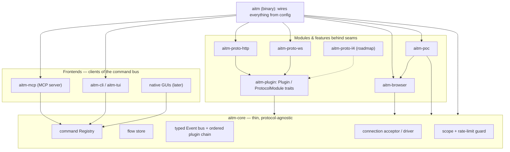
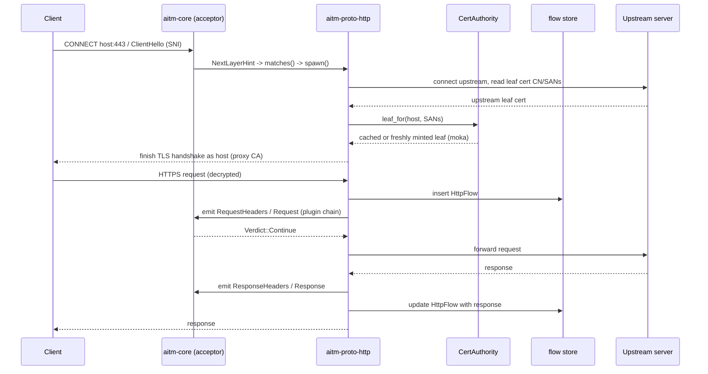
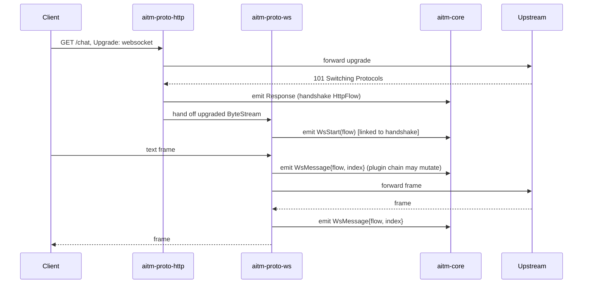
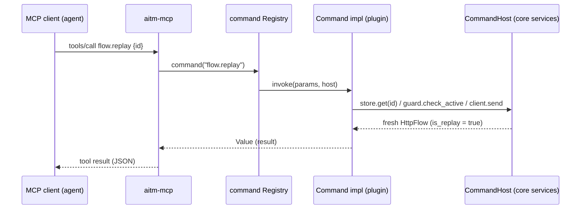
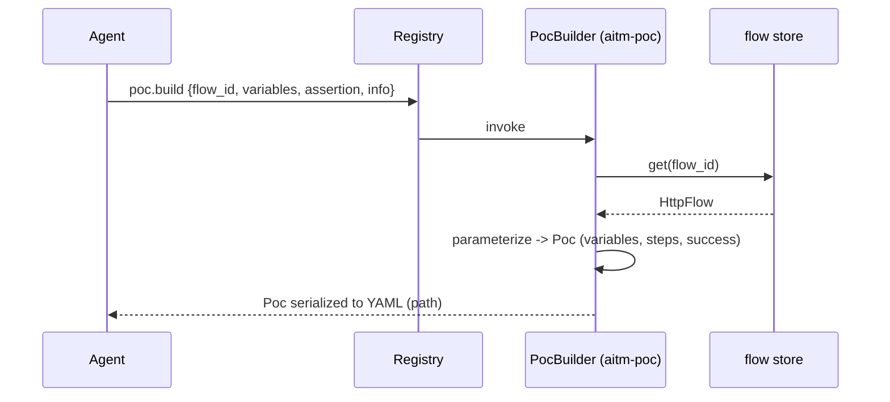
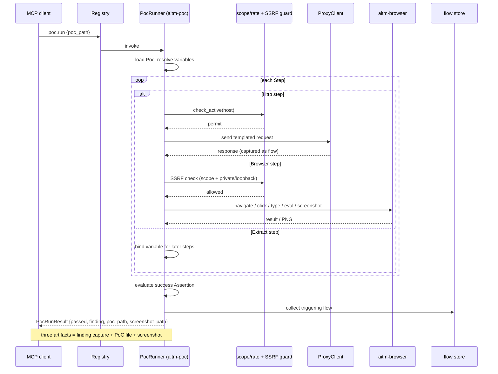
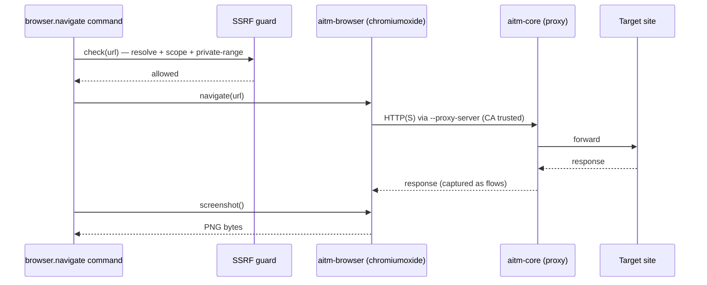
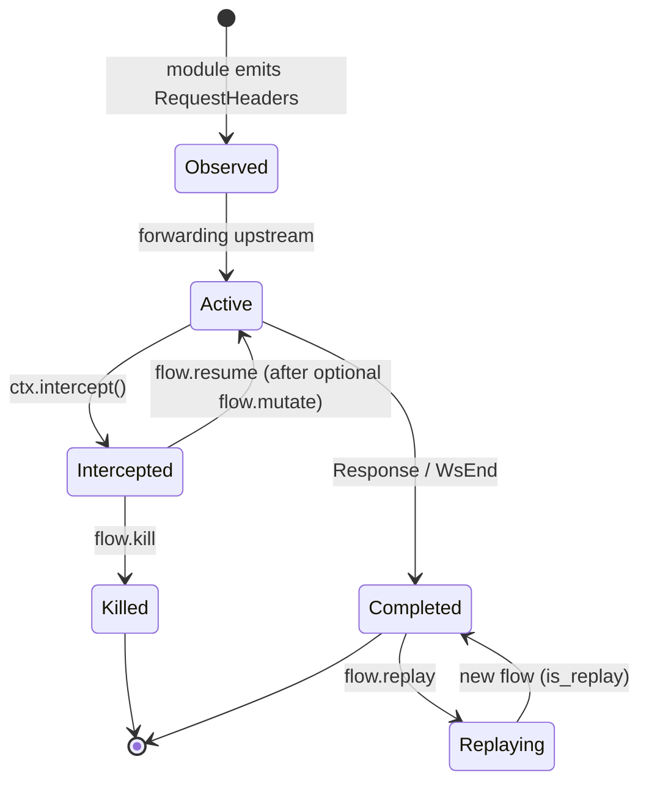
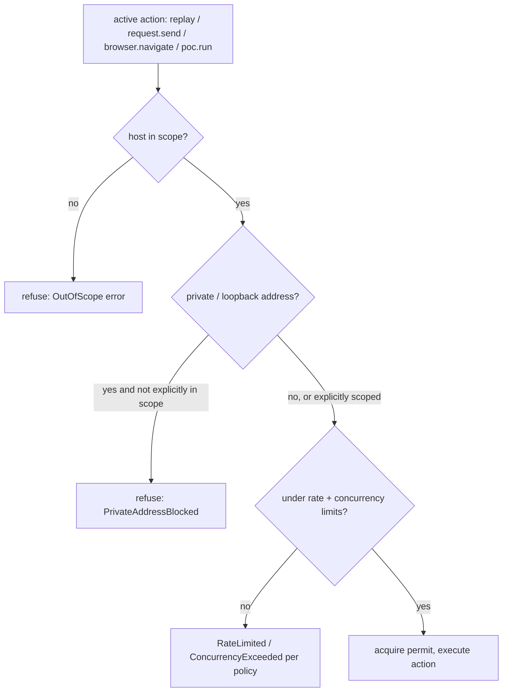

# aitmproxy platform design

**Status:** approved (2026-10-27 by Matt)
**Research inputs:** `docs/research/01-mitmproxy.md`, `docs/research/02-nuclei.md`, `docs/research/03-rust-proxy-stack.md`, `docs/research/04-playwright-cua.md`, `docs/research/05-synthesis.md`
**Companion specs:** plugin system — `docs/superpowers/specs/2026-10-27-aitmproxy-plugin-system-design.md` (the two-tier Rust+Rhai plugin model); PoC language — `docs/superpowers/specs/2026-10-27-aitmproxy-poc-language-design.md` (the YAML PoC language + script escape hatch). This spec owns the core/architecture and the `aitm-core`/`aitm-poc`/`aitm-plugin` Rust types the two companions reference; it does not duplicate their detail.

## Intent

aitmproxy ("AI-in-the-middle proxy") is a Rust intercepting-proxy **platform**
for authorized security testing. Security is the primary purpose but not the
only one, so the heart of the system is a general-purpose, protocol-agnostic
MITM core (the mitmproxy pattern), not a security-only scanner. Around that core
sit pluggable features and pluggable frontends. The decisive frontend is an
**MCP interface that controls 100% of the tool**: an AI agent is the main
driver, human CLI/GUI use is secondary. The core design principle is the
**tool/agent split** — the tool owns all deterministic machinery (capture,
replay, mutate, drive the browser, craft packets, run campaigns, emit PoCs); the
intelligence (crawl strategy, what to test, which payloads, triage, confirmation)
lives in the agent. Remove the agent and aitmproxy must still do every
deterministic thing on command. This spec defines the overall platform
architecture to build toward, then specifies **Milestone 1** concretely: an
HTTP/S + WebSocket intercepting core, driven over MCP, that captures traffic,
reproduces a finding as a parameterized self-contained PoC, and drives an
embedded headless browser to screenshot the vulnerability triggering —
demonstrated end to end on a reflected XSS.

**Why Rust — performance and stability under load.** A core reason for the
rewrite is resource behaviour: mitmproxy (Python) and Burp (Java) consume heavy
memory and, under high-volume or large-body traffic, bog down, exhaust resources,
or crash (OOM). aitmproxy exists partly to **avoid that** — to sustain heavy
sustained load with bounded, stable memory and no crashes. This is not a
nice-to-have; it is a first-class, tested requirement (see Constraints and the
performance acceptance criterion).

## Goals

Platform (build toward):

- A thin, protocol-agnostic MITM core that emits typed events over a flow store,
  with all features (including first-party ones) implemented as plugins.
- A **protocol-module seam** so protocols can be added later (HTTP/S + WebSocket
  first; raw L4/packet capability designed in, built later), by us or by
  external contributors.
- A **two-tier plugin seam**: native compiled-in Rust (M1), plus a **committed
  Rhai scripting tier** (human-readable runtime addons loaded without recompiling
  the core; API shape decided in M1, runtime in M3), with WASM a roadmap option
  behind the same seam. Detailed in the companion plugin-system spec.
- **Plugin power sufficient for a future automated scanner.** The plugin seam,
  event bus, and command surface must be general enough that a later
  automated-scanner plugin — one that crawls, discovers injection points,
  injects/fuzzes, correlates across many flows, and orchestrates a campaign — can
  be built as **new crates/plugins only, never by editing the core** (the model
  mitmproxy and rustproxy addons set). M1 builds none of this; the architecture
  must leave room for all of it.
- A **seam built for external contributors from the start (Architect's call,
  per Matt).** The `ProtocolModule` and `Plugin`/`Command` traits are the public
  authoring surface; they are documented and kept stable enough that a third
  party can add a protocol, feature plugin, or command in a new crate without
  forking the core. (PoC signing/validation, which this would eventually want,
  stays deferred past M1 — see Non-goals.)
- Pluggable **frontends** that are all clients of one command surface: CLI/TUI
  now; native macOS/Linux apps later; **MCP controlling everything**.
- A **reproducible-PoC engine**: parameterize a finding and emit a self-contained,
  replayable proof-of-concept runnable with only aitmproxy.
- An **embedded headless browser** routed through the proxy, trusting its CA,
  that can screenshot a vulnerability triggering in the live site.

Milestone 1 (ship and prove):

- Intercept and capture HTTP/1.1, HTTP/2, HTTPS (TLS MITM) and WebSocket flows.
- Expose the full M1 deterministic command surface over MCP (and the same surface
  over a minimal CLI).
- Capture a finding into a **parameterized PoC artifact** and run it with only
  aitmproxy (no agent).
- Drive the embedded browser to navigate a target and **screenshot the vuln
  triggering**.
- Produce the **three artifacts** (the finding capture, the replayable PoC, the
  screenshot) for a reflected-XSS target, driven over MCP, end to end.
- Run on **macOS and Linux** (Architect's call, per Matt).

## Non-goals

- aitmproxy does **not** fix vulnerabilities. Find and reproduce only;
  remediation is the operator's responsibility.
- **No full automated scanner today / not in M1.** aitmproxy does not ship
  scanner or discovery logic now; for M1 the discovery intelligence (crawl
  strategy, injection-point selection, payload choice, triage) lives in the
  **agent**, and the declarative layer serves **reproduction of a known finding**,
  not discovery. This is a *not-yet*, not a *never*: a full automated scanner
  (Burp-style — crawl, discover injection points, inject/fuzz, correlate across
  flows, orchestrate a campaign) is an **explicitly anticipated future plugin**
  built on the same seams (see Goals, Constraints, and the roadmap), not a
  direction the architecture forecloses. (The "nuclei" reference meant two things:
  a customizable plugin system for custom flows, and the PoC-reproduction
  capability.)
- No report prose or recommended-fix generation in the tool. The agent assembles
  the three artifacts into a markdown report; the tool produces the artifacts.
- M1 does not implement L4/raw-packet fuzzing, additional protocols beyond
  HTTP/WS, native GUIs, a runtime (WASM/scripting) plugin mechanism, or PoC
  signing/validation. The architecture must not preclude them.
- **No separate recorded-authorization gate in M1 (Architect's call, per Matt).**
  Deny-by-default scope is the authorization mechanism for M1; an explicit,
  recorded per-scope authorization file is a deferred, post-M1 option, not built
  now (see Safety).
- The companion Claude plugin (skills/helpers) is out of scope except where the
  MCP contract must support it.

## Anti-goals

- A core that knows about specific protocols or specific features. Protocol and
  feature knowledge belongs in modules/plugins behind seams; a protocol or
  feature that cannot be removed without touching the core is a design failure.
- A PoC that needs the agent, a network service, or the original captured flow to
  replay. A PoC that is not self-contained and deterministic is a failure.
- An agent-only tool. If disabling MCP leaves any deterministic capability
  unreachable from the CLI, the tool/agent split has failed.
- Python-tier throughput or Python/Java-tier resource behaviour. If the Rust core
  cannot comfortably out-throughput mitmproxy on high-volume or large-body
  traffic, a core reason for the project is lost — and it is **equally a failure**
  if the proxy crashes, OOMs, or grows memory without bound under sustained load.
  Stable, bounded memory under heavy load is as required as raw speed.
- Shipping active-attack capability with unsafe defaults (no scope control, no
  rate limiting, unguarded SSRF from the embedded browser).
- A plugin API too narrow to host a future automated scanner. If adding active
  scanning later — multi-flow correlation, injection-point discovery, active
  injection/fuzzing, campaign orchestration — would force changes to `aitm-core`
  rather than new crates/plugins, the plugin seam has failed by design.

## Constraints

- **Language/gate:** Rust. `cargo fmt --check && cargo clippy --all-targets -- -D warnings && cargo test`
  must pass before any review. `unsafe` requires a `// SAFETY:` comment and a
  signed-off Security-reviewer entry.
- **Performance/memory:** async, zero-copy where practical, bodies streamed not
  buffered by default; must scale to high connection counts. sans-IO protocol
  logic kept allocation-light. These choices exist precisely to beat the
  Python/Java resource profile (see Intent): streamed bodies + backpressure cap
  peak memory, and allocation-light sans-IO keeps per-flow cost flat.
- **Throughput & memory under load (hard requirement):** a single instance must
  sustain **thousands up to ~10,000 requests/second with bounded, stable
  memory** — no leaks, no unbounded growth, no OOM, no crash under sustained
  load. Memory must plateau (not trend upward) over a long run. This is a direct
  consequence of the streamed-bodies / backpressure / allocation-light-sans-IO
  design above, and is verified, not assumed (see the performance acceptance
  criterion; the M1-gated floor vs. the ~10,000 rps standing target is an
  Architect's call recorded there).
- **Platform (decided):** developed/distributed on macOS (`brew install`); the
  core and browser **must also run on Linux**. M1 targets **macOS + Linux**
  (Architect's call, per Matt). No L4/transparent capture either way in M1, so
  this affects only browser launch flags and path/permission handling.
- **Dependencies:** prefer the 2025/2026 Rust stack from `03-rust-proxy-stack.md`
  (tokio, hyper 1.x, rustls/tokio-rustls, rcgen, moka, tokio-tungstenite,
  chromiumoxide). Pure-Rust TLS (rustls) is the default.
- **Security:** authorized testing only. Scope controls, rate limiting, per-host
  backoff, concurrency caps, SSRF/private-IP guards for the browser, and a clean
  CA generation/trust flow are required from the start, not retrofitted.
- **Plugin-seam generality (scanner-ready):** the plugin API, event bus, and
  command surface must stay general enough to host a future automated-scanner
  plugin (multi-flow correlation, injection-point discovery, active
  injection/fuzzing, campaign orchestration) via new crates/plugins only, with no
  `aitm-core` edits. M1 ships no scanner, but no M1 decision may foreclose one.
- **External-authoring stability:** the public trait surface (`ProtocolModule`,
  `Plugin`, `Command`, `ParamSchema`) is treated as an API others build on;
  breaking it is a cost, not a free refactor (Architect's call, per Matt's
  decision to open the project to contributors).
- **MCP transport (decided):** M1 exposes MCP over **stdio and a loopback-only
  TCP bind guarded by a required token**; no authenticated remote or multi-client
  transport in M1 (Architect's call, per Matt).
- **Workflow:** every change travels the seven stages in `docs/superpowers/WORKFLOW.md`.

## Design

### Overall architecture

The system is a Cargo **workspace** of small crates arranged in three rings:
a thin core, modules/features behind seams, and frontends. Everything above raw
I/O is a plugin; every frontend is a client of one command surface.

```
                        ┌───────────── frontends (clients of the command bus) ─────────────┐
                        │   aitm-mcp (MCP server)   aitm-cli / aitm-tui   [native GUIs ►]   │
                        └───────────────────────────────┬─────────────────────────────────┘
                                                         │  Command / Query bus
┌──────────────────────────────────── aitm-core (thin, protocol-agnostic) ───────────────────────────────┐
│  connection acceptor · flow store · typed Event bus · ordered plugin chain (halt/short-circuit) ·        │
│  interception primitives (intercept/resume/kill/backup) · command registry · scope & rate-limit guard    │
└───────┬───────────────────────────┬─────────────────────────────┬──────────────────────────────────────┘
        │ ProtocolModule seam        │ Plugin seam                  │ consumes core services
┌───────┴────────┐  ┌───────────────┴───────────────┐  ┌───────────┴───────────────────────────────────────┐
│ aitm-proto-http │  │ first-party plugins:           │  │ aitm-browser (chromiumoxide/CDP, routes via proxy) │
│ aitm-proto-ws   │  │  capture, replay, intercept,   │  │ aitm-poc (parameterized PoC build + run)           │
│ [aitm-proto-l4 ►]│  │  mutate, scope, rate-limit     │  │                                                    │
└────────────────┘  └───────────────────────────────┘  └────────────────────────────────────────────────────┘
```

The same three rings and the **crate dependency edges** (everything points *into*
the core; the core points at nothing above raw I/O):



**Crate layout (Architect's call):**

| Crate | Responsibility | Status |
|---|---|---|
| `aitm-core` | Connection acceptance, `Flow` store, typed `Event` bus, ordered plugin chain, interception primitives, command registry, scope + rate-limit guard. Knows no protocol. | yes |
| `aitm-proto-http` | HTTP/1.1 + HTTP/2 + TLS MITM protocol module (hyper 1.x, rustls, rcgen, moka, x509-parser). | yes |
| `aitm-proto-ws` | WebSocket module; intercepts after the HTTP upgrade (tokio-tungstenite). | yes |
| `aitm-proto-l4` | Raw-packet / L4 module behind the same seam. Trait placement only. | roadmap |
| `aitm-plugin` | The plugin API: `Plugin`, `ProtocolModule`, event hooks, command registration. | yes |
| `aitm-browser` | Embedded headless browser over CDP — the forked **obscura** engine (default, M2) or external Chrome, selected by `BrowserConfig.engine`; CUA-style primitives; SSRF guard. | yes (Chrome M1, obscura M2) |
| `aitm-poc` | PoC artifact model, builder, and runner. | yes |
| `aitm-mcp` | MCP server frontend over the command bus. | yes |
| `aitm-cli` | Minimal CLI/TUI frontend over the command bus. | yes (CLI) |
| `aitm-ca` | OS trust-store management for the MITM CA: the `ca.*` commands (export/status/install/uninstall), per-platform stores (macOS/Linux/Windows), fail-closed JSONL audit, deny-by-default agent-install gate. | M2 |
| `aitm-plugin-rhai` | Rhai scripting tier: a `.rhai` file as a first-class chain plugin + the PoC `script` step. | M3 |
| `aitm` | The binary: wires core + modules + plugins + frontends from config. | yes |

**Separation of concerns that must hold:** the core depends on none of the
protocol crates, browser, poc, or frontends — they depend on it (or on
`aitm-plugin`). Adding a protocol or feature means adding a crate and registering
it; it never edits `aitm-core`.

### The core: flow, events, plugin chain

Following mitmproxy's "the platform is just a host for plugins" pattern and the
sans-IO split: pure, synchronous protocol state machines live in the protocol
modules; the tokio I/O/driver layer lives in the core.

The declarations below fix the **shapes** (types, fields, trait method
signatures). Bodies, internal fields marked `/* … */`, exact error payloads, and
file layout remain the builder's.

```rust
// aitm-core — identity, flow model

/// Opaque, globally unique flow identifier. UUID-backed (v4 vs v7 left to builder).
pub struct FlowId(/* uuid-backed */);

/// Every captured interaction. Enum so new protocols slot in without core edits.
pub enum Flow {
    Http(HttpFlow),
    WebSocket(WsFlow),
    // Tcp(TcpFlow), Udp(UdpFlow), Dns(DnsFlow) added later behind the same enum
}

pub struct HttpFlow {
    pub id: FlowId,
    pub request: HttpRequest,
    pub response: Option<HttpResponse>,   // None until the response arrives
    pub client_conn: ConnInfo,
    pub server_conn: Option<ConnInfo>,    // None if short-circuited before upstream
    pub metadata: FlowMeta,               // marks, comments, is_replay, timing
    pub intercept: InterceptState,        // observed / intercepted(backup,resume) / killed
}

pub struct WsFlow {
    pub id: FlowId,
    pub handshake: FlowId,                // the originating HttpFlow (101 upgrade)
    pub messages: Vec<WsMessage>,         // newest == messages.last()
    pub client_conn: ConnInfo,
    pub server_conn: Option<ConnInfo>,
    pub metadata: FlowMeta,
    pub intercept: InterceptState,
}

pub struct HttpRequest {
    pub method: String,
    pub scheme: String,                   // "https" after TLS MITM
    pub authority: String,                // host[:port]
    pub path: String,                     // path + query
    pub version: HttpVersion,
    pub headers: HeaderMap,
    pub body: Body,                       // streamed by default; buffered on demand
    pub timestamp: SystemTime,
}

pub struct HttpResponse {
    pub status: u16,
    pub version: HttpVersion,
    pub headers: HeaderMap,
    pub body: Body,
    pub timestamp: SystemTime,
}

pub enum HttpVersion { Http11, H2 }

/// Ordered, case-insensitive header collection (preserves duplicates/order).
pub struct HeaderMap(/* ordered multimap */);

/// Body is streamed by default; `materialize` buffers it when a handler needs bytes.
pub enum Body {
    Empty,
    Bytes(Vec<u8>),
    Streamed(/* backpressured handle */),
}

pub struct WsMessage {
    pub dir: WsDir,
    pub opcode: WsOpcode,
    pub data: Vec<u8>,
    pub timestamp: SystemTime,
    pub injected: bool,                   // true if a plugin/PoC authored it
}

pub enum WsDir { ClientToServer, ServerToClient }
pub enum WsOpcode { Text, Binary, Ping, Pong, Close }

pub struct ConnInfo {
    pub peer: SocketAddr,
    pub sni: Option<String>,
    pub alpn: Option<String>,
    pub tls: bool,
    pub established: SystemTime,
}

pub struct FlowMeta {
    pub marks: Vec<String>,
    pub comment: Option<String>,
    pub is_replay: bool,
    pub created: SystemTime,
    pub duration: Option<Duration>,
}

/// Lifecycle of interception for a single flow (see the state diagram below).
pub enum InterceptState {
    Observed,                                             // flowing normally
    Intercepted { backup: Box<Flow>, resume: ResumeHandle }, // parked; backup taken
    Resumed,
    Killed,
}

/// Wakes the parked pausable future when a command resumes the flow.
pub struct ResumeHandle(/* oneshot-backed */);
```

```rust
// aitm-core — events, verdicts, errors

pub enum Event {
    RequestHeaders(FlowId), Request(FlowId),
    ResponseHeaders(FlowId), Response(FlowId),
    WsStart(FlowId), WsMessage { flow: FlowId, index: usize }, WsEnd(FlowId),
    Error { flow: FlowId, kind: FlowError },
}

/// A plugin's answer after handling an event. `Halt` short-circuits the chain.
pub enum Verdict { Continue, Halt }

pub enum FlowError {
    Tls(String),
    Upstream(String),
    Protocol(String),
    Timeout,
    Killed,
    Guard(GuardError),
}
```

```rust
// aitm-core — the plugin trait and the handler context

pub trait Plugin: Send {
    /// Stable identifier, also the ordering key in the chain.
    fn name(&self) -> &str;
    /// Called once at load: register options and commands into the Registry.
    fn load(&mut self, reg: &mut Registry) {}
    /// Called for every event in registration order. Default: pass through.
    fn on_event(&mut self, ev: &Event, ctx: &mut FlowCtx<'_>) -> Verdict { Verdict::Continue }
}

/// Read/mutate handle a plugin gets while handling an event for one flow.
pub struct FlowCtx<'a> { /* borrows the flow + core handles */ }

impl<'a> FlowCtx<'a> {
    /// The flow this event is about.
    pub fn flow(&self) -> &Flow;
    /// Mutate request/response/ws-message in place before it is forwarded.
    pub fn flow_mut(&mut self) -> &mut Flow;
    /// Short-circuit: answer the client with this response, skip upstream.
    pub fn set_response(&mut self, resp: HttpResponse);
    /// Park this flow as a pausable future; a command later resumes it.
    pub fn intercept(&mut self) -> ResumeHandle;
    /// Resume a parked flow (forward with any edits applied).
    pub fn resume(&mut self);
    /// Drop the flow; client sees a reset/closed connection.
    pub fn kill(&mut self);
    /// Snapshot the flow before edits (enables revert).
    pub fn backup(&mut self);
    /// Restore the last backup, discarding edits.
    pub fn revert(&mut self);
}
```

- `FlowCtx` lets a handler read and **mutate** the flow in place (change request
  before forwarding, set a response to short-circuit, rewrite a WS message) and
  call `intercept() / resume() / kill() / backup() / revert()`. Interception is a
  **pausable future**: `intercept()` parks the flow, a command resumes it.
- The plugin chain is **ordered**; events dispatch to each plugin in registration
  order; a `Halt` verdict short-circuits. First-party features (capture, replay,
  intercept, mutate, scope, rate-limit) are the first plugins, not core code.
- Handlers are async-friendly; CPU/blocking work uses `spawn_blocking`.

```rust
// aitm-core — the flow store (shared, queryable; scanner-ready via `query`)

pub trait FlowStore: Send + Sync {
    fn insert(&self, flow: Flow) -> FlowId;
    fn get(&self, id: FlowId) -> Option<Flow>;
    fn update(&self, id: FlowId, f: &mut dyn FnMut(&mut Flow));
    fn list(&self) -> Vec<FlowId>;
    /// Filtered retrieval; the seam a future scanner uses for multi-flow correlation.
    fn query(&self, q: &FlowQuery) -> Vec<FlowId>;
}

pub struct FlowQuery {
    pub host: Option<String>,
    pub method: Option<String>,
    pub status: Option<u16>,
    pub kind: Option<FlowKind>,
    pub is_replay: Option<bool>,
}

pub enum FlowKind { Http, WebSocket }
```

```rust
// aitm-core — connection acceptor / driver entry point

/// The running proxy: owns the accept loop, the store, the chain, and the registry.
pub struct Proxy { /* tokio runtime handles */ }

impl Proxy {
    pub fn builder() -> ProxyBuilder;
    /// Bind and run the accept loop until shutdown.
    pub async fn run(self, listen: SocketAddr) -> Result<()>;
    pub fn registry(&self) -> &Registry;
}

pub struct ProxyBuilder { /* staged config + registrations */ }

impl ProxyBuilder {
    pub fn with_config(self, cfg: Config) -> Self;
    pub fn register_module(self, m: Arc<dyn ProtocolModule>) -> Self;
    pub fn register_plugin(self, p: Box<dyn Plugin>) -> Self;
    pub fn build(self) -> Result<Proxy>;
}

/// Reissue a request through the proxy's own pipeline (scope/rate-guarded, captured).
pub trait ProxyClient: Send + Sync {
    fn send(&self, req: HttpRequest) -> BoxFuture<'_, Result<HttpFlow>>;
}
```

### Protocol-module seam

**Trait placement (accepted structuring call, orchestrator 2026-10-27).** The
protocol-seam traits and types below — `ProtocolModule`, `NextLayerHint`,
`ModuleCtx`, `ByteStream`, `AsyncReadWrite` — are **defined in `aitm-core`**,
because `aitm-core`'s public surface names them (`ProxyBuilder::register_module(
Arc<dyn ProtocolModule>)`, and `CommandHost`/`ModuleCtx`) and `aitm-core` cannot
depend on crates that depend on it (cargo rejects the cycle). `aitm-plugin`
**re-exports** them (`pub use aitm_core::{ProtocolModule, NextLayerHint,
ModuleCtx, ByteStream, AsyncReadWrite};`), so it remains the public authoring
surface and both documented import paths keep working — `aitm_core::Proxy::
builder().register_module(...)` (platform Example 1) and `use
aitm_plugin::ProtocolModule` (plugin-system Example 2 and the proto crates).
This is a reconciliation within the design: no behavior, scope, or signature
changes. **Governing rule:** any trait or type named by the `aitm-core` public
surface (`CommandHost`, `ModuleCtx`, `ProxyBuilder`, `Config`) is defined in
`aitm-core`; concrete implementations live in their own crates; `aitm-plugin`
re-exports the protocol seam.

```rust
// defined in aitm-core; re-exported by aitm-plugin — the protocol seam and what a module is handed

pub trait ProtocolModule: Send + Sync {
    /// Stable id: "http", "ws", later "l4".
    fn id(&self) -> &str;
    /// mitmproxy-style next_layer: does this module claim the connection?
    fn matches(&self, hint: &NextLayerHint) -> bool;
    /// Drive the connection: turn bytes into Flows/Events via a sans-IO machine.
    fn spawn(&self, io: ByteStream, ctx: ModuleCtx) -> BoxFuture<'_, Result<()>>;
}

/// What the acceptor peeks before choosing a module.
pub struct NextLayerHint {
    pub dst: SocketAddr,
    pub is_tls: bool,
    pub client_hello_sni: Option<String>,
    pub alpn: Vec<String>,
    pub first_bytes: Vec<u8>,             // peeked bytes for protocol sniffing
    pub from_upgrade: bool,               // true when handed off from an HTTP upgrade
}

/// Handles a module uses to emit flows/events and reach upstream — never the
/// concrete core type, so the core stays protocol-agnostic.
pub struct ModuleCtx { /* core service handles */ }

impl ModuleCtx {
    pub fn store(&self) -> &dyn FlowStore;
    /// Dispatch an event through the ordered plugin chain (may mutate/halt/intercept).
    pub fn emit(&self, ev: Event) -> BoxFuture<'_, Verdict>;
    /// Open a guarded upstream byte stream (scope/rate checked).
    pub fn connect_upstream(&self, dst: SocketAddr) -> BoxFuture<'_, Result<ByteStream>>;
}

/// An async, duplex byte stream (client- or server-side), abstracting the socket/TLS.
pub type ByteStream = Pin<Box<dyn AsyncReadWrite + Send>>;
```

- A module turns raw bytes into `Flow`s and `Event`s via a sans-IO state machine
  and feeds them to the core. `aitm-proto-http` owns TLS MITM; `aitm-proto-ws`
  activates on HTTP Upgrade.
- `aitm-proto-l4` (roadmap) implements the **same trait** over `pnet`/`pcap` or
  TPROXY/nfqueue, enabling dual-layer testing (fuzz one target at L7 and L4). The
  seam exists in M1; the module does not.

**Upgrade handoff (accepted structuring call, resolved during implementation,
approved by orchestrator 2026-10-27).** After `HttpModule` MITMs an HTTP 101
upgrade there are two already-upgraded live byte streams, but `spawn(io, ctx)`
otherwise only lets a module dial a *fresh* upstream via
`ModuleCtx::connect_upstream`, and `ModuleCtx` cannot carry the handshake
`FlowId` the `WsFlow` must link to. `ModuleCtx` therefore gains an additive
upgrade-handoff construction path — `ModuleCtx::for_upgrade(handshake: FlowId,
upstream: ByteStream, hint: NextLayerHint)` — plus accessors
`handshake() -> Option<FlowId>`, `take_upstream() -> Option<ByteStream>`, and
`hint() -> &NextLayerHint`. The core acceptor **re-dispatches** after an upgrade
(mitmproxy `next_layer` style): `HttpModule` signals the upgrade, the core
builds the upgrade `ModuleCtx` and calls the matching `ProtocolModule`
(`WsModule`, whose `matches()` is true with `from_upgrade = true`) via its
existing `spawn`; `WsModule` links `WsFlow.handshake` from `handshake()` and
takes the already-upgraded stream with `take_upstream()` instead of dialing a
new one with `connect_upstream()`. There is no direct `aitm-proto-http` →
`aitm-proto-ws` crate edge — the core mediates. The public
`ProtocolModule::spawn` signature is unchanged; this is additive and a
reconciliation within the design, with no behavior or scope change.

#### `aitm-proto-http`: TLS MITM + sans-IO HTTP

```rust
// aitm-proto-http — certificate authority (generate root, mint + cache leaves)

pub struct CertAuthority { /* root key+cert, moka leaf cache */ }

impl CertAuthority {
    /// Load the persisted root CA, or generate one on first run (key file 0600).
    pub fn load_or_generate(dir: &Path, key_mode: u32) -> Result<Self>;
    /// PEM of the root cert, for the "install & trust the CA" flow.
    pub fn root_cert_pem(&self) -> &str;
    /// Cache hit, or mint+sign a leaf for `host` with the sniffed SANs (rcgen).
    pub fn leaf_for(&self, host: &str, sans: &[String]) -> Result<Arc<LeafCert>>;
    /// Visible for tests/metrics: did the last `leaf_for` hit the moka cache?
    pub fn last_was_cache_hit(&self) -> bool;
}

pub struct LeafCert { pub cert_der: Vec<u8>, pub key_der: Vec<u8> }
```

```rust
// aitm-proto-http — sans-IO HTTP state machine (pure; no I/O)

/// Pure request/response parser+encoder. The core driver feeds it bytes and
/// pumps the bytes it wants to write; it never touches a socket itself.
pub trait HttpStateMachine: Send {
    /// Feed bytes read from one side; get back the protocol events they produced.
    fn on_bytes(&mut self, from: Side, buf: &[u8]) -> Result<Vec<HttpSansIoEvent>>;
    /// Bytes the machine wants written to a side (encoded request/response).
    fn poll_outbound(&mut self, to: Side) -> Option<Vec<u8>>;
}

pub enum Side { Client, Server }

/// Fine-grained protocol events the module maps onto core `Event`s.
pub enum HttpSansIoEvent {
    RequestHeaders(FlowId),
    RequestBodyChunk { flow: FlowId, bytes: Vec<u8> },
    RequestComplete(FlowId),
    ResponseHeaders(FlowId),
    ResponseBodyChunk { flow: FlowId, bytes: Vec<u8> },
    ResponseComplete(FlowId),
    Upgrade { flow: FlowId, protocol: String },  // hands off to aitm-proto-ws
}
```

- TLS MITM: read SNI → connect upstream and sniff its cert's CN/SANs →
  `CertAuthority::leaf_for` → complete the client handshake impersonating the
  host → decrypt and drive the HTTP state machine. The leaf cache (`moka`) makes
  the second request to a host a cache hit (AC3).

#### `aitm-proto-ws`: WebSocket module

```rust
// aitm-proto-ws — activates on HTTP upgrade; frames in/out behind the same seam

pub struct WsModule { /* tokio-tungstenite codecs */ }

impl ProtocolModule for WsModule {
    // id() == "ws"; matches() true when NextLayerHint.from_upgrade and protocol == websocket
}

/// Pure frame coder, mirroring the sans-IO split used for HTTP.
pub trait WsStateMachine: Send {
    fn on_bytes(&mut self, from: Side, buf: &[u8]) -> Result<Vec<WsSansIoEvent>>;
    fn poll_outbound(&mut self, to: Side) -> Option<Vec<u8>>;
    /// Author/forward a (possibly mutated) frame.
    fn send_frame(&mut self, to: Side, msg: WsMessage);
}

pub enum WsSansIoEvent {
    Open,
    Message { index: usize },   // appended to WsFlow.messages
    Close,
}
```

### Command surface (the control plane) and frontends

Every deterministic capability is a **command** registered by a plugin into the
core `Registry`. **All frontends — MCP, CLI, TUI, future GUIs — invoke the same
commands.** This is what makes "100% of the tool controllable via MCP" true by
construction, and what enforces the tool/agent split: the CLI can do everything
the agent can.

```rust
// aitm-core — registry, commands, typed params/results

pub struct Registry { /* commands + options + ordered plugin list */ }

impl Registry {
    pub fn add_command(&mut self, cmd: Arc<dyn Command>);
    pub fn add_plugin(&mut self, plugin: Box<dyn Plugin>);
    pub fn command(&self, name: &str) -> Option<&Arc<dyn Command>>;
    pub fn commands(&self) -> impl Iterator<Item = &Arc<dyn Command>>;
}

pub trait Command: Send + Sync {
    fn name(&self) -> &str;                 // e.g. "flow.list", "flow.replay"
    fn schema(&self) -> ParamSchema;        // typed params + result (drives MCP tool schema)
    fn invoke(&self, args: Params, host: &CommandHost) -> Result<Value>;
}

pub struct ParamSchema {
    pub description: String,
    pub params: Vec<ParamDef>,
    pub result: TypeDesc,
}

pub struct ParamDef {
    pub name: String,
    pub ty: TypeDesc,
    pub required: bool,
    pub description: String,
}

/// Transport-neutral type descriptor; MCP derives JSON Schema from it.
pub enum TypeDesc {
    Bool, Int, Float, Str, Bytes, FlowId,
    Array(Box<TypeDesc>),
    Object(Vec<ParamDef>),
    Any,
}

/// Named argument bag handed to a command.
pub struct Params(/* name -> Value map */);

/// Transport-neutral value (what crosses the command bus, MCP and CLI alike).
pub enum Value {
    Null,
    Bool(bool),
    Int(i64),
    Float(f64),
    Str(String),
    Bytes(Vec<u8>),
    Array(Vec<Value>),
    Object(BTreeMap<String, Value>),
}

/// Core services a command may use, without depending on any protocol crate.
pub struct CommandHost<'a> { /* borrows core handles */ }

impl<'a> CommandHost<'a> {
    pub fn store(&self) -> &dyn FlowStore;
    pub fn client(&self) -> &dyn ProxyClient;          // reissue through the proxy
    pub fn browser(&self) -> Option<&dyn BrowserDriver>;
    pub fn guard(&self) -> &dyn ScopeRateGuard;
}
```

```rust
// aitm-core — the scope + rate-limit guard (one gate for every active action)

pub trait ScopeRateGuard: Send + Sync {
    /// Called before any active action; returns a permit or a typed refusal.
    fn check_active(&self, host: &str) -> Result<ActionPermit, GuardError>;
    fn add_scope(&self, entry: ScopeEntry);
    fn list_scope(&self) -> Vec<ScopeEntry>;
}

/// Dropping the permit releases the concurrency slot.
pub struct ActionPermit(/* RAII slot */);

pub enum GuardError {
    OutOfScope(String),
    PrivateAddressBlocked(String),        // SSRF guard: private/loopback, not in scope
    RateLimited { retry_after: Duration },
    ConcurrencyExceeded,
    HostDisabled,                          // error budget exhausted
}
```

- `aitm-mcp` enumerates registered commands and exposes each as an **MCP tool**,
  deriving the tool schema from `ParamSchema`. No command is MCP-only or CLI-only.
- M1 command surface (minimum): `flow.list`, `flow.get`, `flow.replay`,
  `flow.intercept`/`flow.resume`/`flow.kill`, `flow.mutate` (edit + forward),
  `request.send` (craft + send), `browser.navigate`/`click`/`type`/`screenshot`/
  `eval`/`get_dom`, `poc.build`, `poc.run`, `scope.add`/`scope.list`.

#### Frontends: MCP and CLI over one bus

```rust
// aitm-mcp — derive an MCP tool from a command's ParamSchema; serve a transport

/// Maps the transport-neutral ParamSchema onto an MCP tool with JSON Schema input.
pub trait McpSchemaDerive {
    fn to_mcp_tool(&self, cmd: &dyn Command) -> McpTool;
}

pub struct McpTool {
    pub name: String,          // == Command::name()
    pub description: String,
    pub input_schema: JsonValue, // JSON Schema derived from ParamSchema.params
}

pub struct McpServer { /* registry handle + transport */ }

impl McpServer {
    pub fn new(registry: Arc<Registry>, transport: McpTransport) -> Self;
    /// tools/list enumerates every registered command; tools/call -> Command::invoke.
    pub async fn serve(self) -> Result<()>;
}
```

```rust
// aitm-cli — same commands, mapped from argv

pub struct Cli { /* registry handle */ }

impl Cli {
    pub fn new(registry: Arc<Registry>) -> Self;
    /// `aitm flow replay --id <uuid>` -> command "flow.replay" + Params{ id }.
    /// Subcommand path maps 1:1 to Command::name(); flags map to ParamDef by name.
    pub fn dispatch(&self, argv: &[String]) -> Result<Value>;
}
```

**Frontends receive the core service handles via an additive builder; the
declared `McpServer::new`/`Cli::new` signatures are unchanged (accepted
structuring call, resolved during implementation, approved by orchestrator
2026-10-27).** A `Registry` alone cannot answer `tools/call` / `dispatch`:
`Command::invoke(args, &CommandHost)` needs a `CommandHost`, which carries the
flow store, proxy client, scope/rate guard, and (optional) browser — none of
which a `Registry` holds. So `McpServer` and `Cli` each gain an additive
builder method

```rust
fn with_services(self, store: Arc<dyn FlowStore>, client: Arc<dyn ProxyClient>,
                 guard: Arc<dyn ScopeRateGuard>, browser: Option<Arc<dyn BrowserDriver>>) -> Self;
```

These handles are exactly what `Proxy::store()/client()/guard()/browser()`
already provide; at invoke time the frontend builds a `CommandHost` from them
and passes it to `Command::invoke`. If `with_services` was not called, an
invoke returns a clear error. `tools/list` and schema derivation never need
services. This is a reconciliation within the design: additive only, no
behavior or signature change to `new`.

### Embedded headless browser (`aitm-browser`)

- **chromiumoxide in-process over CDP (Architect's call)** — the lean path for a
  Chromium-only security tool; avoids VM overhead and keeps the whole loop in
  Rust. (CUA VMs are reserved for a later milestone if full-desktop/native-app
  control is ever needed.)
- The browser launches with the proxy as upstream (`--proxy-server`) and trusts
  the proxy CA at runtime via CDP `Security.setIgnoreCertificateErrors`. All
  browser traffic therefore appears as captured flows.
- Exposes CUA-style primitives as commands/MCP tools (naming after CUA's stable
  verbs). Screenshots are the mechanism for the "screenshot the vuln triggering"
  artifact.
- **SSRF/private-IP guard:** navigations resolve DNS and are checked against the
  scope + a private/loopback denylist before loading (decided posture below).

**Trait placement (accepted structuring call, orchestrator 2026-10-27).** The
browser-seam trait and types the `aitm-core` surface names — `BrowserDriver`
(returned by `CommandHost::browser() -> Option<&dyn BrowserDriver>`) plus
`ClickTarget`, `NavOutcome`, `BrowserConfig` (held by `Config.browser`), and
`SsrfPolicy` — are **defined in `aitm-core`**, for the same cycle reason as the
protocol seam (per the governing rule above). The concrete chromiumoxide
implementation of `BrowserDriver` and the `SsrfGuard` stay in `aitm-browser`.
No behavior, scope, or signature change; documented import paths are preserved.

```rust
// trait + config types defined in aitm-core; chromiumoxide impl in aitm-browser

pub trait BrowserDriver: Send + Sync {
    fn navigate(&self, url: &str) -> BoxFuture<'_, Result<NavOutcome>>;
    fn click(&self, target: ClickTarget) -> BoxFuture<'_, Result<()>>;
    fn type_text(&self, selector: &str, text: &str) -> BoxFuture<'_, Result<()>>;
    fn screenshot(&self) -> BoxFuture<'_, Result<Vec<u8>>>;   // PNG bytes
    fn eval(&self, expr: &str) -> BoxFuture<'_, Result<Value>>;
    fn get_dom(&self) -> BoxFuture<'_, Result<String>>;
}

pub enum ClickTarget { Selector(String), Point { x: f64, y: f64 } }
pub struct NavOutcome { pub final_url: String, pub status: Option<u16> }

pub struct BrowserConfig {
    pub proxy_addr: SocketAddr,     // the proxy upstream (--proxy-server)
    pub headless: bool,
    pub ignore_cert_errors: bool,   // via CDP Security.setIgnoreCertificateErrors
    pub nav_timeout: Duration,
    pub ssrf: SsrfPolicy,
}

/// Decided posture (per Matt): block private + loopback unless the host is
/// explicitly in scope.
pub struct SsrfPolicy {
    pub block_private: bool,         // default true
    pub block_loopback: bool,        // default true
    pub allow_if_in_scope: bool,     // default true: an explicit scope entry overrides the block
}

pub trait SsrfGuard: Send + Sync {
    /// Resolve the URL's host and validate it against policy + scope before load.
    fn check(&self, url: &str) -> Result<ResolvedTarget, GuardError>;
}

pub struct ResolvedTarget { pub host: String, pub addr: SocketAddr }
```

### Reproducible-PoC engine (`aitm-poc`)

The key differentiator. A PoC is a **self-contained, declarative artifact** that
reproduces a known finding deterministically, runnable with only aitmproxy.

```rust
// aitm-poc — the artifact model

pub struct Poc {
    pub id: String,
    pub info: PocInfo,
    pub variables: Vec<Variable>,   // target URL, injection param, payload, …
    pub steps: Vec<Step>,           // ordered
    pub success: Assertion,         // what "triggered" means
}

pub struct PocInfo {
    pub name: String,
    pub severity: Severity,
    pub references: Vec<String>,
    pub tags: Vec<String>,
    pub cwe: Option<String>,
    // deliberately NO remediation / fix prose (Non-goal)
}

pub enum Severity { Info, Low, Medium, High, Critical }

pub struct Variable {
    pub name: String,
    pub default: Option<Value>,
    pub description: String,
    pub required: bool,
}

pub enum Step {
    Http(HttpStep),                 // request with {{var}} placeholders
    Browser(BrowserStep),           // navigate/click/type/eval/screenshot, with {{var}}
    Extract(ExtractStep),           // bind a variable from a prior response (CSRF, session)
}

pub struct HttpStep {
    pub method: String,
    pub url: String,                // may contain {{var}}
    pub headers: Vec<(String, String)>,
    pub body: Option<String>,       // {{var}} templated
    pub extract: Vec<ExtractStep>,  // post-response captures
}

pub struct BrowserStep { pub action: BrowserAction }

pub enum BrowserAction {
    Navigate { url: String },
    Click { target: String },
    Type { selector: String, text: String },
    Eval { expr: String },
    Screenshot { label: String },  // the "vuln triggering" artifact
}

pub struct ExtractStep {
    pub name: String,               // binds a variable for later steps
    pub source: ExtractSource,
}

pub enum ExtractSource {
    Regex(String),
    JsonPath(String),
    Header(String),
    BrowserEval(String),
}

pub enum Assertion {               // nuclei operator vocabulary; reproduction in M1, reusable by a future scanner plugin
    Status(u16),
    // (Reconciliation R2, 2026-10-27) word/regex carry the nuclei `part`
    // (body default / header / all) so a matcher can target response headers.
    Word { word: String, part: MatchPart }, Regex { regex: String, part: MatchPart }, Dsl(String),
    BrowserEval { expr: String, equals: Value },  // e.g. XSS marker observed in the page
    All(Vec<Assertion>), Any(Vec<Assertion>), Not(Box<Assertion>),
}
pub enum MatchPart { Body, Header, All }   // default Body
```

```rust
// aitm-poc — builder, runner, templating, result

/// `poc.build`: turn a captured flow + the agent's choices into a Poc.
pub trait PocBuilder: Send + Sync {
    fn build(&self, flow: &HttpFlow, spec: PocSpec) -> Result<Poc>;
}

pub struct PocSpec {
    pub info: PocInfo,
    pub variables: Vec<Variable>,
    pub success: Assertion,
}

/// `poc.run`: execute a Poc with no agent; emit the three artifacts.
pub trait PocRunner: Send + Sync {
    fn run(&self, poc: &Poc, bindings: VarBindings, host: &CommandHost)
        -> BoxFuture<'_, Result<PocRunResult>>;
}

/// Caller-supplied overrides of variable defaults.
pub struct VarBindings(/* name -> Value */);

/// {{var}} substitution into URLs, headers, bodies, and expressions.
pub trait Template: Send + Sync {
    fn render(&self, input: &str, vars: &VarBindings) -> Result<String>;
}

pub struct PocRunResult {
    pub passed: bool,
    pub finding_capture: FlowId,    // (1) triggering request/response flow
    pub poc_path: PathBuf,          // (2) the replayable PoC file (YAML)
    pub screenshot_path: PathBuf,   // (3) PNG of the vuln triggering
    pub evaluated: Vec<AssertionOutcome>,
}

pub struct AssertionOutcome { pub assertion: String, pub matched: bool }
```

- **PoC artifact format (decided by Matt): YAML.** A serde-serializable document;
  **YAML** is the on-disk format (chosen for readability and nuclei/mitmproxy
  familiarity). This supersedes this spec's earlier TOML call. The full PoC
  language — schema, templating, matcher/extractor DSL, step types, and the Rhai
  `script` escape hatch — is specified in the companion **PoC-language spec**
  (`docs/superpowers/specs/2026-10-27-aitmproxy-poc-language-design.md`); this
  section keeps only the Rust `aitm-poc` model it serializes to/from.
- The PoC is **parameterized, not a transcript** — it need not retrace the exact
  original flow; it reproduces the finding from variables. The matcher/extractor
  vocabulary is borrowed from nuclei (`02-nuclei.md`); in M1 it is exercised to
  assert a **known finding reproduces**, but it is deliberately **not walled off
  to "reproduction only."** The same matcher/extractor and flow-correlation
  machinery is designed to be reusable by a future scanner plugin that hunts for
  unknown bugs — M1 simply does not drive it that way.
- `poc.build` turns a selected flow (+ the agent's chosen variables/assertion)
  into a `Poc`. `poc.run` executes it with **no agent**: issues steps via the
  proxy's own client and the embedded browser, evaluates `success`, and emits the
  three artifacts.
- **Three artifacts** a successful run produces, for the agent to assemble into a
  report: (1) the finding capture (the triggering request/response flow),
  (2) the replayable PoC file, (3) the screenshot of it triggering.
- Signing/validation of PoCs (supply-chain safety, nuclei precedent) is designed
  for but deferred past M1.

### Configuration model

*(M2 amendment: config is now loadable from a **YAML file** — `--config <path>` or `AITM_CONFIG`, parsed with `deny_unknown_fields` so a misspelled key errors. `BrowserConfig` gains `engine` (`obscura` default | `chrome`) and `obscura` (binary path + start/stop timeouts); `CaConfig` gains `allow_agent_install` (default `false`) and `audit_log`. `AITM_CA_ALLOW_AGENT_INSTALL` bridges the gate from the environment.)*

```rust
// aitm (binary) — the config the ProxyBuilder consumes

pub struct Config {
    pub listen: SocketAddr,
    pub scope: ScopeConfig,
    pub limits: LimitConfig,
    pub ca: CaConfig,
    pub mcp: McpConfig,
    pub browser: BrowserConfig,
    pub ssl_insecure: bool,             // (R3) default false: verify upstream TLS
}

pub struct ScopeConfig {
    pub entries: Vec<ScopeEntry>,       // deny-by-default: empty == nothing active
}

pub struct ScopeEntry {
    pub host: String,                   // host or host:port; wildcard allowed
}

pub struct LimitConfig {
    pub global_rps: u32,                // default 150
    pub per_host_rps: u32,              // 0 == refuse (not "1 rps")
    pub max_concurrency: u32,           // default 25
    pub host_error_budget: u32,         // host disabled after N errors
    pub backoff: BackoffConfig,
    pub max_body_bytes: usize,          // default 10 MiB; per-message body cap
}

pub struct BackoffConfig { pub base: Duration, pub max: Duration, pub factor: f64 }

pub struct CaConfig {
    pub dir: PathBuf,                   // user config dir
    pub key_mode: u32,                  // 0o600
}

pub enum McpTransport {
    Stdio,
    LoopbackTcp { port: u16, token: String },   // 127.0.0.1 only, token required
}

pub struct McpConfig { pub transport: McpTransport }
```

### Build-vs-reuse decision

**Assemble the proxy on hyper 1.x + rustls/tokio-rustls + rcgen + moka +
tokio-tungstenite directly, rather than forking hudsucker (Architect's call).**
hudsucker's architecture does not match our event-bus/plugin/command model, and
we need direct control over HTTP/2 correlation and the protocol-module seam.
hudsucker and `hatoo`'s write-up remain the reference for the CONNECT/upgrade and
cert-forging mechanics. (Schedule tradeoff: this costs more than forking; noted
for Matt.)

### Safety and authorization (decided)

- **Scope control (Architect's call: deny-by-default):** no host is in scope
  until added via `scope.add`. Active actions (`flow.replay`, `request.send`,
  `browser.navigate`, `poc.run`) against an out-of-scope host are refused with a
  clear error. Passive capture of observed traffic is allowed, but active reissue
  is gated. **(Reconciliation R1, 2026-10-27):** the scope/rate check is applied
  **only on active actions**, by the command handlers / `PipelineClient` — the
  passive upstream connector does **not** scope-gate proxied traffic and does not
  consume the active-action rate budget. The scope key is the requested
  **authority** (`host[:port]`, via `aitm_core::Authority`), not a resolved IP.
- **Upstream TLS verification (Reconciliation R3, 2026-10-27):** the MITM path
  **verifies upstream server certificates against the platform/webpki roots by
  default**; a certificate that does not verify fails the handshake and the
  tunnel is dropped (the proxy never presents a trusted leaf for a server it
  could not authenticate). `Config.ssl_insecure` (default `false`) turns
  verification off for a lab of self-signed targets.
- **MITM CA trust (M2 amendment):** the forged root CA (signing per-host leaves)
  stays `0600` in a `0700` dir and is never read, logged, or exported by any new
  code path — `ca.*` and the obscura child receive only the certificate *file*
  path. Trusting it is explicit and operator-controlled via two approved paths:
  `aitm ca install`/`export` (OS trust store, for native browsers and other apps
  through the proxy) and the embedded obscura engine's `--ca-cert` flag (obscura
  ignores the OS store). `ca.install`/`ca.uninstall` are **deny-by-default for
  agents** (the MCP `Frontend`) — gated behind `ca.allow_agent_install` (default
  `false`), confirmed interactively on the CLI, and recorded in a fail-closed
  JSONL audit log.
- **Authorization gating (decided, per Matt):** deny-by-default scope **is** the
  M1 authorization mechanism; there is **no separate recorded-authorization file**
  in M1. An explicit, recorded per-scope authorization gate (e.g. a confirmed
  scope file that must exist before any active action runs) is a **deferred,
  post-M1 option**, designed-for but not built now.
- **Rate limiting / backoff / concurrency (Architect's call, nuclei defaults as
  starting point):** global rate limit ~150 req/s, per-host rate limiting with
  backoff, concurrency cap ~25, host skipped after a configurable error count.
  All configurable.
- **SSRF / private-IP guard (decided, per Matt):** the browser **blocks
  navigations to private and loopback ranges unless the host is explicitly in
  scope**. An explicit `scope.add` of that host (or host:port) is the single,
  deliberate escape hatch for testing `localhost`/internal apps; there is no
  global "allow all private" flag in M1.
- **CA (Architect's call):** generated on first run, persisted under the user
  config dir, private key file mode `0600`. Clear instructions for installing/
  trusting it (the single biggest adoption-friction point in mitmproxy).
- **MCP exposure (decided, per Matt):** server exposes **stdio and a
  loopback-only (127.0.0.1) TCP bind with a required token**; no authenticated
  remote or multi-client transport in M1.

### Fitness for a future automated-scanner plugin (not built in M1)

A full automated scanner is a future plugin, not M1 work — but the M1 seams are
designed so it can be added as new crates/plugins without touching `aitm-core`.
Checking each scanner capability against an existing seam:

- **Multi-flow correlation** — the `Flow` store is a shared, queryable record of
  every flow keyed by `FlowId` (handshake links are already modeled, e.g. `WsFlow`
  → its `HttpFlow`); `FlowStore::query` is the correlation seam. Sufficient as-is.
- **Injection-point discovery** — a scanner plugin observes `RequestHeaders` /
  `Request` / `Response` events via `on_event` + `FlowCtx`, parsing params,
  headers, and bodies to enumerate candidates. The typed event bus already
  delivers every flow to every plugin. Sufficient as-is.
- **Active injection / fuzzing** — the same client path behind `flow.replay`,
  `request.send`, and `flow.mutate` (and `ProxyClient::send`) lets a plugin
  reissue mutated requests at will; the first-party mutate plugin is the pattern
  to follow. Sufficient as-is.
- **Campaign orchestration** — a scanner plugin registers its own `Command`s
  (e.g. `scan.start` / `scan.status`) into the `Registry`, which the MCP and CLI
  frontends expose automatically; the `ScopeRateGuard` already gates its active
  actions. Sufficient as-is.
- **One place to broaden later, not in M1:** events today carry a `FlowId` and
  plugins pull state from the flow store; a scanner running large campaigns may
  later want richer query/index APIs on the flow store and a way to register
  long-running background tasks. These are **additive** (new methods and plugins),
  not core redesigns — flagged so the M1 flow-store and command-registry shapes
  stay open to them, but built later.

Net: the typed event bus, the `Plugin` / `ProtocolModule` / `Command` traits, and
the flow store are already the right seams; **no M1 seam needs broadening** to
keep the scanner option open, and this revision adds none.

## Data-flow walkthroughs (M1)

Step-by-step expectations for each key path, naming the component that acts and
the events/commands that fire. These are normative for how the pieces fit; exact
internals stay the builder's.

### 1. TLS MITM handshake + capture

1. The **acceptor** (`aitm-core`) accepts the client TCP connection and, on a
   CONNECT or TLS ClientHello, peeks bytes/SNI/ALPN into a `NextLayerHint`.
2. It asks each registered `ProtocolModule::matches`; `aitm-proto-http` claims it
   and is handed a `ByteStream` + `ModuleCtx` via `spawn`.
3. `aitm-proto-http` connects upstream (through `ModuleCtx::connect_upstream`;
   passive capture is **not** scope-gated — R1), verifies the upstream
   certificate (R3), reads the upstream leaf's CN/SANs, and calls
   `CertAuthority::leaf_for(host, sans)` — a **moka cache hit** on a repeat host.
4. It completes the client TLS handshake impersonating the host, then decrypts and
   drives the `HttpStateMachine`.
5. On request headers/body it builds an `HttpRequest`, `FlowStore::insert`s an
   `HttpFlow`, and `ModuleCtx::emit`s `RequestHeaders` then `Request` through the
   ordered plugin chain.
6. If no plugin halts/short-circuits, it forwards upstream; the response drives
   `ResponseHeaders`/`Response`, updates the flow, and streams back to the client.



### 2. Intercept → mutate → forward (pausable future)

1. An **intercept plugin** returns from `on_event(Request)` after calling
   `ctx.backup()` then `ctx.intercept()`, parking the flow;
   `InterceptState::Intercepted` holds the backup and a `ResumeHandle`.
2. An operator/agent calls `flow.mutate(id, edits)` — the command edits the
   backed-up flow via `FlowStore::update`.
3. `flow.resume(id)` fires the `ResumeHandle`; the parked future wakes and the
   (mutated) request is forwarded upstream. `flow.kill(id)` instead drops it.

```mermaid
sequenceDiagram
  participant C as Client
  participant Core as aitm-core
  participant P as intercept plugin
  participant A as Agent / CLI (commands)
  participant U as Upstream
  C->>Core: request
  Core->>P: Request event (FlowCtx)
  P->>Core: ctx.backup(); ctx.intercept()
  Note over Core: InterceptState = Intercepted (parked)
  A->>Core: flow.mutate(id, edits)
  Core->>Core: apply edits to backed-up flow
  A->>Core: flow.resume(id)
  Core->>U: forward mutated request
  U-->>Core: response
  Core-->>C: response
```

### 3. WebSocket upgrade + message intercept

1. `aitm-proto-http` sees an `Upgrade` and emits `Response` for the 101 handshake
   `HttpFlow`, then hands the upgraded `ByteStream` to `aitm-proto-ws`.
2. `aitm-proto-ws` creates a `WsFlow` linked by `handshake: FlowId`, emits
   `WsStart`, and for each frame emits `WsMessage { flow, index }` through the
   chain (where a plugin may mutate or intercept it) before forwarding.
3. `WsEnd` closes the flow.



### 4. MCP command dispatch

1. An MCP client calls `tools/call flow.replay {id}` into `aitm-mcp`.
2. `aitm-mcp` looks up `flow.replay` in the `Registry` and calls
   `Command::invoke(params, host)`.
3. The command uses `CommandHost` services (`store`, `client`, `guard`) and
   returns a `Value`, which `aitm-mcp` serializes back as the tool result. The
   identical path serves the CLI (AC8).



### 5. `poc.build`

1. The agent calls `poc.build {flow_id, variables, assertion, info}`.
2. The `PocBuilder` reads the flow from the store and **parameterizes** it:
   replaces concrete values with `{{var}}` placeholders per the chosen variables,
   orders the steps, attaches the success `Assertion`.
3. It serializes the `Poc` to YAML and returns its path.



### 6. `poc.run` end-to-end (the reflected-XSS E2E, AC18)

1. The MCP client calls `poc.run {poc_path}`. The `PocRunner` loads the `Poc` and
   resolves variables from defaults + `VarBindings`.
2. For each `Step`: HTTP steps template the request and send it through the
   scope/rate `guard` + `ProxyClient` (captured as flows); browser steps pass the
   SSRF guard then drive `BrowserDriver`; extract steps bind variables for later
   steps.
3. The runner evaluates the `success` `Assertion` (e.g. `BrowserEval` seeing the
   XSS marker), collects the triggering flow, and writes the **three artifacts**:
   finding capture, PoC file, screenshot. It returns a `PocRunResult { passed, … }`
   — **pass** against the vulnerable target, **fail** against the patched build.



### 7. Browser routed through proxy + screenshot

1. A `browser.navigate {url}` command first runs the **SSRF guard**: resolve the
   host, block private/loopback unless explicitly in scope.
2. On allow, `BrowserDriver::navigate` drives chromiumoxide, which reaches the
   target **through the proxy** (`--proxy-server`) trusting the proxy CA — so the
   page's requests land in the flow store.
3. `browser.screenshot` returns PNG bytes (the artifact).



### 8. Flow / interception lifecycle



### 9. Scope / rate-limit gating of an active action

Every active action (`flow.replay`, `request.send`, `browser.navigate`,
`poc.run`) passes `ScopeRateGuard::check_active` (and, for the browser, the SSRF
guard) before it runs:



## Milestones and exit criteria

Development proceeds milestone by milestone, and **each milestone has an explicit
test gate that must fully pass before the next milestone begins.** A milestone is
not "done" — and the next does not start — until its gate is green. Verification
at every gate is **both** TDD unit tests **and** functional/behavioral tests that
drive the real tool end-to-end (see the Acceptance-criteria preamble); unit tests
alone never close a gate.

**Intentionally-vulnerable test target (M1 deliverable).** M1 ships a bundled,
intentionally-vulnerable web app exhibiting a **reflected XSS**, plus a **patched
variant** of the same app. The patched variant is what makes AC14's pass/fail
deterministic (vulnerable → `poc.run` passes; patched → it fails). This target is
an M1 deliverable, not test scaffolding borrowed from elsewhere; only its
implementation details are left to the builder. M1's test site is limited to this
reflected-XSS vulnerable+patched pair — the broad, multi-vulnerability,
agent-driven site is a later milestone (below).

**M1 exit gate.** All M1 acceptance criteria (AC1–AC20) green — unit **and**
functional (AC10, AC14, AC18) **and** performance/soak (AC20) — through the Rust
gate `cargo fmt --check && cargo clippy --all-targets -- -D warnings && cargo test`.
Only then does post-M1 work begin.

**Later milestones and their gates (roadmap depth).** Sketched, not detailed; each
gets its own explicit exit test when specced:

| Milestone (roadmap) | Theme | Exit gate (high level) |
|---|---|---|
| Performance scale-up | Reach the **~10,000 rps** standing target on a single instance with bounded memory | A soak/load gate at the 10k-rps target, memory plateau held |
| More protocols / L4 | `aitm-proto-l4` and further modules behind the existing seam | Capture/interception functional tests per new protocol; core untouched |
| Embedded obscura browser + CA trust (**M2, committed**) | Bundled forked obscura engine trusting the MITM CA via `--ca-cert`, behind the unchanged `BrowserDriver`; `ca.*` OS-trust-store commands; YAML config | M2-AC1–22 + CA-AC1–29 green; stage-6 panel review PASS |
| Rhai scripting tier (**M3, committed**) | Human-readable runtime script plugins + the PoC `script` step, loaded without recompiling the core (API shape decided in M1) | Script-tier ACs green (plugin-system spec AC-P6–AC-P11; PoC-language AC-L8) |
| WASM plugin runtime (roadmap) | Sandboxed any-language plugins behind the same seam | A WASM plugin loaded at runtime passes the plugin-API conformance tests |
| Native GUIs | macOS/Linux GUI frontends over the same command bus | GUI drives the same commands; parity test with CLI/MCP |
| PoC signing/validation | Supply-chain safety for shared PoCs | Signed-PoC verify/reject tests |
| Automated-scanner plugin | Full Burp-style scanner **as a plugin** on the existing seams | Scanner plugin finds seeded bugs with no core edits |
| **Agent-driven vuln-finding site (product-level goal)** | An **AI agent autonomously drives aitmproxy against a test website seeded with known vulnerabilities and finds them by itself** — the ultimate functional proof the tool works | An exit test that seeds N known vulns and asserts the agent, unaided, reports them |

## Acceptance criteria

All criteria are for **Milestone 1** and are observable via `cargo test`
(integration tests may stand up local TLS/HTTP/WS servers and a bundled
vulnerable target) unless noted. Verification is **TDD unit tests AND
functional/behavioral tests that drive the real tool end-to-end** — not unit
tests alone. The **functional acceptance tests** of M1 are **AC10**
(browser-routed-through-proxy), **AC14** (`poc.run` pass-vs-patched), and
**AC18** (end-to-end reflected XSS over MCP); they exercise aitmproxy as a user
(or agent) would and are distinct from the per-type unit tests behind the other
criteria. **AC20** is the performance/soak criterion. M1's exit gate (see
"Milestones and exit criteria") is **every criterion below green**.

1. **AC1 — HTTPS capture:** With the CA generated and trusted, an HTTPS GET sent
   through the proxy is captured as an `HttpFlow` whose request and response are
   stored and retrievable by `FlowId` via `flow.get`. The test asserts method,
   path, status, and a known response-body substring. (See data-flow 1.)
2. **AC2 — WebSocket capture:** A WebSocket connection upgraded through the proxy
   produces a `WsFlow` linked to its handshake `HttpFlow`, and a text frame sent
   each way appears in `messages` in order. (See data-flow 3.)
3. **AC3 — TLS MITM cert minting + cache:** On first run a root CA is generated
   and persisted; a per-host leaf cert is minted and signed by the CA; a second
   request to the same host reuses the cached leaf (test asserts a cache hit via
   `CertAuthority::last_was_cache_hit`, not a second mint).
4. **AC4 — Typed event chain with halt:** Registered plugins receive `Request`,
   `Response`, and `WsMessage` events in registration order; a plugin returning
   `Verdict::Halt` stops propagation to later plugins (asserted with two
   recording plugins).
5. **AC5 — Request mutation:** A handler that edits the request in the `Request`
   event (e.g. adds a header) causes the upstream server to receive the mutation
   (asserted by an echo upstream). (See data-flow 2.)
6. **AC6 — Replay:** `flow.replay` on a captured `HttpFlow` reissues the request
   via the proxy's own client (`ProxyClient::send`) and returns a fresh response;
   the returned flow is marked `is_replay`. (See data-flow 4.)
7. **AC7 — MCP exposes the full M1 surface:** An MCP `tools/list` returns tools
   for every M1 command (`flow.list`, `flow.get`, `flow.replay`, intercept/
   resume/kill, `flow.mutate`, `request.send`, `browser.*`, `poc.build`,
   `poc.run`, `scope.*`). The test asserts the exact expected tool-name set.
   *(M2 amendment: the surface grows to **22 tools**, adding `ca.export`, `ca.status`, `ca.install`, `ca.uninstall`; the M2 test pins the 22-name set.)*
8. **AC8 — One surface, two frontends:** A chosen command (e.g. `flow.list`)
   invoked over MCP and over the CLI returns equivalent results, proving both are
   clients of one command bus.
9. **AC9 — MCP-only capture:** Driving only via an MCP client (no agent logic,
   no CLI), a flow is captured and then retrieved via `flow.get`.
10. **AC10 — Browser routes through proxy:** The embedded browser launches with
    the proxy upstream and CA errors ignored; navigating to an HTTPS page yields
    that page's requests as captured flows in the store. (See data-flow 7.)
11. **AC11 — Browser primitives:** `navigate`, `click`, `type`, `screenshot`,
    `eval`, and `get_dom` are invokable; `screenshot` returns a PNG (asserted by
    PNG magic bytes and non-zero size) and `eval` returns a value from the page.
12. **AC12 — SSRF/private-IP guard:** A browser navigation to a private or
    loopback address that is **not explicitly in scope** is blocked with a clear
    `PrivateAddressBlocked` error; after `scope.add` of that exact host (or
    host:port), the same navigation is **permitted**. (Encodes the decided
    posture: block private + loopback unless explicitly in scope.)
13. **AC13 — PoC artifact round-trips:** A reflected-XSS finding is captured into
    a `Poc` with variables (target URL, injection parameter, payload) and a
    `BrowserEval` success assertion; the artifact serializes to **YAML** on disk
    and deserializes back equal, and passes schema validation. (See data-flow 5
    and the companion PoC-language spec.)
14. **AC14 — PoC runs with no agent, deterministically:** `poc.run` on the
    artifact executes with only aitmproxy: it returns **pass** against a bundled
    vulnerable target and **fail** against a patched build of the same target.
    (See data-flow 6.)
15. **AC15 — Three artifacts produced:** A successful `poc.run` writes all three
    artifacts — the triggering request/response capture, the replayable PoC file,
    and a screenshot of the vuln triggering — and the screenshot is a valid PNG.
16. **AC16 — Scope gating:** `flow.replay`, `request.send`, `browser.navigate`,
    and `poc.run` against an out-of-scope host are each refused with a clear
    error; the same actions succeed once the host is added via `scope.add`.
    (See data-flow 9.)
17. **AC17 — Rate limiting:** With a low per-host rate limit configured, a burst
    of active requests is throttled or rejected per the configured policy
    (asserted by observed timing or rejection count).
18. **AC18 — End-to-end reflected XSS over MCP:** Against the bundled
    reflected-XSS target, driven entirely over MCP, aitmproxy captures the vuln,
    builds a parameterized PoC, runs it with no agent, and screenshots the XSS
    triggering — producing all three artifacts. (Integration/E2E test; see
    data-flow 6.)
19. **AC19 — Gate green:** `cargo fmt --check && cargo clippy --all-targets -- -D warnings && cargo test`
    passes for the workspace.
20. **AC20 — Throughput & bounded memory under load (performance/soak):** A
    load/soak test drives sustained traffic through the proxy and asserts both:
    (i) a **sustained-throughput floor** — the proxy holds **≥ 2,000 requests/
    second on a single instance** for the duration of the run (Architect's call
    for the M1 floor; **~10,000 rps on a single instance** is recorded as the
    standing architectural target, gated at a later milestone, not M1); and
    (ii) **memory stays bounded** — resident memory plateaus over the sustained
    run with no upward trend, no leak, and no crash/OOM. (The exact load profile,
    body sizes, and run duration are the builder's, so long as the run is long
    enough to expose a leak or unbounded growth.)

## Left to the builder

- Internal module file layout within each crate; exact struct fields beyond those
  named; internal error-payload shapes.
- Concrete crate versions within the stack named in `03-rust-proxy-stack.md`, and
  whether HTTP/2 support in M1 is full multiplexing or h1-first with h2 behind it
  (as long as AC1 holds over at least one HTTPS path).
- The exact DSL surface of `Assertion::Dsl` (reuse a subset of nuclei helpers;
  the builder picks which helpers M1 needs to satisfy AC13–AC15).
- The bundled vulnerable/patched reflected-XSS test target implementation.
- CLI command/flag ergonomics and any minimal TUI, so long as they go through the
  command bus (AC8) and preserve the 1:1 subcommand↔command-name mapping.
- MCP library/transport implementation details consistent with the decided
  stdio + loopback-TCP-with-token transport.
- Whether `FlowId` is UUID v4 or v7, and the flow-store backing structure.
- The exact `HttpSansIoEvent` → core `Event` mapping and backpressure handling in
  the sans-IO state machines.

## Open questions

*(All prior open questions have been answered by Matt and folded into the
Constraints, Design, Safety, and Acceptance-criteria sections above; none remain.)*

---

### Summary

aitmproxy is a Rust workspace with a thin, protocol-agnostic MITM **core**
(flow store + typed event bus + ordered plugin chain + command registry +
scope/rate guards), protocols and features behind a **ProtocolModule seam** and a
**two-tier Plugin seam** (compiled-in Rust in M1, committed **Rhai scripting tier**
in M2, WASM roadmap), and frontends — **MCP**, CLI,
future GUIs — that are all clients of **one command surface**, which is what makes
100% of the tool MCP-controllable and keeps the tool/agent split honest. M1 runs
on **macOS + Linux** and delivers HTTP/S + WebSocket capture, MCP control (stdio +
loopback-TCP-with-token), an embedded chromiumoxide browser routed through the
proxy with a block-private/loopback-unless-scoped SSRF guard, and a
**parameterized, self-contained PoC engine** (YAML artifacts) that reproduces a
reflected XSS with no agent and emits the three artifacts (finding, replayable
PoC, screenshot). Authorization in M1 is deny-by-default scope (no separate
recorded-authorization file). A **first-class, tested performance requirement**
(the reason for the Rust rewrite) stands against Python/Java resource behaviour:
sustained **thousands up to ~10,000 rps on a single instance with bounded, stable
memory** — no leaks, no OOM, no crash — with an M1 floor of **≥ 2,000 rps**
(Architect's call) soak-tested in AC20 and the ~10,000 rps target gated later.
Development is **milestone-gated**: each milestone has an explicit exit test
(unit **and** functional/end-to-end **and**, where relevant, performance) that
must fully pass before the next begins; M1's gate is AC1–AC20 green, and M1 ships
a bundled reflected-XSS **vulnerable + patched** test target. Later milestones
(roadmap only): the ~10,000 rps performance scale-up, L4 raw-packet fuzzing, more
protocols, native macOS/Linux GUIs, a runtime plugin mechanism, PoC
signing/validation, a **full automated-scanner plugin (Burp-style), built on the
plugin system**, and the product-level goal of an **AI agent autonomously driving
aitmproxy against a vulnerability-seeded test website and finding the bugs by
itself** — none of which may require editing the core.

### Architect's calls

1. Workspace crate layout and names (`aitm-core`, `aitm-proto-http`,
   `aitm-proto-ws`, `aitm-proto-l4` [roadmap], `aitm-plugin`, `aitm-browser`,
   `aitm-poc`, `aitm-mcp`, `aitm-cli`, `aitm`).
2. Assemble the proxy on hyper 1.x + rustls + rcgen + moka + tokio-tungstenite
   directly; do **not** fork hudsucker (reference only). Schedule cost noted.
3. sans-IO protocol state machines under the tokio driver; `ProtocolModule` trait
   as the protocol seam; L4 behind the same trait, defined but unbuilt in M1.
4. `Flow` as an enum (`Http`, `WebSocket`) extensible to Tcp/Udp/Dns.
5. One **command bus** as the single control plane; MCP and CLI/TUI/GUIs are
   frontends over it; MCP tool schemas derive from command `ParamSchema` via the
   transport-neutral `TypeDesc`/`Value`.
6. Plugin API = **two tiers behind one seam**: native compiled-in Rust trait
   objects (M1) and a **committed Rhai scripting tier** (human-readable runtime
   addons; API shape decided in M1, runtime in M2), with WASM a further-future
   roadmap option — not "Rust-only, WASM-later." Public trait surface and the
   script-facing API are treated as external-authoring contracts (per Matt's
   decision to open the project). Detailed in the companion plugin-system spec.
7. Embedded browser via **chromiumoxide/CDP in-process**, proxy via
   `--proxy-server`, CA trust via `Security.setIgnoreCertificateErrors`; CUA VMs
   reserved for later.
8. PoC engine = declarative-first, parameterized, self-contained serde artifact in
   **YAML** (decided by Matt, superseding the earlier TOML call; readability +
   nuclei familiarity), flexible via a **Rhai `script` escape hatch** reusing the
   plugin-system scripting API. Reuses nuclei's matcher/extractor vocabulary — used
   for reproduction in M1 but kept **reusable by a future scanner plugin**, not
   walled off; signing deferred. Detailed in the companion PoC-language spec.
9. Deny-by-default scope posture; active actions gated, passive capture allowed.
   This is also the M1 authorization mechanism — **no separate recorded-auth file
   in M1** (deferred), per Matt.
10. Rate-limit/backoff/concurrency defaults seeded from nuclei (~150 rps, ~25
    concurrency, per-host backoff), all configurable.
11. CA generated on first run, persisted in user config dir, key mode `0600`.
12. MCP transport **decided**: stdio **and** loopback-only (127.0.0.1) TCP with a
    required token; no remote/multi-client in M1 (per Matt).
13. SSRF posture **decided**: block private + loopback ranges unless the host is
    explicitly in scope; `scope.add` is the only escape hatch (per Matt).
14. M1 runtime OS **decided**: macOS + Linux (per Matt).
15. **M1 sustained-throughput floor = ≥ 2,000 rps on a single instance** with
    bounded/plateauing memory (AC20); **~10,000 rps** is the standing
    architectural target, gated at a later performance-scale-up milestone, not
    M1. Memory stability under sustained load is as required as speed.
16. **Milestone-gated development:** each milestone has an explicit exit gate
    (unit + functional/end-to-end + performance where relevant) that must fully
    pass before the next starts; M1's gate = AC1–AC20 green. The bundled
    reflected-XSS **vulnerable + patched** test target is an M1 deliverable; the
    broad agent-driven multi-vuln site is a later-milestone product goal with its
    own exit test.
17. **Seam-trait placement (accepted structuring call, resolved during
    implementation, approved by orchestrator 2026-10-27).** Any trait or type
    named by the `aitm-core` public surface is **defined in `aitm-core`**, because
    `aitm-core` cannot depend on crates that depend on it (cargo rejects the
    cycle). The protocol seam (`ProtocolModule`, `NextLayerHint`, `ModuleCtx`,
    `ByteStream`, `AsyncReadWrite`) and the browser seam (`BrowserDriver`,
    `ClickTarget`, `NavOutcome`, `BrowserConfig`, `SsrfPolicy`) are therefore
    defined in `aitm-core`; concrete impls live in their own crates (`aitm-proto-*`,
    `aitm-browser`), and `aitm-plugin` **re-exports** the protocol seam so it stays
    the public authoring surface. A reconciliation within the design: no behavior,
    scope, or signature change; all documented import paths still work.
18. **Frontend service handles via an additive `with_services(...)` builder
    (accepted structuring call, resolved during implementation, approved by
    orchestrator 2026-10-27).** `McpServer::new(Arc<Registry>, McpTransport)` and
    `Cli::new(Arc<Registry>)` receive only a `Registry`, but `tools/call` /
    `dispatch` must build a `CommandHost` to call `Command::invoke`, and a
    `CommandHost` needs the flow store, proxy client, scope/rate guard, and
    optional browser. Both frontends therefore gain `with_services(self, store:
    Arc<dyn FlowStore>, client: Arc<dyn ProxyClient>, guard: Arc<dyn
    ScopeRateGuard>, browser: Option<Arc<dyn BrowserDriver>>) -> Self`, fed from
    `Proxy::store()/client()/guard()/browser()`; the frontend builds a
    `CommandHost` per invoke, and an invoke without `with_services` returns a
    clear error. The declared `new` signatures are unchanged — additive only, no
    behavior/scope/signature change.
19. **Protocol-module upgrade handoff (accepted structuring call, resolved
    during implementation, approved by orchestrator 2026-10-27).** A WebSocket
    101 upgrade produces two already-upgraded live streams, but `spawn(io, ctx)`
    only lets a module dial a fresh upstream via `ModuleCtx::connect_upstream`,
    and `ModuleCtx` cannot carry the handshake `FlowId` the `WsFlow` links to.
    `ModuleCtx` therefore gains an additive `for_upgrade(handshake: FlowId,
    upstream: ByteStream, hint: NextLayerHint)` constructor plus `handshake() ->
    Option<FlowId>`, `take_upstream() -> Option<ByteStream>`, and `hint() ->
    &NextLayerHint`; the core re-dispatches an upgrade to the matching module
    (mitmproxy `next_layer` style), which takes the existing upstream stream with
    `take_upstream()` rather than dialing a new one. No `aitm-proto-http` →
    `aitm-proto-ws` crate edge — the core mediates. The public
    `ProtocolModule::spawn` signature is unchanged; additive only, no
    behavior/scope/signature change.
