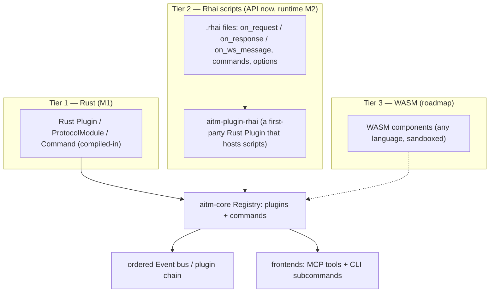

# aitmproxy plugin system design

**Status:** approved (2026-10-27 by Matt)
**Research inputs:** `docs/research/01-mitmproxy.md`, `docs/research/02-nuclei.md`, `docs/research/03-rust-proxy-stack.md`, `docs/research/05-synthesis.md`
**Companion specs:** platform — `docs/superpowers/specs/2026-10-27-aitmproxy-platform-design.md`; PoC language — `docs/superpowers/specs/2026-10-27-aitmproxy-poc-language-design.md`

## Intent

aitmproxy is agent-first, but Matt's guiding principle is that **everything must
also be human-readable, human-usable, and flexible.** For extensibility that
yields **two authoring tiers behind one plugin API**, not one:

1. **Rust plugins / protocol modules** — compiled-in, for performance-critical and
   first-party work. **Milestone 1.**
2. **Rhai scripting plugins** — human-writable, human-readable runtime scripts
   loaded **without recompiling the core**, modelled on mitmproxy's Python addons,
   for custom flows and light plugins. This is the human-usability/flexibility
   tier. The **plugin API is designed in M1 so this slots in**; the **Rhai runtime
   layer itself targets Milestone 2 (Architect's call — keep M1 lean)**, but the
   **script-facing API shape is decided now** so M1's core and the PoC language
   (which reuses this scripting surface) are built against it.
3. **WASM components** — a further-future option behind the same seam (any
   language, sandboxed). **Roadmap only, not committed.**

Both tiers share one event/command/flow model (the platform spec's), so a feature
is the same feature whether written in Rust or Rhai, and every plugin-registered
command is automatically a CLI subcommand and an MCP tool. This spec details that
shared model, the Rust tier (M1), and the decided Rhai script-facing API (runtime
in M2).

## Goals

- **One plugin API, two authoring tiers.** Rust and Rhai plugins register into the
  same `Registry`, receive the same `Event`s, and mutate the same `Flow`s.
- **Rust tier (M1):** first-party features (capture, replay, intercept, mutate,
  scope, rate-limit) are ordinary plugins — the first plugins in the chain, not
  core code — proving the seam by construction.
- **Rhai tier (API decided in M1, runtime in M2):** a person can drop a `.rhai`
  file next to a config line (or `--script foo.rhai`), with mitmproxy-style hooks
  (`on_request`/`on_response`/`on_ws_message`), register commands and options, and
  call host functions (log, http, browser, store/query) — no recompile.
- **Commands authored in either tier are first-class:** a Rhai-registered command
  appears in MCP `tools/list` and as a CLI subcommand exactly like a Rust one.
- **Sandboxed scripts:** Rhai runs with no ambient file/OS access, an operation/
  time budget, and all network/browser actions still routed through the scope,
  rate-limit, and SSRF guards.
- **A stable external-authoring contract** for both tiers, so third parties can
  ship plugins (and scripts) without forking the core.

## Non-goals

- The Rhai **runtime** is not built in M1 (only its API shape is fixed). M1 ships
  the Rust tier and the `Registry`/`Event`/`Command` seam it plugs into.
- No WASM runtime now (roadmap). No arbitrary native dynamic loading (`dlopen`
  of `.so`/`.dylib` plugins) — the two committed tiers are compiled-in Rust and
  sandboxed Rhai.
- No plugin marketplace, dependency resolver, or remote plugin fetching in M1/M2.
- Script **signing/validation** is deferred (aligned with PoC signing in the PoC
  spec); M1/M2 treat scripts as trusted-by-operator but sandboxed.
- This spec does not redefine the core types (`Plugin`, `ProtocolModule`,
  `Command`, `Event`, `FlowCtx`, `Registry`, `ParamSchema`, `FlowStore`,
  `CommandHost`) — they live in the platform spec and are referenced here.

## Anti-goals

- A second, divergent event or command model for scripts. If a Rhai hook sees a
  different flow shape or a script command cannot be an MCP tool, the "one model,
  two tiers" goal has failed.
- A scripting tier that forces core edits to add a hook or host function. New
  host functions and hooks must be additive behind the runtime plugin.
- An unsandboxed script tier: a script that can read the filesystem, spawn
  processes, bypass the scope/rate/SSRF guards, or wedge the proxy with an
  infinite loop is a security failure.
- A script API so different from the Rust traits (or from the PoC `script` step)
  that a person must learn three surfaces. One scripting surface, reused.
- Breaking the public trait surface or the script-facing API casually; external
  authors build on both.

## Constraints

- **Language/gate:** Rust; the workspace gate
  `cargo fmt --check && cargo clippy --all-targets -- -D warnings && cargo test`
  must pass. Rhai is the embedded scripting engine (Architect's call): pure-Rust,
  embeddable, memory-safe, natively sandboxable (operation limits, no I/O unless
  granted) — the right fit for an untrusted, human-authored tier, and it avoids
  pulling a JS/V8 runtime into the core. Confirmed by Matt (2026-10-27).
- **Performance:** the Rust tier carries performance-critical paths; scripts are
  for flexibility, not throughput. Script hooks run under an operation/time budget
  and must not stall the proxy (CPU-bound work is bounded and offloaded, mirroring
  mitmproxy's `@concurrent`).
- **One registration path:** both tiers register through the platform `Registry`
  (`add_plugin`, `add_command`); the ordered plugin chain and `Verdict::Halt`
  semantics are identical for both.
- **Security:** scripts are sandboxed; all `http`/`browser`/`store` host calls go
  through the same scope, rate-limit, and SSRF guards as Rust plugins and
  commands. No guard bypass is reachable from a script.
- **Stability:** the Rust trait surface and the script-facing API are versioned
  public contracts (see External-authoring stability policy).
- **Workflow:** every change travels the seven stages in `docs/superpowers/WORKFLOW.md`.

## Design

### One event/command/flow model, two authoring tiers

The platform spec already defines the seam both tiers use:

- **Events:** `Event` (`RequestHeaders`/`Request`/`ResponseHeaders`/`Response`/
  `WsStart`/`WsMessage`/`WsEnd`/`Error`), dispatched to the ordered plugin chain;
  a handler returns `Verdict::Continue | Halt`.
- **Handler context:** `FlowCtx` (read/mutate the flow, `set_response`,
  `intercept`/`resume`/`kill`/`backup`/`revert`).
- **Commands:** `Command` (`name`, `schema() -> ParamSchema`, `invoke`), registered
  into the `Registry`; MCP tool schemas derive from `ParamSchema`.
- **Services:** `CommandHost` / `ModuleCtx` (flow store, proxy client, browser,
  guards).

A **tier** is just a way to *author* a `Plugin` and its `Command`s. The Rust tier
authors them directly as Rust types. The Rhai tier authors them as script
functions that a single first-party Rust plugin — **`aitm-plugin-rhai`** — hosts
and bridges onto the exact same traits. Nothing downstream can tell which tier a
plugin or command came from.



### Tier 1 — Rust plugins and protocol modules (Milestone 1)

Uses the platform spec's `Plugin`, `ProtocolModule`, and `Command` traits verbatim
(not redefined here). What this spec pins down:

- **Event-hook surface.** A plugin implements `on_event(&mut self, ev: &Event,
  ctx: &mut FlowCtx)`; it matches on the `Event` variants it cares about. The full
  M1 hook set a plugin may observe: `RequestHeaders`, `Request`, `ResponseHeaders`,
  `Response`, `WsStart`, `WsMessage`, `WsEnd`, `Error`. (This mirrors mitmproxy's
  `requestheaders`/`request`/`responseheaders`/`response`/`websocket_*` hooks; the
  TCP/UDP/DNS/TLS hooks mitmproxy also has are future protocols behind the same
  `Event` enum, not M1.)
- **Registration & lifecycle.** `Plugin::load(&mut self, reg: &mut Registry)` is
  called once at startup; the plugin registers its **options** and **commands**
  there (the mitmproxy `load(loader)` pattern). Ordering in the chain is
  registration order; `Verdict::Halt` short-circuits. A plugin holds its own
  state across events (`&mut self`).
- **First-party features are the first plugins.** `capture`, `replay`,
  `intercept`, `mutate`, `scope`, `rate-limit` are each a `Plugin` registered
  ahead of third-party plugins — removing one from the registration list removes
  its behavior with **no core edit** (the proof the seam is real).
- **Protocol modules** are authored the same way via `ProtocolModule` (`id`,
  `matches(&NextLayerHint)`, `spawn`), so a new protocol is a new crate + a
  registration call. L4 is the roadmap example behind the same trait.
- **Options.** A plugin declares typed options at `load` (name, default,
  description), settable from config/CLI and readable at event time. (Exact
  `Registry` option API is a small addition the builder makes to the platform
  `Registry`; shape mirrors `ParamDef`.)

### Tier 2 — Rhai scripting plugins (API decided now; runtime is Milestone 2)

A **script** is a `.rhai` file whose top-level functions are hooks and lifecycle
callbacks, exactly paralleling a mitmproxy addon. `aitm-plugin-rhai` loads each
declared script, compiles it once, and for every `Event` calls the matching hook
function; script-registered commands and options are installed into the same
`Registry`.

**Script shape (the decided surface):**

```rhai
// --- optional metadata ---
const NAME = "header-tagger";
const API  = "1";                 // script-facing API version this file targets

// --- lifecycle: called once at load ---
fn load(reg) {
    reg.add_option("tag_value", "seen-by-aitm", "value for the X-Aitm header");
    reg.add_command("demo.ping", "replies pong", |args| { "pong" });
}

// --- event hooks (names mirror mitmproxy addons) ---
fn on_request(flow) {
    flow.request.set_header("X-Aitm", option("tag_value"));
}

fn on_response(flow) {
    if flow.response.status == 500 {
        flow.mark("server-error");
    }
}

fn on_ws_message(flow, msg) {
    if msg.direction == "c2s" && msg.text.contains("secret") {
        msg.drop();               // or msg.set_text("redacted")
    }
}
```

**Hook functions** (all optional; absent == no-op):

| Hook | Fires on `Event` | Arguments |
|---|---|---|
| `load(reg)` | startup | registration handle |
| `configure()` | after options change | — |
| `on_request_headers(flow)` | `RequestHeaders` | flow |
| `on_request(flow)` | `Request` | flow |
| `on_response_headers(flow)` | `ResponseHeaders` | flow |
| `on_response(flow)` | `Response` | flow |
| `on_ws_start(flow)` | `WsStart` | flow |
| `on_ws_message(flow, msg)` | `WsMessage` | flow, message |
| `on_ws_end(flow)` | `WsEnd` | flow |
| `on_error(flow, err)` | `Error` | flow, error |

A hook may return a verdict to halt the chain: returning `halt()` maps to
`Verdict::Halt`; returning nothing (or `continue()`) maps to `Verdict::Continue`.

**The flow object exposed to scripts** (a script-facing view over the Rust `Flow`;
getters read, setters mutate in place — the same mutation the Rust tier does):

```
flow.id                      -> string
flow.kind                    -> "http" | "ws"
flow.marks, flow.comment     -> array / string (settable)
flow.is_replay               -> bool

flow.request.method          -> string (settable)
flow.request.url             -> string (scheme://authority/path?query, settable)
flow.request.path            -> string (settable)
flow.request.headers         -> map-like: get(k), set(k,v), remove(k), has(k)
flow.request.body            -> string | bytes (get/set; set_json(obj))
flow.request.query           -> map-like over query params

flow.response.status         -> int (settable)
flow.response.headers        -> map-like
flow.response.body           -> string | bytes

// control
flow.set_response(status, headers, body)   // short-circuit before upstream
flow.intercept()  flow.resume()  flow.kill()
flow.backup()     flow.revert()
flow.mark(tag)

// websocket message object (on_ws_message)
msg.direction   -> "c2s" | "s2c"
msg.opcode      -> "text" | "binary" | "ping" | "pong" | "close"
msg.text        -> string (settable; set_text / set_bytes)
msg.data        -> bytes
msg.drop()      // do not forward this frame
```

**Host functions** (globals the runtime injects; identical surface reused by the
PoC `script` step):

```
log(msg)   log.info(msg)   log.warn(msg)   log.error(msg)

// active HTTP through the proxy's own client — scope/rate-gated, captured as a flow
http.send(#{ method, url, headers, body })  -> #{ status, headers, body, flow_id }

// embedded browser — scope + SSRF-gated
browser.navigate(url)   browser.click(selector_or_xy)   browser.type(selector, text)
browser.screenshot()    -> bytes (PNG)
browser.eval(expr)      -> value
browser.get_dom()       -> string

// flow store (read/correlate)
store.get(id)           -> flow view
store.query(#{ host, method, status, kind, is_replay })  -> array of flow views

// scope
scope.add(host)   scope.list()  -> array

// DSL / helpers (shared vocabulary with the PoC matcher DSL — see PoC spec)
b64_encode(s) b64_decode(s) url_encode(s) hex_encode(s) sha256(s) md5(s)
rand_text_alpha(n) rand_int(a,b) regex_match(pat, s) regex_extract(pat, s, group)

// options set at load
option(name)  -> value
```

**Declaring/loading a script.** Two equivalent paths, mirroring mitmproxy's `-s`:

- **Config:** a `scripts` list in `Config` (platform spec), each entry a path and
  optional per-script options:
  ```toml
  # aitmproxy config
  [[scripts]]
  path = "addons/header-tagger.rhai"
  options = { tag_value = "x" }
  ```
- **CLI:** `aitm --script addons/header-tagger.rhai` (repeatable).

Scripts load at startup; `aitm-plugin-rhai` compiles each, calls `load`, and
registers its commands/options. (Hot-reload on file change is a later nicety, not
required for M2.)

**Sandboxing (required for M2).**

- No ambient authority: Rhai starts with **no file, network, process, env, or
  clock access**. The only capabilities a script has are the injected host
  functions above.
- Every host function that touches the network or browser (`http.*`, `browser.*`)
  passes through the **same scope/rate-limit/SSRF guards** as Rust — a script
  cannot reach an out-of-scope or private host the guards would refuse.
- **Resource budget:** Rhai's `max_operations`, `max_call_levels`, `max_string_size`,
  and `max_array_size` are set to bounded defaults; a per-hook **wall-clock
  timeout** aborts a runaway hook with an `Error` event, never a proxy stall.
- Scripts are **untrusted content**: compiled in a fresh scope, with no access to
  other scripts' state except through the shared store/commands.

### Tier 3 — WASM components (roadmap, not committed)

The same `Plugin`/`Command` seam can later host a **WASM component host plugin**
(analogous to `aitm-plugin-rhai`) that loads sandboxed WASM modules written in any
language, bridging their exports onto `Event`/`Command`. Nothing in M1/M2
precludes it; it is explicitly not committed and not designed in detail here.

### External-authoring stability policy

- **Rust trait surface** (`Plugin`, `ProtocolModule`, `Command`, `ParamSchema`,
  `Event`, `FlowCtx`, `FlowStore`, `CommandHost`) is a **semver-stable public API**.
  Breaking it is a major-version event accompanied by migration notes; additive
  changes (new `Event` variants behind `#[non_exhaustive]`, new host services) are
  minor.
- **Script-facing API** (hook names, the flow object shape, host functions) is a
  **documented, versioned contract**. A script declares the `API` version it
  targets (`const API = "1"`); the runtime refuses or warns on a mismatch.
  Additive host functions and hooks are preferred; removals are versioned.
- **Both tiers are untrusted-authorable** → sandbox now (scripts), signing later
  (scripts and PoCs share the deferred signing mechanism).
- Changes to either contract travel the seven-stage workflow and are called out in
  the Security reviewer's report.

### How the two tiers share one model (summary)

- Same `Registry`, same ordered chain, same `Verdict` semantics.
- Same `Event` set; the Rhai hooks are a 1:1 naming of the `Event` variants.
- Same `Flow` (scripts get a view; Rust gets the type) and the same mutation verbs.
- Same `Command`/`ParamSchema` → a script command is an MCP tool and a CLI
  subcommand automatically.
- Same guards: scope, rate-limit, SSRF apply to script `http`/`browser` calls.
- Same scripting surface as the PoC `script` step (PoC spec), so one language is
  learned once.

## Worked examples (normative reference shapes)

These are **normative reference shapes**: implementers match these signatures and
the script-facing surface, and a plugin or script author copies them as a starting
point. The Rust examples (1–2) are Milestone 1; the Rhai examples (3–4) show the
decided M2 script surface. Each ends with a one-line note on what it demonstrates.
(The platform spec's trait definitions are authoritative for exact signatures;
these show how they are *used*.)

### Example 1 — complete Rust compiled-in plugin (M1)

A request tagger + response logger that also registers a command and is wired into
the builder.

```rust
use std::sync::Arc;
use aitm_core::{
    Plugin, Registry, Event, Flow, FlowCtx, Verdict,
    Command, ParamSchema, Params, Value, CommandHost,
};

/// Adds an `X-Aitm` header to every request and logs each response status.
pub struct Tagger {
    tag: String,
    counter: Arc<std::sync::atomic::AtomicU64>,
}

impl Tagger {
    pub fn new(tag: impl Into<String>) -> Self {
        Self { tag: tag.into(), counter: Arc::new(Default::default()) }
    }
}

impl Plugin for Tagger {
    fn name(&self) -> &str { "tagger" }

    fn load(&mut self, reg: &mut Registry) {
        // expose a command; it shares the same counter the hooks increment
        reg.add_command(Arc::new(StatsCmd { counter: self.counter.clone() }));
    }

    fn on_event(&mut self, ev: &Event, ctx: &mut FlowCtx<'_>) -> Verdict {
        match ev {
            Event::Request(_) => {
                if let Flow::Http(f) = ctx.flow_mut() {
                    f.request.headers.set("X-Aitm", &self.tag);   // mutate in place
                }
            }
            Event::Response(_) => {
                self.counter.fetch_add(1, std::sync::atomic::Ordering::Relaxed);
                if let Flow::Http(f) = ctx.flow() {
                    if let Some(resp) = &f.response {
                        log::info!("tagger: {} -> {}", f.request.path, resp.status);
                    }
                }
            }
            _ => {}
        }
        Verdict::Continue
    }
}

/// `tagger.stats` — how many responses the plugin has logged.
struct StatsCmd { counter: Arc<std::sync::atomic::AtomicU64> }

impl Command for StatsCmd {
    fn name(&self) -> &str { "tagger.stats" }
    fn schema(&self) -> ParamSchema {
        ParamSchema { description: "Responses logged by tagger".into(),
                      params: vec![], result: aitm_core::TypeDesc::Int }
    }
    fn invoke(&self, _args: Params, _host: &CommandHost) -> anyhow::Result<Value> {
        Ok(Value::Int(self.counter.load(std::sync::atomic::Ordering::Relaxed) as i64))
    }
}
```

```rust
// in the `aitm` binary: first-party plugins first, then third-party.
let proxy = aitm_core::Proxy::builder()
    .with_config(cfg.clone())
    .register_module(Arc::new(aitm_proto_http::HttpModule::new()))
    .register_module(Arc::new(aitm_proto_ws::WsModule::new()))
    // first-party feature plugins (capture, replay, intercept, mutate, scope, rate-limit) …
    .register_plugin(Box::new(Tagger::new("seen-by-aitm")))   // our plugin, last in the chain
    .build()?;
proxy.run(cfg.listen).await?;
```

Demonstrates: `name`/`load`/`on_event`, in-place request mutation and response
logging, a plugin-registered `Command` (auto-exposed over MCP/CLI), and builder
wiring with ordering.

### Example 2 — Rust `ProtocolModule` skeleton (M1 seam; the shape a new protocol author fills in)

```rust
use std::sync::Arc;
use aitm_plugin::{ProtocolModule, NextLayerHint, ModuleCtx, ByteStream};
use futures::future::BoxFuture;

/// A new protocol module. `matches` claims a connection; `spawn` drives a
/// sans-IO state machine that emits Flows/Events into the core.
pub struct FooModule;

impl ProtocolModule for FooModule {
    fn id(&self) -> &str { "foo" }

    fn matches(&self, hint: &NextLayerHint) -> bool {
        // claim by destination port and/or a protocol magic in the peeked bytes
        hint.dst.port() == 9999 && hint.first_bytes.starts_with(b"FOO")
    }

    fn spawn(&self, io: ByteStream, ctx: ModuleCtx) -> BoxFuture<'_, anyhow::Result<()>> {
        Box::pin(async move {
            // 1. build a sans-IO state machine (pure protocol logic, no sockets)
            // 2. read bytes from `io`, feed the machine, pull protocol events
            // 3. construct Flow(s): ctx.store().insert(flow)
            // 4. ctx.emit(Event::Request(id)).await -> honor the chain Verdict
            // 5. forward via ctx.connect_upstream(dst).await (scope/rate-gated)
            let _ = (io, ctx);
            Ok(())
        })
    }
}
// registered with `.register_module(Arc::new(FooModule))` — no aitm-core edit.
```

Demonstrates: the full `ProtocolModule` surface a contributor implements to add a
protocol in a new crate, registration-only, with no core change (the protocol seam).

### Example 3 — Rhai scripting plugin, same job (M2 tier)

Same request-tag + response-log behavior as Example 1, as a runtime script.

```rhai
// addons/tagger.rhai
const NAME = "tagger";
const API  = "1";                 // script-facing API version

fn load(reg) {
    reg.add_option("tag_value", "seen-by-aitm", "value for the X-Aitm header");
    reg.add_command("tagger.ping", "liveness check", |args| { "pong" });
}

fn on_request(flow) {
    // flow object: request.headers map-like + request.path getter
    flow.request.headers.set("X-Aitm", option("tag_value"));
}

fn on_response(flow) {
    // host API: log.info; flow.response.status getter
    log.info("tagger: " + flow.request.path + " -> " + flow.response.status);
}
```

```toml
# config stanza that loads it (equivalently: `aitm --script addons/tagger.rhai`)
[[scripts]]
path = "addons/tagger.rhai"
options = { tag_value = "seen-by-aitm" }
```

Demonstrates: the `load`/`on_request`/`on_response` hooks, the flow object shape
(`request.headers.set`, `request.path`, `response.status`), the host API
(`log.info`, `option`), command/option registration, and the config loader — the
human-usability tier reaching parity with the Rust plugin.

### Example 4 — Rhai custom-flow: conditional mutate-and-forward (M2 tier)

```rhai
// addons/guard-admin-writes.rhai — real control flow in a script.
const NAME = "guard-admin-writes";
const API  = "1";

fn on_request(flow) {
    // Short-circuit writes to /admin that lack a token: answer 403, don't forward.
    if flow.request.path.starts_with("/admin") && flow.request.method != "GET" {
        if !flow.request.headers.has("X-Admin-Token") {
            flow.set_response(403, #{ "Content-Type": "text/plain" }, "blocked by aitm");
            return halt();                     // Verdict::Halt — stop the chain
        }
        flow.request.headers.set("X-Reviewed", "aitm");   // else tag and continue
    }

    // Transparently re-home a legacy Host header before forwarding.
    if flow.request.headers.get("Host") == "old.internal" {
        flow.request.headers.set("Host", "new.internal");
        flow.mark("rehomed");
    }
}
```

Demonstrates: control flow in a script — conditional short-circuit via
`flow.set_response(...) + halt()`, conditional mutate-and-forward, and marking —
the flexibility tier for custom flows, using the same flow object and verdict
model as Rust.

## Acceptance criteria

Each is observable via `cargo test` (integration tests may register test plugins,
load test scripts, and stand up local servers). **AC-P1–AC-P5 are Milestone 1
(Rust tier). AC-P6–AC-P11 are Milestone 2 (Rhai runtime)** and are specified now
so M1 builds the seam to satisfy them.

1. **AC-P1 — Rust plugin receives ordered events + halt (M1):** Two registered
   Rust plugins receive `Request`/`Response`/`WsMessage` in registration order;
   the first returning `Verdict::Halt` stops propagation to the second. (Shares
   intent with platform AC4; this is the plugin-system-owned test.)
2. **AC-P2 — Plugin-registered command is first-class (M1):** A Rust plugin
   registers a command `demo.ping` in `load`; it appears in MCP `tools/list`, is
   invokable over MCP and over the CLI, and returns the same result (parity with
   platform AC7/AC8).
3. **AC-P3 — First-party features are removable plugins (M1):** Dropping the
   `mutate` plugin from the registration list disables mutation **without editing
   `aitm-core`** (asserted by the mutate behavior disappearing while capture still
   works).
4. **AC-P4 — Plugin options (M1):** A plugin declares an option at `load`; setting
   it via config/CLI changes observed behavior, and reading it at event time
   returns the set value.
5. **AC-P5 — Protocol module via the seam (M1):** A test `ProtocolModule` whose
   `matches` claims a toy protocol is driven by the core without any `aitm-core`
   change (registration-only), proving the protocol seam.
6. **AC-P6 — Script hook mutates a request (M2):** A `.rhai` script with
   `on_request` that adds a header causes the upstream echo server to receive it —
   script parity with platform AC5.
7. **AC-P7 — Script command is an MCP tool (M2):** A script registers
   `demo.ping` via `reg.add_command`; it appears in MCP `tools/list` and is
   invokable over MCP and CLI, indistinguishable from a Rust command.
8. **AC-P8 — Load without recompile (M2):** Adding a script via config or
   `--script` changes proxy behavior with no rebuild of the core binary.
9. **AC-P9 — Sandbox denies ambient authority (M2):** A script attempting a
   disallowed operation (file read, process spawn) fails with a clear sandbox
   error; the proxy keeps running.
10. **AC-P10 — Resource budget bounds a runaway (M2):** A script with an infinite
    loop in a hook is aborted by the operation/time budget and surfaces an `Error`
    event; the proxy does not stall or OOM.
11. **AC-P11 — Script network calls are guarded (M2):** A script `http.send` /
    `browser.navigate` to an out-of-scope or private/loopback host is refused by
    the same scope/SSRF guards as Rust (parity with platform AC12/AC16).

## Left to the builder

- The exact `Registry` option API (name/type/default), consistent with `ParamDef`.
- Rhai embedding details: the precise `max_operations`/timeout defaults, how the
  flow view and host functions are registered into the Rhai engine, and the
  bytes-vs-string body representation at the boundary.
- Whether `aitm-plugin-rhai` compiles each script once and caches the AST (yes,
  recommended) and the error surface for a script that fails to compile.
- The `Error`-event payload a timed-out/aborted script produces.
- Internal file layout of `aitm-plugin` and `aitm-plugin-rhai`.

## Open questions

*(Resolved. The scripting engine is **Rhai**, confirmed by Matt on 2026-10-27, for
both the plugin tier and the PoC `script` step. No questions remain.)*
