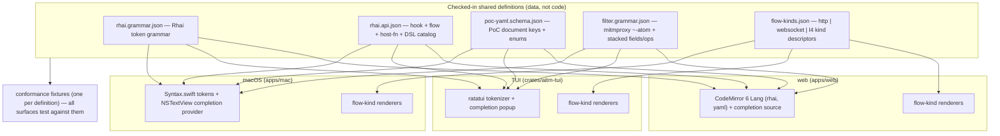

# Operator-UI scripting, highlighting & L4 design

**Status:** approved (2026-10-28 by Matt — "as drafted," so each open question is resolved to its proposed default; see Open questions). Design only; nothing here is built.
**Extends:** `docs/design/operator-ui-foundation.md` (the shared operator-UI foundation — this spec is an addition to it, consistent with its palette/type/components) and its companions `docs/design/tokens.json`, `docs/design/mockup/index.html`.
**Companion specs:** plugin system / Rhai — `docs/superpowers/specs/2026-10-27-aitmproxy-plugin-system-design.md`; PoC language — `docs/superpowers/specs/2026-10-27-aitmproxy-poc-language-design.md`; platform — `docs/superpowers/specs/2026-10-27-aitmproxy-platform-design.md`; L4 (M5) — `claude/m4-l4-spec-10eea7` branch.
**Surfaces:** the three human-operator UIs the foundation defines — macOS (SwiftUI/AppKit, `apps/mac`), web (SolidJS + CodeMirror 6, `apps/web`), TUI (Rust/ratatui, `crates/aitm-tui`). Each is an unmerged branch at writing (web PR #3, TUI PR #5, macOS in flight).

## Intent

The three operator UIs ship with the foundation's shell, flow list, inspector, and bus client, but three authoring/inspection capabilities are missing or stubbed, and each has been (or would be) solved three incompatible ways. This spec pins **one shared definition** for each, so all three surfaces behave identically and stay in lockstep with the Rust that backs them:

1. **Syntax highlighting + autocomplete** for the two languages an operator actually edits — **Rhai** (plugins, PoC `script` steps) and **PoC YAML** — in the **edit** path, not just read-only viewing, plus the mitmproxy-style **filter grammar** every surface already parses. Today Rhai highlighting is absent everywhere, PoC-YAML highlighting exists only in read-only viewers as per-surface hand-rolled colorizers (`apps/web/src/panels/findings/yaml.ts`, equivalents elsewhere), and autocomplete is absent for all of them.
2. **A real "add a plugin" UI** — a script editor that validates and reloads a Rhai plugin through the shipped M3 bus commands, so an operator authors and installs a plugin from the UI instead of hand-editing config and restarting. This also reconciles the macOS Scripts empty-state copy ("Drop a .rhai file into the proxy's scripts folder") with the shipped model, which is an explicit config `scripts:` list and has **no folder auto-scan**.
3. **L4 (packet) flow support** across all three surfaces, plus a single flow-kind model that gives **complete coverage of every flow type the product has** — HTTP, WebSocket (including the currently-gated frame display and send-frame), and L4 — so no surface silently renders only HTTP.

The unifying idea is the foundation's own: **one definition, three faces.** Just as `tokens.json` generates `Tokens.swift` / `tokens.css` / `tokens.rs`, each language and the flow-kind set get one checked-in definition that every surface realizes with its native machinery, and a shared conformance fixture proves the three stay identical.

## Goals

- **One shared language definition per language**, checked into the repo as data, from which each surface derives its highlighter and completion source — no three divergent hand-rolled grammars.
- **Rhai editing with highlighting + autocomplete** on all three surfaces: tokens by the foundation's five syntax colours; completion of Rhai keywords, the hook names, the flow object members, and the host API/DSL catalog drawn from the plugin-system spec.
- **PoC YAML editing with highlighting + schema-aware autocomplete** on all three surfaces: the YAML token set plus completion of PoC document keys and enum values (step types, matcher types, extractor types, severities).
- **One filter grammar** (the mitmproxy-style `~`-atom expression) shared by all three surfaces, so a filter string copies between surfaces and highlights identically — the portability rule the TUI team flagged.
- **An authorable Scripts panel**: edit → **Validate** (`script.validate`) → **Save & Reload** (`script.reload`), with inline positioned compile errors, a live script list with status/hooks/errors, and a corrected, truthful empty state.
- **L4 flows as first-class rows and inspector content** on every surface, plus a flow-kind abstraction that handles HTTP / WebSocket / L4 uniformly and feature-detects what the live bus can serve.
- **Honest degradation and honest gating**: a surface or platform that cannot do a thing (a terminal rendering a packet layer-tree, a web client validating unsaved source without a new bus param) shows what it is and names the core follow-up, never silently drops it.

## Non-goals

- **No new Rhai/PoC/L4 language semantics.** This spec defines how the UIs *present and complete* the languages the plugin-system, PoC, and M5 specs already define; it does not add keywords, hooks, host functions, PoC keys, or packet layers.
- **No full language server / type inference.** Completion is catalog- and context-driven (keyword, member-after-`.`, schema-key), not a semantic analyzer. No go-to-definition, no cross-file symbol resolution.
- **No in-UI execution of a plugin outside the proxy.** Validate compiles; Reload swaps hooks on the running proxy. There is no sandbox-in-the-editor preview run.
- **No L4 protocol engine work.** The L4 flow/packet/command model is M5's (`aitm-proto-l4`); this spec consumes it. Where M5 is not built, L4 UI is specified and marked **M5-gated**.
- **No change to `tokens.json`'s existing values.** New tokens this spec needs (an L4 badge hue, syntax-token completeness) are additive and flagged.
- This spec does not re-specify the foundation's shell, flow list, inspector chrome, or bus-connection handshake — it references them.

## Anti-goals

- **Three drifting grammars.** If the Rhai highlighter on one surface colours a keyword the others don't, or the completion catalog lists a host function the engine never registered, the "one definition" goal has failed. The catalog must be checkable against the shipped `register_fn` set.
- **Highlighting that dies on edit.** A viewer that colours YAML read-only and drops to plain text the moment the operator types is the current failure; the edit path must carry the same colours.
- **A filter string that means different things on different surfaces.** One grammar, one conformance fixture; no per-surface operator dialects.
- **A Scripts panel that lies.** An empty state that tells the operator to drop a file in a folder that is never scanned, or a Save button that silently fails to persist on a remote/web client, is worse than no panel.
- **An L4 inspector that invites misuse.** Craft/inject/intercept controls must carry the same scope-as-authorisation dimming/gating as every other mutating action, and the agent-facing path must be gated exactly like `ca.install`.
- **A surface that renders only HTTP.** Every list and inspector handles every flow kind or says, in place, why it cannot.

## Constraints

- **Consistency with the foundation.** Palette (§2.2), typography (§2.3 — the data face carries code; six-size scale), components (§2.7 — the Script editor, body viewers, filter bar, flow list, inspector), interaction rules (§2.8), and per-platform mapping (§2.9/§2.10) are binding. Syntax colour uses the foundation's `syntax.*` tokens (`key`/`string`/`number`/`boolean`/`punct`); colour goes on data, never chrome.
- **Bus contract.** Surfaces are bus clients (foundation §4). New capability means a new `Command` (a core follow-up), never a side channel. Surfaces feature-detect from `tools/list` and degrade when a command is absent (the foundation's adaptive rule).
- **Shipped M3 reality (verified on `origin/feat/aitmproxy-m3`).** The scripting bus surface is exactly `script.validate { path }`, `script.reload { name }`, and `findings.list { limit? }`. Scripts are declared in config `scripts:` (a YAML list of `{ path, options }`), plus `--script` and `AITM_SCRIPTS` (PATH-style). **There is no folder auto-scan, no `script.list`, no `script.save`, no `script.enable/disable`.** The registry is **sealed after build**: `script.reload` recompiles a *loaded* script and swaps its hooks live, but commands and options a script registers in `load(reg)` need a restart.
- **Rhai API catalog source of truth.** The hooks (`on_request_headers`/`on_request`/`on_response_headers`/`on_response`/`on_ws_start`/`on_ws_message`/`on_ws_end`/`on_error`, plus `load`/`configure`), the flow object shape, the host functions (`log[.info/.warn/.error]`, `http.send`, `browser.navigate/click/type/screenshot/eval/get_dom`, `store.get/query`, `scope.add/list/remove`, `option`, `sleep`, `finding`), the WS `msg` object, and the DSL helpers are defined by the plugin-system spec §"Host functions" / §"flow object" and confirmed against the shipped `register_fn` set.
- **Performance.** Highlighting and completion must hold the foundation's budgets: web 28px rows at 50/s and sub-16ms tab switches (CodeMirror 6 is already the body viewer); TUI one render pass per key; macOS no main-thread stall (tokenize off the editing hot path for large files). Completion popups open under one frame.
- **Security.** Script authoring writes code that runs sandboxed inside the proxy; the human operator authors freely, but any agent-facing (`Frontend::Mcp`) write/reload is gated by config (mirrors `ca.allow_agent_install`, `scope.allow_agent_widen`) and recorded in the activity log. L4 craft/inject/intercept inherit M5's deny-by-default `L4Guard` and the UI's scope-dimming.
- **Workflow.** Every change travels the seven stages in `docs/superpowers/WORKFLOW.md`. The core follow-ups this spec names (F8a–F8c, the L4 UI wiring) are each their own spec + plan.

## Design

### Overview — three shared definitions, one flow-kind model



The five definition files live under **`docs/design/languages/`** (a sibling of `tokens.json`), are the single source of truth, and are consumed by each surface's existing generation/loading path (web `scripts/gen-*.mjs`, TUI `build.rs`, macOS `tools/gen-*.swift`). A surface **never** hard-codes a keyword list, a host-function name, a PoC key, or a filter atom.

---

### Part 1 — Syntax highlighting + autocomplete (Rhai, PoC YAML, filters)

#### 1.1 The shared language-definition files

Each is plain data. The shapes below are **(Architect's call)** and left to the builder to finalize (exact JSON field names), but the *content* is fixed by the specs it mirrors.

**`rhai.grammar.json`** — a token grammar sufficient for colouring, not parsing:
- `keywords`: Rhai control words (`fn let const if else while loop for in return break continue switch` …) and the literals `true false ()`.
- `operators`, `punctuation`.
- lexical rules for `comment` (`//`, `/* */`), `string` (`"…"` with escapes, and Rhai's raw/interpolated forms), `number` (int/float/hex), `identifier`.
- `map_token`: each lexical class → one of the foundation's `syntax.*` tokens (`key`/`string`/`number`/`boolean`/`punct`) plus `comment` and `text`. (The foundation's `syntax` set gains an explicit **`comment`** and **`keyword`** token — additive to `tokens.json`; see §Constraints. Rhai keywords map to `keyword`, identifiers to `text`.)

**`rhai.api.json`** — the completion + hover catalog, the one that must not drift from the engine:
- `hooks`: the nine top-level hook functions and their arguments (`on_request(flow)`, `on_ws_message(flow, msg)`, `load(reg)`, `configure()` …), each with a one-line description → completed as snippets at top level.
- `flow`: the flow object members (`flow.id`, `flow.request.method`, `flow.request.headers` with its map-like `get/set/remove/has/keys`, `flow.response.status`, `flow.set_response`, `flow.intercept/resume/kill/backup/revert/mark` …) — completed after `flow.` / `flow.request.` / `flow.response.`.
- `msg`: the WS message object (`msg.direction`, `msg.opcode`, `msg.text`, `msg.data`, `msg.set_text`, `msg.set_bytes`, `msg.drop`) — completed after `msg.` inside `on_ws_message`.
- `globals`: `log` (+`.info/.warn/.error`), `http.send`, `browser.*`, `store.*`, `scope.*`, `option`, `sleep`, `finding` — each with signature and description.
- `dsl`: the shared helper vocabulary (`b64_encode/decode`, `url_encode`, `hex_encode`, `sha256`, `md5`, `hmac`, `rand_text_alpha`, `rand_int`, `regex_match/extract`, `contains`, `to_number` …).
- `api_version`: `"1"` — the `const API` a generated template stamps.

> **Drift guard (gate):** a test on `feat/aitmproxy-m3` (and wherever the engine lives after merge) asserts every `globals`/`flow`/`msg`/`dsl` entry in `rhai.api.json` corresponds to a real `register_fn`/registered member, and vice-versa, so the catalog cannot list a function the sandbox does not provide. (Architect's call; builder wires it into the Rust gate.)

**`poc-yaml.schema.json`** — the PoC document model as a key tree:
- top-level keys (`id`, `info`, `variables`, `steps`, `success`); `info` keys; `variables[]` keys; the three/four step shapes (`http`, `browser`, `extract`, `script`) and their fields; matcher types (`status`, `word`, `regex`, `size`, `binary`, `dsl`, `browser-eval`) and modifiers (`part`, `condition`, `negative`, `internal`, `name`); extractor types; enum values (`severity: info|low|medium|high|critical`, `from: body|header|all`, `matchers-condition: and|or`, browser `action` values).
- each key carries a description and, where it exists, the value enum → drives schema-aware completion (complete keys at the right nesting, complete enum values after a key).
- This is the UI-facing companion of the builder's validation `poc-schema` (PoC spec "Left to the builder"); if that JSON Schema ships first, `poc-yaml.schema.json` is generated from it rather than hand-kept.

**`filter.grammar.json`** — the one filter grammar (the TUI portability flag):
- `atoms`: the mitmproxy-style `~` operators, canonicalized from the TUI's shipped `filter.rs` and the foundation §2.7 field list: `~u` url, `~d` domain/host, `~m` method, `~s` status, `~h` header, `~b` body, `~q` query, `~c` content-type (`~t` alias), `~a` agent-origin, `~scope`, `~ws`, `~paused`, `~killed`, and (Part 3) `~l4`, `~tcp`, `~udp`, `~icmp` — each with argument kind and description.
- `combinators`: `& | ! ( )`; `bare word == ~u`.
- `stacked_fields` + `operators`: the GUI stacked-filter model (Field · Operator · Value; operators `contains/equals/wildcard/regex/jsonpath/full-text`) and the **documented bijection** to the `~`-atom text form, so the GUIs' "advanced view" is exactly the TUI's native expression.
- **Portability rule:** all three surfaces parse and highlight filters *only* from this file. A **conformance fixture** `filter.conformance.json` lists filter strings with their expected token spans and parsed AST; web (vitest), TUI (`cargo test`), and macOS (`swift test`) each assert their parser/highlighter matches it. A filter copied from one surface's bar into another's parses to the identical AST, by test.

#### 1.2 Per-surface realization

| | macOS (`apps/mac`) | web (`apps/web`) | TUI (`crates/aitm-tui`) |
|---|---|---|---|
| **Rhai highlight** | extend `AitmproxyKit/Syntax.swift` with a Rhai token set from `rhai.grammar.json`; render in the `NSTextView` code editor already used for paused-request raw edit | a CodeMirror 6 `LanguageSupport` for Rhai (a `StreamLanguage`/Lezer tokenizer generated from `rhai.grammar.json`); register as a new `Lang.rhai` in `apps/web/src/viewers/codemirror.ts` | a tokenizer in a new `src/syntax/` emitting `(SyntaxToken, span)`; mapped to `ratatui::Style` via the existing `theme.rs` token→style table |
| **PoC YAML highlight** | add a YAML token set to `Syntax.swift`; replaces the read-only hand-rolled colorizer in the Findings/PoC editor with one shared set used in view **and** edit | add `Lang.yaml` to `codemirror.ts`; **retire `apps/web/src/panels/findings/yaml.ts`** once `Lang.yaml` lands (its own header comment says "CodeMirror takes over once the viewers' `Lang` grows a `yaml`") | same tokenizer module, YAML rules; used by the Findings/PoC view and its edit buffer alike |
| **Autocomplete** | an `NSTextView` completion provider (completion controller) reading `rhai.api.json` / `poc-yaml.schema.json`; context = token-before-caret (`flow.` → members; top level → hooks; YAML key position → keys/enums) | CodeMirror 6 `autocompletion` with a completion source per `Lang`, reading the same catalogs; `@codemirror/autocomplete` popup styled with foundation tokens (radius 10, `floating` shadow, 160ms, keyboard open no-animate per §2.8) | a completion-popup overlay (new `src/ui/complete.rs`): a `floating`-style list anchored at the caret, `Tab`/`Enter` accept, `Esc` dismiss, `↑↓` move; candidates from the same catalogs |
| **Filter highlight/parse** | `FilterExpressionSyntax.swift` + `Filter.swift` pinned to `filter.grammar.json`; the stacked `FilterBar` ↔ advanced text uses the documented bijection | `apps/web/src/flows/FilterBar.tsx` parser/highlighter generated from `filter.grammar.json` | `src/filter.rs` is the canonical parser; its grammar is *generated from / checked against* `filter.grammar.json` so it is the shared definition, not a fourth dialect |

**Shared behaviour on every surface:**
- Highlighting is live in the **edit** buffer, not only the read-only viewer. Match-highlighting in body viewers (foundation §2.7) is unaffected.
- Completion triggers: on identifier typing, on `.` (member), on YAML key-position / after-`:` (enum), on `~` and field names (filter). Manual trigger: `⌃Space` (macOS/web), `Tab` (TUI).
- Unknown/odd input still renders (the colorizer is tolerant, not a validator) — the current `yaml.ts` tolerance behaviour is the standard.
- **Degradation:** none of this needs the network; it is all local to the surface. The TUI completion popup needs ≥ a few rows of height; below that it falls back to inline ghost-completion on `Tab` (accept-first-match). macOS/web are full.

---

### Part 2 — The "add a plugin" UI

#### 2.1 The install model (reconciled, decided)

**Decision (Architect's call):** the truth is the shipped config-list model, **not** a scanned folder. Scripts are explicit `scripts:` entries (path + options), loaded in chain order at startup; `script.reload { name }` swaps a loaded script's hooks live; new commands/options need a restart because the registry is sealed after build. The macOS empty-state copy "Drop a .rhai file into the proxy's scripts folder" is **wrong** and is corrected on all surfaces to describe authoring + the config list.

The foundation's Script editor (§2.7, modelled on Proxyman's) becomes authorable:

- **Left — Matching rule / metadata:** name, URL wildcard/regex, method, subpaths, flag; *Run on* ☑ Request ☑ Response ☐ WebSocket; status `● Saved and active` / `● Unsaved` / `● Error`. (Matching-rule-to-hook mapping is a convenience the editor writes into a template; a raw-Rhai author can ignore it.)
- **Centre — editor:** Rhai highlighting + autocomplete from Part 1, line numbers, a **New script** template that stamps `const NAME`, `const API = "1"`, and empty `on_request`/`on_response` stubs.
- **Right — console:** the script's log output and the last validate/reload result (the `{ name, api, hooks }` summary or the positioned compile error).
- **Bottom bar:** `Beautify · Snippets · Validate · Save & Reload ⌘S`.
- **Sidebar Scripts group:** the list of scripts with enable toggles, hooks, active/error status (foundation §2.6/§3.8).

#### 2.2 Wiring to the bus (what exists vs what it needs)

| Operator action | Shipped command (use now) | Gap → core follow-up |
|---|---|---|
| Validate the current file on disk | `script.validate { path }` → `{ name, api, hooks }` or positioned error | — (works for a server-side path) |
| Validate **unsaved editor content** (needed by web/remote, no disk) | — | **F8b**: add `script.validate { source }` variant (compile a string, read nothing from disk) |
| Reload a loaded script's hooks | `script.reload { name }` (failed recompile keeps previous; hooks only) | — |
| List installed scripts + status/hooks/errors | — (macOS fixtures already assume `script.list`) | **F8a**: `script.list {}` → `[{ name, path, api, hooks, enabled, last_error? }]` |
| Save a new/edited script to the server + register it | — | **F8b**: `script.save { name|path, source }` (write a `.rhai` into the configured `scripts.dir`, confined like `poc.dir`) + register as a `scripts:` entry |
| Enable/disable a script live | — | **F8c**: `script.enable { name }` / `script.disable { name }` |
| Activate a script that registers **new commands/options** | — (registry sealed) | documented limitation: a restart banner; optional future "hot command registration" (see Open questions) |

**Flow of "Save & Reload":**
1. If the bus lists `script.validate { source }` (F8b), the editor validates unsaved content continuously (debounced); otherwise it validates on the last-saved path only and shows a "validate needs save (F8b)" note on remote/web.
2. Save: a **loopback** surface with disk access may write the file directly and add the config entry; a **remote/web** surface **requires** `script.save` (F8b) and disables Save with "needs core F8b" until it is present.
3. Reload: `script.reload { name }` swaps hooks. If `script.validate` reported the file registers commands/options (its `hooks` summary plus a `registers` field F8b adds), show the **restart-to-activate** banner for those; hooks are live immediately.
4. The console shows the `{ name, api, hooks }` result; a compile error renders inline with a gutter marker at the positioned location (the error format `script.validate` already returns).

**Scripts list** uses `script.list` (F8a) when present; otherwise it shows the config-declared `scripts:` entries read from `config.get` (foundation F7) with status "declared (restart to see live state)", degrading honestly.

#### 2.3 Security / agent gating

- Human operators (`Frontend::Operator`) author, save, reload, enable/disable freely.
- The agent (`Frontend::Mcp`) is **denied** `script.save`/`script.reload`/`script.enable`/`script.disable` unless a config flag allows it (`scripts.allow_agent_authoring`, default **off** — mirrors `ca.allow_agent_install` and `scope.allow_agent_widen`). `script.validate` is read-only-ish (compiles, registers nothing, reads only `.rhai`) and may stay agent-allowed. Every authoring call appears in the activity log with the teal agent tick and, when gated, surfaces as a one-time approval request (foundation §2.7 Agent toggle).
- `script.save` writes are confined to the configured scripts dir (path-traversal rejected), exactly as `poc.artifact` confines reads.

---

### Part 3 — L4 flows and full flow coverage

#### 3.1 The flow-kind model

Define **`flow-kinds.json`**, a descriptor per kind that the list and inspector render against, so adding a kind is data + renderers, never a rewrite:

```
kind: "http" | "websocket" | "l4"
  badge:      { label, token }          // method/kind badge in the list
  list_cells: how URL/target, status, sizes map for this kind
  inspector:  which panes/viewers apply
  detail_cmd: how to fetch detail (flow.detail | l4.flow.get)
  realtime:   which subscription events apply (F4 / l4 capture stream)
```

| Kind | List row | Inspector | Detail source | State |
|---|---|---|---|---|
| **http** | method badge + URL + status + sizes (as today) | Request \| Response panes, all body viewers | `flow.detail` (F5) | shipped shell; bodies need F5 |
| **websocket** | `WS` badge (violet) + URL + `101` + frame count | handshake + **frame list** (dir, opcode, length, data, time, injected) + per-frame viewers (text/JSON/hex/protobuf) | `flow.detail.messages` (F5) | list shows row today; **frames need F5**; **send/inject needs F9** |
| **l4** | **L4 badge** + target (`iface cidr:port ↕dir`) + capture/craft/intercept state + packet count + injected count | **packet list** (dir, time, length, decoded summary, injected) + packet detail (**layer tree** + hex) + craft editor + in-path intercept controls | `l4.flow.get` (M5) | **entirely M5-gated** |

This makes the foundation's reserved intent concrete: the flow list and inspector iterate a `FlowKind` enum (`Http`, `WebSocket`, `L4`) with per-kind renderers, and a surface can never "only render HTTP" — an unknown/absent kind renders a labelled placeholder row, not nothing.

#### 3.2 L4 in the three surfaces (consistent with M5)

L4 is M5's `aitm-proto-l4`: capture + scapy-style craft + guard-gated inject, and (pulled into M5, decided by Matt 2026-10-28) **in-path packet interception** (NFQUEUE on Linux; macOS documented-limited). An `L4Flow { kind: CaptureSession | CraftSession | Intercept, bind, packets: [L4Packet], meta }`; an `L4Packet { dir, timestamp, bytes, decoded: PacketSummary, injected }`; a human-readable layered `PacketSpec { layers: [Ether|Ipv4|Ipv6|Tcp|Udp|Icmp|Raw] }` that is YAML-serializable and Rhai-expressible.

**Flow list & chips:**
- A new **L4 kind badge** (and, from `decoded`, a protocol sub-label `TCP`/`UDP`/`ICMP`). Palette: an L4 hue distinct from accent-blue, intercept-amber, agent-teal, and WS-magenta — **proposed slate/indigo** (Open question 1; palette is Matt's per foundation OQ1–2).
- Chip bar gains `L4` (and the filter atoms `~l4 ~tcp ~udp ~icmp` from `filter.grammar.json`).
- The `URL` column renders the L4 target (`en0 10.0.0.0/24:443 →`); Status renders the session state; Req/Resp sizes render packet counts; the SSL column is blank (n/a).
- **Scope-as-authorisation applies hardest here:** out-of-L4-scope sessions/packets are dimmed and every craft/inject/forward/drop action is disabled with the scope tooltip; the agent path is gated by M5's `L4Guard` + the config flags, surfaced like `ca.install`.

**Inspector:**
- **Packet list** mirrors the WS frame list component exactly (one shared "message/packet stream" list: dir, time, length, decoded one-line summary, injected tick).
- **Packet detail**: a **layer tree** (Ether → IPv4/6 → TCP/UDP/ICMP → Raw), reusing the JSON-tree component's fold/copy/path affordances over packet fields, plus the existing **hex viewer** for raw bytes. Malformed/forced values (the point of fuzzing) render as-is with a notice, never "corrected."
- **Craft editor**: the `PacketSpec` authored as human-friendly YAML (Part 1 YAML highlighting) or a Rhai `l4.craft(#{…})` call (Part 1 Rhai highlighting + the `l4.*` host-fn catalog, once M5 adds it to `rhai.api.json`); `build()` preview shows the resulting bytes in hex.
- **In-path intercept** reuses the HTTP intercept bar's mental model 1:1: a parked packet (`Intercepted` state) with **Forward** (resume, possibly mutated), **Mutate** (edit via `PacketSpec`/bytes), **Drop** (kill); bounded `intercept_timeout` with `on_timeout: Forward|Drop`. The amber intercept bar labels it a packet.

**Per-surface degradation (foundation §2.9/§2.10):**
- macOS / web: full — layer tree, hex, craft editor, intercept controls.
- TUI: full for text content (packet list, layer tree, hex, craft YAML/Rhai, intercept verbs); no images are involved, so no image degradation applies. Narrow-terminal rules (inspector full-screen < 120 cols) carry over.

**L4 commands the UI consumes (from M5, feature-detected in `tools/list`):** `l4.interfaces`, `l4.scope.add/list/remove`, `l4.capture.start/stop/status`, `l4.flow.list/get`, `l4.craft`, `l4.inject`, and the in-path verbs `l4.intercept.start/stop/status/list/mutate/forward/drop`. The UI's flow-kind abstraction feature-detects these and also accepts whichever flow-store model M5 ships — the unified core `Flow::L4` variant **or** M5's own `l4.flow.*` store — because it reads detail via the kind's `detail_cmd` indirection, not a hard-coded `flow.detail`.

#### 3.3 WebSocket completeness (closing the gated gaps)

The foundation already lists WS but gates two pieces; this spec pins their UI:
- **Frame display** (dir/opcode/length/data/time/injected + per-frame viewers) is the WS branch of the shared packet/frame-list component; it renders from `flow.detail.messages` and is **F5-gated** (no frames over the live bus until `flow.detail`; until then the inspector shows the handshake + "frames need core F5").
- **Send / inject / drop frame** is **F9-gated** (`ws.send { id, dir, opcode, data }`); the compose/inject controls render disabled with "needs core F9" until present. The scripted path (`on_ws_message` + `msg.drop()/set_text()`) already exists via M3 and is authored in the Scripts panel (Part 2).

---

### What depends on M5 (L4) being built first

| UI element | Depends on |
|---|---|
| Any L4 row, badge, chip, `~l4`/`~tcp`/`~udp`/`~icmp` filter atoms | M5 `l4.*` commands + L4 flow kind on the bus |
| L4 packet list / layer tree / hex / craft editor | M5 `l4.flow.get`, `l4.craft` |
| L4 inject controls | M5 `l4.inject` + `L4Guard` |
| L4 in-path intercept bar (Forward/Mutate/Drop) | M5 in-path (`l4.intercept.*`; Linux NFQUEUE / CAP_NET_ADMIN; macOS documented-limited) |
| `l4.*` in the Rhai completion catalog | M5 adding `l4.*` host fns → `rhai.api.json` |

Everything in **Part 1** (highlighting/autocomplete/filter grammar) and **Part 2** (add-a-plugin UI, against `script.validate`/`script.reload` plus the F8a–F8c follow-ups) is **independent of M5** and buildable now. The flow-kind model (§3.1) is buildable now with `l4` present-but-inert (renders the placeholder until M5 lands), so L4 drops in as data + renderers without a later rewrite.

### New / referenced core follow-ups

Extends the foundation's §5 F-list. New items are F8 sub-items (F8 = M3 scripting); L4 items are M5's.

| # | Follow-up | Unblocks | Size |
|---|---|---|---|
| **F8a** | `script.list {}` → `[{name, path, api, hooks, enabled, last_error?}]` | live Scripts panel list + status/errors | S |
| **F8b** | `script.validate { source }` variant + `script.save { name\|path, source }` (confined write) + a `registers` field in the validate result + `scripts.allow_agent_authoring` gate | authoring/validating from web/remote; the real "add a plugin" button | M |
| **F8c** | `script.enable { name }` / `script.disable { name }` | live enable toggle | S |
| **(M5)** | `l4.*` command set + L4 flow kind on the bus (unified `Flow::L4` or `l4.flow.*` store) + in-path `l4.intercept.*` | all of Part 3 | (M5) |
| **(F5)** | `flow.detail.messages` | WS frame display | (existing) |
| **(F9)** | `ws.send {id, dir, opcode, data}` | WS send/inject frame | (existing) |

## Acceptance criteria

Observable and testable on each surface's existing harness (web vitest + `shot.mjs`; TUI `cargo test` + `snapshot`; macOS `swift test` + `selftest.sh` + `snap.sh`) and the shared conformance fixtures. "All three surfaces" means a per-surface test for each.

1. **AC1 — Rhai highlighting in the edit path:** On all three surfaces, typing a Rhai script into the Scripts editor colours keywords, strings, numbers, comments, and punctuation by the foundation `syntax.*` tokens, live as the operator types (not only in a read-only view).
2. **AC2 — PoC YAML highlighting in the edit path:** On all three surfaces, the Findings/PoC YAML editor colours keys/strings/numbers/booleans/comments/structure in **edit** mode with the same token set used in view mode; the web surface no longer uses `panels/findings/yaml.ts` once `Lang.yaml` lands.
3. **AC3 — Rhai autocomplete from the catalog:** On all three surfaces, completion offers the nine hooks at top level, flow members after `flow.`/`flow.request.`/`flow.response.`, `msg` members after `msg.` inside `on_ws_message`, and the host globals/DSL helpers — all sourced from `rhai.api.json`.
4. **AC4 — PoC YAML schema completion:** On all three surfaces, completion offers PoC document keys at the correct nesting and enum values after the relevant key (e.g. `severity:` → the five severities; a step → `http|browser|extract|script`), sourced from `poc-yaml.schema.json`.
5. **AC5 — Catalog drift guard:** A gate test fails if `rhai.api.json` lists a host function/flow member the engine does not register, or omits one it does.
6. **AC6 — One filter grammar, proven portable:** All three surfaces parse and highlight filters from `filter.grammar.json`; each passes `filter.conformance.json` (a filter string → identical token spans + AST on every surface), so a filter copied between surfaces parses identically.
7. **AC7 — Validate surfaces a positioned error:** On all three surfaces, Validate on a script with a syntax error shows the positioned compile error (from `script.validate`) inline at its location; Validate on a good script shows `{ name, api, hooks }`.
8. **AC8 — Reload swaps hooks live:** With a loaded script, editing it and Save & Reload (`script.reload { name }`) changes observed proxy behaviour without a restart; a failed recompile keeps the previous version and shows the error (parity with the shipped command).
9. **AC9 — Truthful Scripts panel & empty state:** No surface's empty state refers to a scanned "scripts folder"; it describes authoring + the config `scripts:` list. The list shows each script's status/hooks (live via `script.list` when present, else config-declared with an honest "restart to see live state" note).
10. **AC10 — Restart-to-activate is explicit:** A script that registers a new command/option shows the restart banner for those, while its hooks reload live — the registry-sealed limitation is surfaced, not silently swallowed.
11. **AC11 — Agent authoring is gated:** With `scripts.allow_agent_authoring` off (default), an agent (`Frontend::Mcp`) `script.save`/`reload`/`enable`/`disable` is refused and shown as a gated request in the activity log; a human operator's is allowed.
12. **AC12 — Every flow kind renders:** On all three surfaces, HTTP, WebSocket, and L4 rows each render their kind badge and open a kind-appropriate inspector; an unknown/absent kind renders a labelled placeholder row, never an empty one.
13. **AC13 — L4 inspector (M5-gated):** With the L4 bus present (M5 or fixture), an L4 flow shows the packet list, a packet's layer tree + hex, the craft editor (YAML/Rhai highlighted), and in-path Forward/Mutate/Drop controls; out-of-L4-scope packets are dimmed and their mutating actions disabled.
14. **AC14 — WS gated pieces are honest:** The WS inspector shows frames when `flow.detail` (F5) is present and "needs core F5" otherwise; send/inject-frame controls are disabled with "needs core F9" until `ws.send` is present.
15. **AC15 — Consistency with the foundation:** Completion popups, the editor, the L4 badge, and the packet/craft viewers use the foundation's tokens, type scale, radii, shadows, and motion rules (keyboard-triggered actions do not animate); verified in each surface's snapshot review.

## Left to the builder

- Exact JSON field names and file layout under `docs/design/languages/`, and whether `poc-yaml.schema.json` is generated from the builder's validation `poc-schema` or hand-kept until it exists.
- The CodeMirror 6 Rhai language implementation choice (hand-written `StreamLanguage` tokenizer vs a Lezer grammar) and the TUI tokenizer's incremental strategy for large buffers.
- The macOS `NSTextView` completion-controller details and how tokenization is kept off the main-thread hot path for large files.
- The debounce interval for continuous validation and the exact inline-error presentation (gutter marker vs underline) per surface, within the foundation's component rules.
- The snippet set shipped with the Scripts editor "Snippets" action.
- The precise shapes of the F8a–F8c commands are fixed in their own specs; this spec fixes what the UI needs from them.
- Whether the L4 craft editor defaults to YAML or Rhai, and the packet-layer tree's field labels (from M5's `PacketSummary`).

## Open questions

Resolved at approval (2026-10-28, Matt approved "as drafted" → each proposed default accepted):

1. **L4 badge hue** → **slate/indigo** `color.l4.*` added to `tokens.json` (light/dark + TUI ANSI), with `TCP`/`UDP`/`ICMP` as sub-labels in that one hue. (Revisit if the hue clashes once rendered.)
2. **Agent authoring gate default** → `scripts.allow_agent_authoring` **off** by default (agent cannot save/reload/enable/disable scripts; `script.validate` stays agent-allowed); humans author freely.
3. **Registry-sealed limitation** → **accepted**: `script.reload` swaps hooks live; new commands/options need a restart (surfaced via the restart banner). "Hot command registration" is **deferred**, not a committed follow-up.
4. **Filter vocabulary** → **confirmed**: `~l4 ~tcp ~udp ~icmp` atoms and an `L4` chip join the shared `filter.grammar.json` and the conformance fixture.
