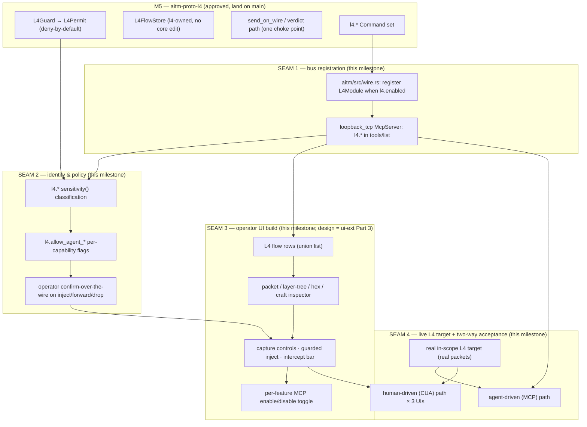
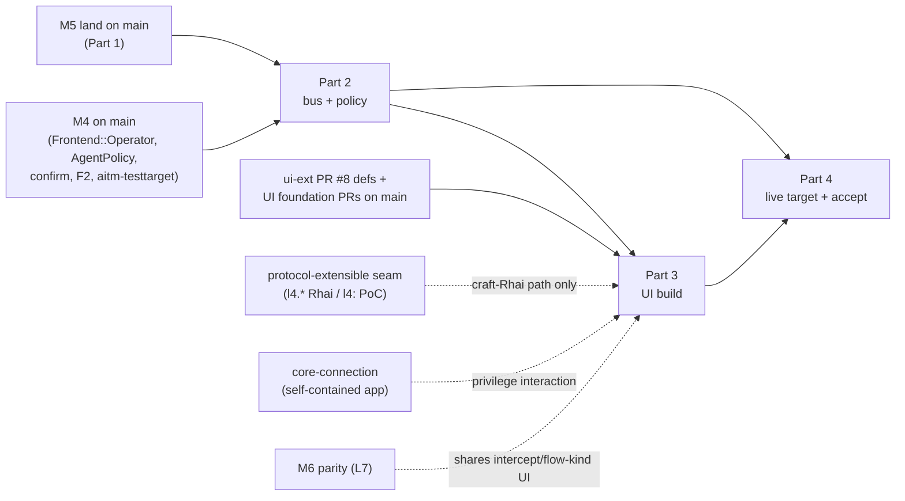

# L4 operator surfaces design

**Status:** approved (2026-10-28 by Matt — all seven open questions resolved; see **Resolved decisions**). The milestone is **two-phased**: **Phase 1** (CLI/Linux-first live-wire L4 + bus + the three UI surfaces + the live target + two-way testing) and **Phase 2** (the macOS Network/System Extension capture path). Design only; nothing here is built.
**Research inputs:** `docs/research/08-l4-packet-rust.md`, `docs/research/09-l4-inpath-interception.md`, `docs/research/05-synthesis.md`. **Phase 2 needs a new research note** (`docs/research/10-macos-network-extension.md`) before its plan — see **Resolved decisions** OQ1.
**Composes (does not re-specify) three approved specs:**
- **L4 engine (M5):** `docs/superpowers/specs/2026-10-27-aitmproxy-m5-l4-packet-mitm-design.md` (M5-AC1–AC21; plan `docs/superpowers/plans/2026-10-28-aitmproxy-m5-l4-packet-mitm-plan.md`, branch `feat/aitmproxy-m5`). Owns `aitm-proto-l4`, `L4Guard`/`L4Permit`, `L4FlowStore`, the `l4.*` command set, the NFQUEUE in-path backend.
- **L4 operator UI (ui-scripting-highlight-l4 Part 3):** `docs/superpowers/specs/2026-10-27-aitmproxy-ui-scripting-highlight-l4-design.md` (AC12/AC13 and §3.1–3.2). Owns the visual design of the L4 flow row, packet/layer/hex inspector, craft editor, intercept bar, scope-dimming, the `FlowKind` model and `flow-kinds.json`.
- **Agent identity & policy (M4):** `docs/superpowers/specs/2026-10-27-aitmproxy-m4-agent-milestone-design.md`. Owns `Frontend::Operator`, `AgentPolicy{All,Auto,Ask,ReadOnly,Paused}`, `Command::sensitivity(){Read,Write,Sensitive}`, confirm-over-the-wire, the F2 activity log, and `aitm-testtarget`.
- **Coordinates with (does not build):** the protocol-extensible languages seam — `docs/superpowers/specs/2026-10-28-aitmproxy-protocol-extensible-languages-design.md` — which owns the `l4.*` Rhai host namespace and the native `l4:` PoC step.

## Intent

M5 built the raw-L4 / packet-MITM engine (`aitm-proto-l4`: scoped **capture**, scapy-style **craft**, guard-gated **inject**, **send-and-receive**, and Linux **in-path interception**) behind a deny-by-default `L4Guard` that mints an unforgeable `L4Permit`, with one `send_on_wire` choke point and an l4-owned `L4FlowStore`. It is green at the crate level on `feat/aitmproxy-m5` but it is **invisible to operators**: it is not merged, it is not registered on the running core's command bus, and the three operator UIs (macOS, web, TUI) render only HTTP and WebSocket. L4 today is a library with tests, not a capability anyone can drive.

This milestone makes L4 **operator-drivable and provable end to end**. It (1) lands M5 on `main` with its remaining wiring and exit gate done; (2) registers the `l4.*` command surface on the live loopback-TCP bus under the M4 identity/policy model, so both agents (MCP) and the UIs drive capture / craft / inject / send_recv / intercept by feature detection; (3) builds the already-designed L4 surfaces in all three UIs, surfacing guard/scope/permit state and the operator confirmation the dangerous paths require; and (4) proves the whole stack against a **real in-scope L4 target with real packets**, two ways — agent-driven over MCP and human-driven (CUA) in each UI — the same bar M4 held for the HTTP surfaces. Deny-by-default is preserved at every new layer: no UI control and no bus command can aim craft/inject/intercept at an out-of-scope target or write to the wire without an `L4Permit`.

This is an **integration milestone**. The L4 engine, the L4 UI look-and-feel, and the `l4.*` scripting vocabulary are each already designed and approved elsewhere; this spec does not re-design them. It designs the seams **between** them that no prior spec owns: bus registration, sensitivity/policy classification, the operator-confirmation and per-feature agent-gate surfacing, the live L4 test target, and the two-way acceptance bar.

## Goals

- **M5 on `main`.** `feat/aitmproxy-m5` Tasks 10 (active wire commands), 12 (in-path commands), 13 (binary wiring) and 15 (exit gate) are complete; the full Rust gate is green; the Stage-6 panel passes; the branch merges with no open findings and no `aitm-core` edits.
- **`l4.*` live on the bus.** A running `aitm` core with `l4.enabled: true` advertises the `l4.*` commands in `tools/list` over the loopback-TCP MCP bus, so an MCP agent and all three UIs reach capture/craft/inject/send_recv/intercept. Read-only and pure commands work regardless of host privilege; wire-touching commands return a typed `L4Unavailable { reason }` when privilege is absent — never silence, never a panic.
- **Policy-classified.** Every `l4.*` command declares an M4 `sensitivity()`; the wire-writing and scope-widening verbs are `Sensitive`; the agent path is gated by **both** `AgentPolicy` **and** a per-capability `l4.allow_agent_*` flag (default off), exactly like `ca.allow_agent_install` / `scope.allow_agent_widen`.
- **L4 surfaces in all three UIs.** Each surface renders L4 flows in the unified flow list, a packet/craft/layer-tree/hex inspector, capture controls, and guarded inject with the operator confirmation the `L4Guard` path requires; where available, the in-path intercept bar (Forward / Mutate / Drop). Cross-UI parity per the operator-UI foundation; each surface exposes a **per-feature MCP enable/disable toggle** reflecting the `l4.allow_agent_*` gates.
- **Surfaces never bypass the guard.** The UI reaches the wire only through the same guard-gated `l4.*` commands the agent uses; it surfaces scope / guard / permit state (out-of-scope sessions and packets dimmed, mutating actions disabled with the scope reason); there is no UI side channel to `send_on_wire`.
- **Proven on real packets, two ways.** A real in-scope L4 target (an L4 extension of `aitm-testtarget`, or a dedicated target) is driven with real packets both agent-driven (MCP) and human-driven (CUA) in each UI; a deterministic CI path proves the agent side where privilege exists.
- **Security gate.** A Stage-6 security review is **mandatory** for this milestone with extra scrutiny on the inject / craft / send / intercept paths; it verifies the guard, scope model and one-choke-point invariant survive the new bus and UI layers.

## Non-goals

- **No L4 engine redesign.** The packet model, `L4Guard`, `L4Permit`, `L4FlowStore`, the NFQUEUE backend, and the `l4.*` command semantics are M5's and are consumed as-is. A gap found here is reported to the M5 owners, not patched in place.
- **No L4 UI redesign.** The visual design of the L4 row, inspector, craft editor and intercept bar is ui-scripting-highlight-l4 Part 3's; this milestone builds it, it does not restyle it or add packet layers.
- **No `l4.*` scripting work.** The `l4.*` Rhai host namespace and the native `l4:` PoC step belong to the protocol-extensible seam. This milestone depends on and coordinates with that work; it does not build it. The UI craft editor's **YAML** path and the **command-bus** inject path do not depend on it; only the craft editor's **Rhai** authoring path and the Rhai completion catalog do.
- **No macOS in-path interception engine.** Per M5, in-path is Linux-NFQUEUE only; macOS reports `L4Unavailable`. This milestone does not add a macOS in-path backend.
- **No privileged-helper build.** Running raw L4 on a user-level core (e.g. the self-contained macOS app's embedded core) via a privilege-separated helper is named as a future direction and an open decision, not built here.
- **No new L4 protocol semantics,** no L7 stream reassembly, no detection-evasion tooling, no DoS primitive. The rate caps and bounded counts M5 ships are preserved.

## Anti-goals

- **A UI that can aim L4 at an out-of-scope or non-consented target.** If any surface can craft-and-inject, send, or forward a mangled packet toward a destination the `L4Guard` would refuse, the milestone has failed. The UI must be refused by the *same* guard the agent is.
- **A wire write without a permit.** If the UI (or a new bus adapter) reaches a code path that writes to the wire without an `L4Permit` minted by `L4Guard::check`, the one-choke-point invariant (M5-AC21) is broken.
- **L4 on `main` with core edits or a weakened guard.** M5-AC19 (no `aitm-core` edits) and the deny-by-default posture must hold through landing; the integration must not relax them to make wiring easier.
- **An agent that self-grants.** If an agent can flip an `l4.allow_agent_*` flag, change `AgentPolicy`, or widen L4 scope without operator authorization, the gate is theatre.
- **An unclassified L4 command on the bus.** A command reaching the bus without a `sensitivity()` (so the fail-closed `Sensitive` default does not apply) is a policy hole.
- **"Green tests and screenshots" acceptance.** Synthetic buffers, mocked backends, or a screenshot of an L4 row are not the bar. The bar is real packets, on a real interface, against a real in-scope target, driven both ways.

## Constraints

- **No `aitm-core` edits (M5-AC19).** L4 flows live in the l4-owned `L4FlowStore`; the UI reads L4 detail through the `FlowKind`'s `detail_cmd` / `list_cmd` indirection (`l4.flow.list` / `l4.flow.get`), never a hard-coded `flow.detail`. The flow list is a **union** of `flow.list` (http/ws) and `l4.flow.list` (l4), per the ui-ext `flow-kinds.json` amendment.
- **`forbid(unsafe_code)`** in `aitm-proto-l4`; `unsafe` stays inside `pcap`/`nfq`. Any `unsafe` reached while wiring requires a `// SAFETY:` comment and a signed-off Security-reviewer entry.
- **Deny-by-default + one choke point.** Nothing captures / injects / intercepts without a matching scope entry; `send_on_wire` and the mangling-verdict path both require an `L4Permit` by type (M5-AC21). The bus and UI add layers *above* the guard, never a path around it.
- **Fail-closed privilege.** `l4.enabled` defaults false. Missing privilege / libpcap / NFQUEUE / an unsupported OS yields a typed `L4Unavailable`, never a panic. In-path additionally needs `CAP_NET_ADMIN`; capture/inject need `CAP_NET_RAW` (Linux) or `/dev/bpf` (macOS).
- **M4 identity & policy.** Per-connection `Frontend::Operator` vs `Frontend::Mcp`; `AgentPolicy{All,Auto,Ask,ReadOnly,Paused}` against `Command::sensitivity()`; two independent gate dimensions (policy **and** per-capability flag, both must pass). Operator `Sensitive` actions use the confirm-over-the-wire two-phase handshake (`needs_confirmation` + `confirm_token`, reserved `_confirm` arg). **M4 must be on `main` for this layer to exist (hard prerequisite).**
- **Operator-UI foundation.** Palette / type / components / interaction rules are binding; the L4 badge hue is slate/indigo (`color.l4.*`, ui-ext OQ1 default); surfaces feature-detect from `tools/list` and degrade honestly; colour goes on data, never chrome.
- **Cross-UI parity.** One behaviour, three faces; the three surfaces consume the shared `flow-kinds.json` and L4 descriptors from ui-ext PR #8; a shared conformance fixture proves they stay identical.
- **Workflow.** Every change travels the seven stages in `docs/superpowers/WORKFLOW.md`. The Rust gate (`cargo fmt --check && cargo clippy --all-targets -- -D warnings && cargo test`) passes before any review. git/gh and the macOS build run through the Terminal panel only.

## Design

### Overview — three approved pieces, four new seams

The four seams are the whole of this milestone's new design. Everything inside the `Engine`, the UI look, and the `l4.*` scripting vocabulary is referenced, not re-decided.

#### Phasing (Matt, 2026-10-28)

- **Phase 1 — CLI/Linux-first live-wire L4.** Land M5; register `l4.*` on the bus; build the three UI surfaces and the policy seam; add the live `aitm-testtarget` L4 service; prove it two ways on real packets. Live-wire L4 (raw capture/inject via `CAP_NET_RAW`/`/dev/bpf`; in-path via Linux NFQUEUE/`CAP_NET_ADMIN`) runs on a **privileged CLI core** (Linux in CI and for the in-path path). The macOS app renders every L4 surface and drives a privileged core over the bus, but **its own embedded user-level core reports `L4Unavailable`** for the wire verbs. This is the whole of this spec's buildable milestone.
- **Phase 2 — the macOS capture path, the Proxyman way.** A macOS **Network/System Extension** (an `NETransparentProxyProvider`-class provider — transparent-proxy / packet-tunnel / content-filter, with user approval at the OS level) feeds the core's capture path so the self-contained macOS app does live L4 **without** manual proxy config and **without** a bare privileged helper. This is its own meaty design area (§Part 7) and gets its own research note and plan before it is built.

#### Design principle — one capture path, all protocols (Matt, 2026-10-28)

The core and the macOS Network Extension are **protocol-general**. HTTP, WebSocket, L4, and every future protocol enter the core through the **same capture hook** and are governed by the **same deny-by-default guards**, aligned with the protocol-extensibility seam. Matt: *"Proxyman has interesting plugins that hook themselves / a network extension — we should do the same, and support the core with all protocols."* Concretely: the macOS extension (Phase 2) is **not** an L4-only shim bolted onto `aitm-proto-l4`; it is a general ingress that hands captured traffic to the core, which dispatches by protocol (HTTP/WS via the existing `ProtocolModule` acceptor seam; L4 via the `aitm-proto-l4` capture path) behind each protocol's guard (`ScopeRateGuard` for L7, `L4Guard` for L4). Phase 1 must not shape the capture path in a way that assumes a single protocol, so Phase 2 drops in without a rewrite. **(Architect's call — the Phase-1 capture/ingress abstraction is designed protocol-general from the start, even though Phase 1 only lights up the Linux/CLI L4 path.)**

---

### Part 1 — Land M5 on `main`

M5 is green at the crate level; the remaining work is the wiring that connects the crate to a running proxy plus the exit gate. This milestone **finishes those M5 tasks under M5's own plan and acceptance criteria** (it does not restate them) and adds the bus-registration refinement below.

**Remaining M5 tasks (owned here, completed to M5's ACs):**

- **Task 10 — active wire commands** (`l4.capture.*`, `l4.inject`, `l4.send_recv`): each composes `L4Guard::check` with the core `ScopeRateGuard::check_active` for defense in depth. Satisfies M5-AC1/2/9/10/11.
- **Task 12 — in-path commands** (`l4.intercept.start/stop/status/list/mutate/revert/forward/drop`): mirror `flow.*`; the Intercept capability is gated; out-of-scope packets auto-forward untouched. Satisfies M5-AC12/13 and AC3(Intercept).
- **Task 13 — binary wiring + config plumbing** (see Part 2 for the registration decision). Satisfies M5-AC17/19.
- **Task 15 — exit / integration tests + hard-gate checks**: the scoped-loopback active round-trip + `send_recv`; Linux-gated in-path mutate-forward + drop; the `core_untouched` git check (AC19); the `no_unsafe` check (AC20); the `one_choke_point` structural check (AC21). Satisfies the M5 exit gate.

**Coordination note on M5 Task 14 (Rhai `l4.*`):** M5's plan Task 14 registers `l4.*` host functions hard-coded in `aitm-plugin-rhai`. The protocol-extensible seam **supersedes** this: `l4.*` Rhai (and the native `l4:` PoC step) are registered *from `aitm-proto-l4` through the seam's `ScriptHostRegistry`*, not hard-coded. **(Architect's call)** Task 14 is **not** completed as written under M5; it is delivered by the protocol-extensible seam. Landing M5 on `main` does **not** require Task 14 — the bus/MCP/UI paths in this milestone depend only on the `l4.*` **commands** (Tasks 10/12), which do not route through Rhai. This is the "coordinate, don't duplicate" resolution: one owner for the `l4.*` scripting vocabulary (the seam), one owner for the `l4.*` command bus surface (M5 + this milestone).

**Landing criteria:** the full Rust gate green with the privilege-gated suites run where privilege exists; the Stage-6 panel (security, quality, spec) passes with no open findings; `git diff` under `aitm-core/` empty; then merge via `superpowers:finishing-a-development-branch`.

---

### Part 2 — Bus registration, identity, and policy

#### 2.1 Registering `l4.*` on the live bus

The running core builds its command set in `aitm/src/wire.rs` (`register_module` / `register_plugin` into the `Registry`); the loopback-TCP `McpServer` serves that `Registry`, so every registered `Command` appears in `tools/list` and is reachable by MCP agents and the UIs. L4 is **command-driven** (M5's seam call): it registers as a `Plugin` (`L4Module::load`), not a `ProtocolModule`.

**Registration rule (Architect's call — this is the concrete shape of M5 Task 13):**

- **`l4.enabled: false` (default):** `L4Module` is **not** constructed; no `l4.*` in `tools/list`. The UIs feature-detect absence and render the L4 flow-kind as a labelled, inert placeholder (ui-ext §3.1). This is the zero-footprint default.
- **`l4.enabled: true`, privilege present:** `L4Module` is constructed and `register_plugin`'d; the **full** `l4.*` surface is advertised and live.
- **`l4.enabled: true`, privilege absent:** `L4Module` is **still** constructed and registered, so the operator who opted in sees an honest, drivable surface — but the wire-touching commands (`l4.capture.*`, `l4.inject`, `l4.send_recv`, `l4.intercept.*`) return a typed `L4Unavailable { reason }` at call time naming the missing capability (e.g. "needs CAP_NET_RAW" / "needs CAP_NET_ADMIN" / "no /dev/bpf access"). The pure / read-only commands (`l4.interfaces`, `l4.scope.*`, `l4.flow.*`, `l4.craft`) work regardless.

**Why register even without privilege:** the brief requires operators to be able to *drive and understand* L4. A silently-absent surface cannot tell the operator "L4 is on but your core lacks privilege — run elevated or grant `CAP_NET_RAW`." Registering the surface and failing each wire call with a typed reason turns an invisible dead-end into an honest, remediable state the UI renders in place. The deny-by-default posture is unaffected: an unprivileged core still writes nothing to any wire. **This refines M5 Task 13's "construct only when privilege present" to "construct when enabled; fail wire calls closed when unprivileged"; flagged to the M5 owners as the adopted Task 13 behaviour.**

The core probes privilege once at startup (a cheap capability check, not an actual raw-socket open against a target) and caches the result into the module so each command returns the specific missing-capability reason without re-probing.

#### 2.2 Sensitivity classification (new; aligns M5 commands to M4)

Every `l4.*` command declares `Command::sensitivity()`. The classification follows M4's rule: a command that can **write to the wire, drop/alter live traffic, or widen authority** is `Sensitive`; a mutation with no wire effect is `Write`; a pure read is `Read`. Fail-closed: any command without an explicit classification defaults to `Sensitive`.

| Command | sensitivity() | Rationale |
|---|---|---|
| `l4.interfaces` | **Read** | enumerates local interfaces; no target contact |
| `l4.scope.list` / `l4.flow.list` / `l4.flow.get` | **Read** | reads l4-owned state |
| `l4.capture.status` / `l4.intercept.status` / `l4.intercept.list` | **Read** | reads session/parked state |
| `l4.craft` | **Read** | pure `PacketSpec::build`; no wire, no privilege (produces bytes/summary only) |
| `l4.scope.remove` | **Write** | narrows authority; mutating but safe-ward |
| `l4.capture.stop` / `l4.intercept.stop` | **Write** | stops a session the operator started |
| `l4.intercept.revert` | **Write** | restores a parked packet's backup; no new wire write |
| **`l4.scope.add`** | **Sensitive** | **widens L4 authority** — gated like `scope.add` |
| **`l4.capture.start`** | **Sensitive** | promiscuous/privileged capture; stronger than L7 passive |
| **`l4.inject`** | **Sensitive** | writes packets to the wire |
| **`l4.send_recv`** | **Sensitive** | writes a stimulus packet to the wire |
| **`l4.intercept.start`** | **Sensitive** | binds the NFQUEUE and can hold live traffic |
| **`l4.intercept.mutate`** | **Sensitive** | alters a parked live packet's bytes |
| **`l4.intercept.forward`** | **Sensitive** | releases a (possibly mangled) packet to the wire |
| **`l4.intercept.drop`** | **Sensitive** | drops live traffic |

**(Architect's call)** `l4.craft` is `Read`, not `Write`: it is M5's pure, sans-IO, size-capped `build()` with no side effect on the wire and no flow-store mutation on its own (the UI pairs a craft preview with an explicit inject). If M5 ships `l4.craft` as creating a persistent `CraftSession` flow, it reclassifies to `Write`; the panel review verifies which.

#### 2.3 Per-capability agent gates (new config flags)

Mirroring `ca.allow_agent_install`, `scope.allow_agent_widen` and `scripts.allow_agent_authoring`, this milestone adds per-capability flags under the `l4:` config section, **all default off**:

- **`l4.allow_agent_inject`** — gates agent (`Frontend::Mcp`) `l4.inject` and `l4.send_recv` (the send side).
- **`l4.allow_agent_capture`** — gates agent `l4.capture.start`.
- **`l4.allow_agent_intercept`** — gates agent `l4.intercept.start/mutate/forward/drop`.
- **`l4.allow_agent_widen`** — gates agent `l4.scope.add` (parity with `scope.allow_agent_widen`, scoped to the L4 scope).

**Two dimensions, both must pass (M4 semantics):**

1. **AgentPolicy** — `Auto` refuses *all* `Sensitive` agent calls (autonomous, zero-sensitive); `All` runs a `Sensitive` call **iff** its per-capability flag is on; `Ask` parks it for operator approval over the F4 channel (`agent.approve`); `ReadOnly`/`Paused` refuse all mutations.
2. **Per-capability flag** — even under `All`, a `Sensitive` L4 call is refused unless its `l4.allow_agent_*` flag is on.

The operator role (`Frontend::Operator`) is **not** subject to the per-capability flags (humans author freely) but **is** subject to confirm-over-the-wire on the hardest verbs (§2.4). Gated agent requests and refusals are appended to the **F2 activity log** (secrets redacted), exactly like `ca.install`, so a live agent run over L4 is reviewable.

#### 2.4 Operator confirmation (the guard the inject path requires)

The brief's "operator confirmation the `L4Guard` requires" is realized by M4's **confirm-over-the-wire** two-phase handshake, applied to the operator role on the irreversible-to-the-target verbs: **`l4.inject`, `l4.send_recv`, `l4.intercept.forward`, `l4.intercept.drop`** (and `l4.intercept.mutate` when it precedes a forward). The first call returns `needs_confirmation` with a `confirm_token` and a **summary of what will hit the wire** — destination (addr/port/iface/direction), packet summary (`PacketSummary`: proto + key fields), count, and the matched scope entry + minted permit budget; the operator re-issues with the reserved `_confirm` token to proceed. The UI renders this as a confirm dialog (§3.4); a headless operator script can supply `_confirm` directly.

`L4Guard` itself remains non-interactive (it checks scope/rate/denylist and mints the `L4Permit`); the confirmation is the human-authorization layer *above* the guard, never a replacement for it. An out-of-scope target is refused by the guard **before** any confirmation is offered.

---

### Part 3 — L4 operator surfaces in the three UIs

The **visual and interaction design is ui-scripting-highlight-l4 Part 3** (§3.1 the `FlowKind` model, §3.2 the per-surface L4 rendering, AC12/AC13). This milestone **builds** it against the now-live bus and adds the policy-surfacing seam. It does not restyle it. What follows is the integration contract, not a re-specification.

#### 3.1 Flow-kind model and the union list

Each surface's flow list is the **union** of `flow.list` (http/ws) and `l4.flow.list` (l4), merged through the shared `flow-kinds.json` (ui-ext PR #8, with the `list_cmd` + `detail_cmd` amendment). A `FlowKind` ∈ `{Http, WebSocket, L4}`; the L4 row renders the slate/indigo L4 badge + a `TCP`/`UDP`/`ICMP` sub-label from `PacketSummary`, the target (`iface cidr:port ↕dir`), the session state, and packet / injected counts. An absent or unknown kind renders a labelled placeholder, never nothing. Filter atoms `~l4 ~tcp ~udp ~icmp` come from `filter.grammar.json`. Because detail is read via the kind's `detail_cmd` indirection, the surface works with M5's l4-owned store without any `flow.detail` change.

#### 3.2 Inspector: packet list, layer tree, hex, craft

For an L4 flow the inspector shows the packet list (dir, time, length, decoded summary, injected flag), a selected packet's **layer tree + hex** (decoded from `PacketSummary`), and the **craft editor**. The craft editor authors a `PacketSpec` as human-friendly **YAML** (always available) or as a Rhai `l4.craft(#{…})` call (available once the protocol-extensible seam adds `l4.*` to `rhai.api.json`); a `build()` preview shows the resulting bytes in hex. Honest degradation per surface: the TUI renders the layer tree as an indented text tree (it cannot draw a graphical tree), labelled as such — not dropped.

#### 3.3 Capture controls and scope surfacing

Capture controls (`l4.capture.start/stop/status`) bind to an interface + scope-derived filter; the UI shows the active capture sessions and their scope. **Scope-as-authorization applies hardest here** (ui-ext anti-goal): out-of-L4-scope sessions and packets are **dimmed**, and every craft/inject/forward/drop action on them is **disabled with the scope reason** in a tooltip. The scope panel gains an L4 scope view (`l4.scope.list`) alongside the HTTP scope; adding an L4 scope entry is itself `Sensitive` (operator confirm; agent-gated by `l4.allow_agent_widen`).

#### 3.4 Guarded inject and the confirm dialog

Inject is reached only through `l4.inject` (never a UI side channel). The operator action triggers the §2.4 two-phase handshake: the UI renders a **confirm dialog** surfacing the destination, the `PacketSummary`, the count, the matched scope entry, and the minted permit's budget (so the operator sees *exactly* what will hit the wire and that it is in-scope) before sending `_confirm`. A refusal from `L4Guard` (out-of-scope, rate-exceeded, denylisted, oversize, count-exceeded) is surfaced verbatim; the dialog is never shown for a target the guard would refuse. The in-path intercept bar (Forward / Mutate / Drop) reuses this confirm path for Forward/Drop and mirrors the HTTP `flow.intercept` bar the UIs already ship.

#### 3.5 The per-feature MCP enable/disable toggle

Each surface's Agent panel (which already hosts the global `AgentPolicy` control) gains an **L4 capability section** with one toggle per gate — **Capture**, **Inject**, **Intercept**, **Widen** — each reading and (where the core allows) setting the matching `l4.allow_agent_*` flag. This is the "each with its MCP enable/disable toggle" the brief asks for: the operator turns agent access to each L4 capability on or off, and the toggle **reflects the gate that actually governs the agent path** (not a cosmetic switch).

**(Architect's call — open to Matt, §Open questions)** The flags are config today (restart to change), like `ca.allow_agent_install`. For a live toggle the core needs an operator-only setter. The recommended default is a new **operator-gated** command `l4.agent.set { capability, allowed }` (an agent can neither call it nor read-then-flip it — parallel to `agent.set` for policy), with `l4.agent.status` to read the gates. If that setter is deferred, the toggle degrades honestly to **read-only**, showing the config state with a "set in config and restart" note (the foundation's honest-gating rule) — never a switch that silently fails. Either way the agent can never change its own gates.

---

### Part 4 — Live L4 target and two-way acceptance

The acceptance bar is Matt's standing rule, held for L4 as it was for the HTTP surfaces: **real scenarios, real packets, two ways — agent-driven (MCP) and CUA (real human clicks) — never green tests or screenshots alone.**

#### 4.1 A real in-scope L4 target

**(Architect's call — open to Matt, §Open questions)** M4 ships `aitm-testtarget` (a hermetic Rust crate of real, seeded HTTP vulns) as the in-scope target. The recommended default is to **extend `aitm-testtarget` with an opt-in L4 service module** bound to loopback: a bounded UDP echo/responder and a minimal TCP service that exhibit L4-observable behaviour, so one target serves both the HTTP and L4 live tests and stays hermetic and in-scope by construction. The alternative is a dedicated `aitm-l4-testtarget` crate. Recommend extending the existing target (one in-scope asset, one manifest, less surface) unless Matt prefers isolation.

The target gives every L4 capability something real to act on, on an explicitly-scoped loopback interface the operator authorizes:

- **capture** observes real frames on loopback;
- **craft → inject** places a real crafted packet on the wire that capture then observes (M5's headline proof, now driven through the surfaces);
- **send_recv** elicits a real reply from the responder;
- **in-path intercept** (Linux) parks a real in-flight packet via an `nft`/NFQUEUE rule scoped to a port, mutates it, forwards (mangled) or drops it.

#### 4.2 Agent-driven (MCP) acceptance

A harness-neutral script/agent over the loopback bus (operator token, or agent token with the relevant `l4.allow_agent_*` flags on) runs the full path against the target: `l4.scope.add` a loopback entry → `l4.capture.start` → `l4.craft` → `l4.inject` → `l4.flow.get` shows the injected packet captured → `l4.send_recv` returns the echoed payload → (Linux) `l4.intercept.start` → park → `l4.intercept.mutate` → `l4.intercept.forward` / `l4.intercept.drop`. **Guard-airtightness is asserted the same way:** an out-of-scope inject is refused; an agent call without the matching flag is refused; a rate-cap trip returns `InjectionRateExceeded`. This path is **deterministic and CI-runnable where privilege exists** (and asserts `L4Unavailable` cleanly where it does not), extending M5's exit tests up through the bus.

#### 4.3 CUA (human-driven) acceptance, per UI

In each of macOS, web, and TUI, a real operator (real clicks / keystrokes, via the surface's CUA harness) drives: open the L4 view → add an L4 scope entry (confirm) → start capture → author a `PacketSpec` in the craft editor → **Inject** → confirm dialog shows the target + packet summary + scope → the packet appears in the flow list, layer tree and hex → `send_recv` shows the reply → (Linux) use the intercept bar to Forward / Mutate / Drop a parked packet. The out-of-scope case is demonstrated too: an out-of-scope session is dimmed and its inject disabled with the scope reason. Real packets, against the §4.1 target, in each surface — the M4 bar applied to L4.

---

### Part 5 — Security

Raw L4 is the most powerful capability in the tool; the brief makes a Stage-6 security review **mandatory** for this milestone, with **extra scrutiny on the inject / craft / send / intercept paths**. The review's charter for this milestone:

- **The guard survives every new layer.** Verify the bus adapter and all three UIs reach the wire **only** through the guard-gated `l4.*` commands; there is no path to `send_on_wire` or the verdict path without an `L4Permit` (M5-AC21 holds post-integration). Confirm the `one_choke_point` structural check still passes with the commands wired.
- **Scope cannot be bypassed from the surface.** An out-of-scope target is refused identically whether driven by MCP, a UI click, or (later) a Rhai script; the UI's dimming/disabling is a courtesy, not the enforcement — enforcement is the guard. The dangerous-destination denylist (loopback-as-target only when explicitly scoped, link-local, multicast/broadcast, cloud-metadata) is unaffected by the UI.
- **Policy is fail-closed.** Every `l4.*` command has an explicit `sensitivity()`; the default is `Sensitive`; an agent cannot change `AgentPolicy`, flip an `l4.allow_agent_*` flag, or widen L4 scope without operator authorization; confirm-over-the-wire cannot be forged (the `confirm_token` is single-use and bound to the pending call).
- **Fail-closed privilege & no secret leak.** An unprivileged core writes to no wire and panics on nothing; the bus token is never logged by the new wiring (operator first-run hygiene); `L4Unavailable` reasons name the missing capability without leaking host detail.
- **No new `unsafe`.** `forbid(unsafe_code)` holds; any `unsafe` reached during wiring is flagged.

The Stage-6 panel (security, quality, spec) runs on the whole integrated branch before it merges, per the workflow; security findings block the merge.

---

### Part 6 — Dependencies and ordering

- **Hard prerequisites:** **M4 on `main`** (the identity/policy/confirm/activity-log/testtarget this milestone builds on — currently on `feat/aitmproxy-m4`, not yet merged) and **M5 landed** (Part 1, this milestone's own first stage). The UI build additionally needs **ui-ext PR #8** (shared `flow-kinds.json` defs) and the three UI foundation PRs on `main`.
- **Soft / coordinated:** the **protocol-extensible seam** owns `l4.*` Rhai + the `l4:` PoC step; only the craft editor's Rhai authoring path and the Rhai completion catalog depend on it. Part 3 ships with the YAML craft path and command-bus inject independent of it, and the Rhai path lights up when the seam lands. **The L4 UI (ui-ext Part 3) must be built once:** either as this milestone's Part 3 (recommended — this is the milestone that makes L4 drivable) or as ui-ext Phase B. **(Architect's call — open to Matt)** this milestone **absorbs** ui-ext Part 3 as its UI stage to avoid a double-build; ui-ext Phase B keeps Parts 1–2 (highlighting, Scripts panel).
- **core-connection (self-contained macOS app):** the app spawns its embedded core **as the user**, which cannot open raw sockets / `/dev/bpf` / NFQUEUE without elevation. **Resolved (Matt):** Phase 1 is CLI/Linux-first — the macOS app renders the L4 surface and drives a privileged core (Linux / elevated / remote) over the bus, while its embedded user-level core returns `L4Unavailable` for wire verbs. Phase 2 gives the macOS app its own live capture path via a Network/System Extension (§Part 7), not a privileged helper. The two milestones do not block each other; Phase 1's capture/ingress abstraction is shaped protocol-general so Phase 2 feeds it.
- **M6 (L7 parity):** independent protocol layer; shares the flow-kind model and the intercept bar UI components, and the **same capture hook** (the one-capture-path principle) once Phase 2 lands. Coordinate on those shared components so L4 and L7 intercept bars stay one design and the macOS extension serves both; no hard dependency either way.

---

### Part 7 — The macOS Network/System Extension (Phase 2 design area)

**This is a Phase-2 design area, not a Phase-1 deliverable.** It is called out here so Phase 1 shapes its seams correctly; it gets its own research note and its own plan before it is built.

Matt's directive: give the self-contained macOS app a **live capture path the Proxyman way** — a macOS **Network Extension / System Extension** (an `NETransparentProxyProvider`-class provider: transparent-proxy, packet-tunnel, or content-filter, approved by the user at the OS level) that hooks traffic at the OS and feeds it to the core — **not** a bare privileged helper and **not** manual system-proxy configuration. Per the one-capture-path principle, the extension is **protocol-general**: it is the macOS ingress for HTTP/WS/L4 and future protocols, handing captured traffic to the core, which dispatches by protocol behind each protocol's guard.

**Why its own phase.** A Network/System Extension is heavy: a `.systemextension`/`.appex` bundle nested-signed inside the app, the `com.apple.developer.networking.networkextension` entitlements, the system-extension activation + user-approval flow (System Settings), notarization of the nested bundle, and the provider ↔ core transport. That is a milestone of its own; forcing it into Phase 1 would stall the Linux/CLI L4 capability that is ready now.

**Phase-1 seam obligations (so Phase 2 drops in):**
- The core's capture/ingress path is defined **protocol-general** (not `aitm-proto-l4`-specific): a captured frame/flow is handed in with enough context for the core to dispatch by protocol. Phase 1 exercises this path only via the Linux/CLI L4 backend, but the abstraction does not assume one protocol or one backend.
- The `L4Guard` / scope / `L4Permit` boundary sits in the **core**, below the ingress, so a future extension-fed packet is guarded identically to a `pcap`-fed one — the extension can never present an out-of-scope packet the core would act on.
- The macOS app's connection abstraction (from core-connection) already distinguishes "which core this UI drives"; Phase 2 adds "this embedded core has an approved extension providing capture," surfaced like any other capability (feature-detected, honestly degraded until approved).

**Phase-2 design questions (for the Phase-2 research note + spec, not now):** which provider class (`NETransparentProxyProvider` vs packet-tunnel vs content-filter) matches raw-L4 capture/inject + in-path mutate on current macOS; whether mangle (not just allow/deny) is possible through the chosen provider (NFQUEUE's in-path analog); the provider ↔ core transport; activation/approval UX; entitlement provisioning and nested-signing/notarization in the existing packaging pipeline. **Recommendation: a short research note (`docs/research/10-macos-network-extension.md`) precedes the Phase-2 plan.**

---

## Acceptance criteria

Each observable and testable; prefixed `L4OPS-AC` so plans and tests can cite them. **P1** = Phase 1 (this milestone's buildable scope); **P2** = Phase 2 (macOS extension, gated behind its own research note + plan).

1. **L4OPS-AC1 — M5 on `main`.** `feat/aitmproxy-m5` Tasks 10/12/13/15 are complete to their M5 ACs; the full Rust gate is green (privilege-gated suites run where privilege exists, skip-with-`L4Unavailable` where not); the Stage-6 panel has no open findings; `git diff` under `aitm-core/` is empty; the branch is merged to `main`.
2. **L4OPS-AC2 — `l4.*` advertised when enabled.** A running core with `l4.enabled: true` lists the `l4.*` commands in `tools/list` over loopback-TCP; with `l4.enabled: false` none appear.
3. **L4OPS-AC3 — honest unprivileged state.** With `l4.enabled: true` and no privilege, `l4.interfaces` / `l4.scope.*` / `l4.flow.*` / `l4.craft` succeed, and each wire command returns a typed `L4Unavailable { reason }` naming the missing capability — no panic, no silent absence.
4. **L4OPS-AC4 — sensitivity classified.** Every `l4.*` command returns a `sensitivity()`; the §2.2 wire/widen verbs are `Sensitive`; a command with no explicit classification defaults to `Sensitive` (asserted by a test over the registered set).
5. **L4OPS-AC5 — two-dimension agent gating.** Under `AgentPolicy::Auto`, every `Sensitive` `l4.*` agent call is refused. Under `All`, a `Sensitive` call is refused unless its `l4.allow_agent_*` flag is on and succeeds when it is. An agent cannot change policy, flip a flag, or widen L4 scope. Gated requests/refusals appear in the F2 activity log.
6. **L4OPS-AC6 — operator confirmation.** `l4.inject` / `l4.send_recv` / `l4.intercept.forward` / `l4.intercept.drop` from the operator role return `needs_confirmation` + a `confirm_token` + a wire summary; the action proceeds only on re-issue with `_confirm`; an out-of-scope target is refused by the guard **before** any confirmation is offered.
7. **L4OPS-AC7 — union flow list, every kind renders.** On all three surfaces the flow list merges `flow.list` and `l4.flow.list`; HTTP, WebSocket and L4 rows each render their kind badge and open a kind-appropriate inspector; an absent/unknown kind renders a labelled placeholder.
8. **L4OPS-AC8 — L4 inspector.** With the L4 bus present, an L4 flow shows the packet list, a packet's layer tree + hex, and the craft editor (YAML always; Rhai when the seam provides the catalog); a `build()` preview renders the bytes.
9. **L4OPS-AC9 — scope-as-authorization in the UI.** Out-of-L4-scope sessions and packets are dimmed and their craft/inject/forward/drop actions disabled with the scope reason, on all three surfaces.
10. **L4OPS-AC10 — guarded inject through the UI.** A UI inject reaches the wire only via `l4.inject`, shows the confirm dialog with target + packet summary + scope + permit budget, and a guard refusal (out-of-scope / rate / denylist / oversize / count) is surfaced verbatim; there is no UI path to `send_on_wire` without an `L4Permit`.
11. **L4OPS-AC11 — per-feature MCP toggle.** Each surface's Agent panel shows an L4 toggle per capability (Capture/Inject/Intercept/Widen) reflecting the governing `l4.allow_agent_*` gate; where the core exposes the setter, toggling changes the agent path; where it does not, the toggle is read-only with an honest note; an agent cannot flip its own.
12. **L4OPS-AC12 — in-path intercept bar (Linux-gated).** Where `l4.intercept.*` is present, the UI intercept bar parks a real packet and Forward/Mutate/Drop act on it (mutate+forward delivers mangled; drop is not delivered); where absent (macOS/unprivileged), the bar renders documented-limited.
13. **L4OPS-AC13 — real-packet agent acceptance.** The §4.2 MCP path runs end to end against the §4.1 target with real packets (deterministic in CI where privilege exists), including the guard-airtightness refusals; out-of-scope and missing-flag calls are refused.
14. **L4OPS-AC14 — real-packet CUA acceptance ×3.** In each of macOS, web and TUI, a real operator drives capture → craft → inject (with confirm) → see the packet → send_recv → (Linux) intercept, against the §4.1 target with real packets, plus the out-of-scope-dimmed case.
15. **L4OPS-AC15 — mandatory security review passed.** A Stage-6 security review with the Part 5 charter runs on the integrated branch and has no open findings on the inject/craft/send/intercept paths; the one-choke-point, deny-by-default, fail-closed-privilege and no-`unsafe` invariants are confirmed to survive integration.
16. **L4OPS-AC16 — parity & foundation consistency (P1).** The L4 badge, packet/craft viewers, confirm dialog and toggles use the foundation's tokens/type/motion; a shared conformance fixture proves the three surfaces behave identically; keyboard-triggered actions do not animate.
17. **L4OPS-AC17 — protocol-general capture seam (P1).** The core's capture/ingress abstraction accepts captured traffic with protocol-dispatch context and routes each protocol behind its own guard; it is exercised by the Linux/CLI L4 backend and does not assume a single protocol or backend (asserted by a test that feeds the seam and observes guarded, protocol-correct dispatch).
18. **L4OPS-AC18 — macOS honest degradation (P1).** On the self-contained macOS app's embedded user-level core, the L4 surface renders and every wire verb returns `L4Unavailable` with a reason naming the Phase-2 extension as the path; pointing the macOS UI at a privileged (Linux/elevated/remote) core over the bus drives L4 fully.
19. **L4OPS-AC19 — macOS extension capture path (P2, gated).** With the Network/System Extension approved, the macOS app's embedded core captures live traffic through the extension into the same protocol-general seam, guarded identically to the `pcap` path; preceded by `docs/research/10-macos-network-extension.md` and its own Stage-2 spec + Stage-3 plan. **Not in Phase 1's build.**

## Left to the builder

- The exact `l4.agent.set` / `l4.agent.status` command shapes (if adopted), within the M4 `agent.set` pattern.
- Per-surface rendering of the layer tree and confirm dialog (native machinery per surface), within ui-ext Part 3's design.
- The `aitm-testtarget` L4 service's exact protocol choice and ports (loopback, bounded), within "real, in-scope, hermetic."
- The startup privilege-probe mechanism per OS (capability check vs a cheap no-op open), within "probe once, cache, fail each call with the specific reason."
- Which CUA harness each surface uses (reusing the M4 / UI-PR harnesses).
- Config key names under `l4:` beyond those named here, within `deny_unknown_fields`.

## Resolved decisions

All seven open questions were resolved by Matt on 2026-10-28.

1. **Privilege model → CLI/Linux-first (Phase 1); macOS Network/System Extension (Phase 2).** Live-wire L4 runs on a privileged CLI/Linux core in Phase 1; the self-contained macOS app renders the surface and drives a privileged core over the bus, its embedded user-level core reporting `L4Unavailable`. Phase 2 gives macOS a live capture path via an `NETransparentProxyProvider`-class **Network/System Extension** (the Proxyman way) — **not** a bare privileged helper, **not** manual proxy config — feeding the core's protocol-general capture path (§Part 7). Least-privilege guidance (`setcap`/bpf-group) is documented; run-as-root is discouraged. Phase 2 is preceded by a research note (`docs/research/10-macos-network-extension.md`).
2. **First-cut UI capability set → capture + craft + guarded inject in all three UIs;** the in-path intercept bar built but Linux-gated / feature-detected (documented-limited on macOS).
3. **Linux NFQUEUE in-path for Mac-first UIs → in scope, built and feature-detected.** The intercept bar (the cheap `flow.intercept` analog) lights up against a privileged Linux core and renders documented-limited elsewhere.
4. **L4 UI ownership → this milestone absorbs ui-scripting-highlight-l4 Part 3** as its UI stage (one build, against the now-live bus). ui-ext Phase B keeps Parts 1–2 (highlighting, Scripts panel).
5. **Per-feature MCP toggle → live, via an operator-only `l4.agent.set` / `l4.agent.status`.** The agent can neither call nor read-then-flip it (parallel to `agent.set` for policy).
6. **Live L4 target → extend `aitm-testtarget`** with an opt-in loopback L4 service (one in-scope, hermetic asset serving both HTTP and L4 live tests).
7. **`l4.craft` sensitivity → `Read`** (pure build, no wire, no persistent flow). The Stage-6 panel verifies M5's `l4.craft` creates no persistent `CraftSession` flow on its own; if it does, it reclassifies to `Write`.

**One open item carried to the Phase-2 research note (not blocking Phase 1):** which macOS provider class supports raw-L4 capture/inject + in-path mutate, and whether mangle (not just allow/deny) is reachable through it. Answered in `docs/research/10-macos-network-extension.md` before the Phase-2 spec.
