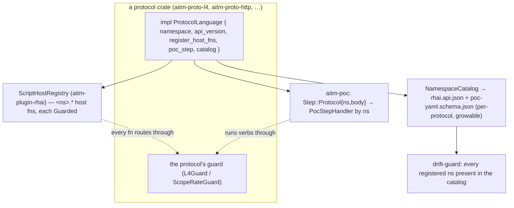

# Protocol-extensible scripting & PoC languages design

**Status:** approved (2026-10-28 by Matt — all three open questions resolved to recommended defaults: named per-protocol PoC steps; incremental migration of existing namespaces; one seam spanning L7 + L4, each namespace naming its guard). Design only; nothing here is built.
**Directive:** Matt, 2026-10-28 — "our scripting language and PoC language need to support L4 as well, and it has to be expandable to all supported protocols."
**Extends (amends) three approved specs:** plugin system / Rhai — `docs/superpowers/specs/2026-10-27-aitmproxy-plugin-system-design.md`; PoC language — `docs/superpowers/specs/2026-10-27-aitmproxy-poc-language-design.md`; L4 (M5) — `docs/superpowers/specs/2026-10-27-aitmproxy-m5-l4-packet-mitm-design.md` (on `claude/m4-l4-spec-10eea7`). Consumed by the operator-UI language definitions (`docs/design/languages/rhai.api.json`, `poc-yaml.schema.json`).

## Intent

Today the Rhai scripting tier and the PoC language know a **fixed** set of capabilities — `http.*`, `browser.*`, `store.*`, `scope.*` host functions, and `http`/`browser`/`extract`/`script` PoC steps — all registered **inside** `aitm-plugin-rhai` / `aitm-poc`. M5 adds `l4.*` host functions the same hard-wired way and **defers** a native L4 PoC step (L4 reproduction is only reachable through the generic `script` step). Matt's requirement is twofold: **L4 must be first-class in both languages**, and the design must **expand to every protocol the platform gains** (future L4 sub-protocols, QUIC, DNS, gRPC, …) without editing the language crates each time.

This spec defines the **extensibility seam**: a protocol module contributes its scripting host-function namespace *and* its PoC step/vocabulary *and* its completion-catalog entries through one registration surface, each routed through the protocol's own guard, deny-by-default and API-versioned. L4 is the first consumer beyond HTTP/browser; it proves the seam the way the first-party plugins prove the `Plugin`/`Command` seam. The guiding rule stays the platform's: **one model, authored once, human-readable and human-writable, agent-usable** — a person learns the shape once and every protocol fits it.

## Goals

- **One extensibility seam, two language faces.** A protocol crate registers a `<proto>.*` **Rhai host namespace** and a PoC **protocol step** (+ its matcher/extractor sources) through a single registration surface; neither `aitm-plugin-rhai` nor `aitm-poc` is edited to add a protocol.
- **L4 first-class in both languages.** `l4.*` host functions in Rhai (M5 already plans these) **and** a native `l4:` PoC step (M5 deferred this — this spec un-defers it as the first instance of the extensible step mechanism), both human-readable.
- **Guarded by construction.** Every protocol namespace routes through that protocol's guard (HTTP → `ScopeRateGuard`; L4 → `L4Guard`), deny-by-default; no protocol can register a function that bypasses its guard.
- **Versioned & catalogued.** Each namespace declares an API version; the shared `rhai.api.json` / `poc-yaml.schema.json` carry a **per-protocol, growable** structure so the operator-UI highlighting/autocomplete gain a protocol's vocabulary as data, and the drift-guard checks every registered namespace appears in the catalog.
- **Human-friendly.** Named PoC steps (`l4:` reads like `http:`/`browser:`) and namespaced host calls (`l4.craft(...)`) stay readable and hand-writable, per Matt's standing rule.

## Non-goals

- **No new protocol engines.** This defines how a protocol *contributes language surface*; the protocols themselves (L4 = M5; future ones) are their own specs.
- **No new scripting/PoC semantics beyond the seam.** Hooks, the flow object, the sandbox, the matcher/extractor DSL vocabulary, the `success` model — unchanged; protocols plug into them.
- **No removal of the generic `script` step.** It stays as the escape hatch; the native protocol steps are the readable first-class path M5 deferred.
- **No change to the guard model.** Each protocol's guard is defined by that protocol's spec; this seam only requires that the registered namespace routes through it.
- **Not a dynamic/third-party protocol loader.** Protocols are compiled-in crates (like the Rust plugin tier); the seam is a registration surface, not `dlopen`.

## Anti-goals

- **A per-protocol fork of the language crates.** If adding QUIC means editing `aitm-plugin-rhai`'s prelude or `aitm-poc`'s `Step` enum by hand, the seam has failed.
- **A protocol namespace that escapes its guard.** A registered `<proto>.*` function that reaches the wire without its guard's permit is a security failure (M5's central anti-goal, generalized).
- **An unreadable generic step.** A `protocol: l4\n op: craft\n args: {...}` blob that reads like machine code defeats the human-friendly rule; named steps per protocol are required.
- **A catalog that silently lags the engine.** A protocol whose host functions are registered but absent from `rhai.api.json` misleads completion — the drift-guard must fail.
- **Divergent scripting vs PoC surfaces.** A protocol's verbs must be the *same* names in a Rhai script and in a PoC step/`script` body; one vocabulary, learned once.

## Design

### The seam — a `ProtocolLanguage` contribution

A protocol module (already a `Plugin` / `ProtocolModule`) additionally implements a small **language contribution** registered at load, in one place:

```
trait ProtocolLanguage {
    fn namespace(&self) -> &str;                 // "l4", "http", "browser", …
    fn api_version(&self) -> &str;               // per-namespace semver-ish, like script `const API`
    fn register_host_fns(&self, reg: &mut ScriptHostRegistry);   // Rhai `<ns>.*` fns, each guard-wrapped
    fn poc_step(&self) -> Option<Box<dyn PocStepHandler>>;       // native `<ns>:` PoC step (+ matcher/extractor sources)
    fn catalog(&self) -> NamespaceCatalog;       // data for rhai.api.json / poc-yaml.schema.json + hover/help
}
```

- **`ScriptHostRegistry`** is a thin wrapper the `aitm-plugin-rhai` engine exposes so a protocol crate injects its `<ns>.*` functions **from its own crate**, instead of `aitm-plugin-rhai` hard-coding them. Each registered fn is wrapped so its call passes the protocol's guard before any effect (the wrapper takes the guard handle; a fn that forgets it does not compile — the registry API requires a `Guarded<_>` wrapper). `http`/`browser`/`store`/`scope` are migrated to register through this same surface (first-party, in `aitm-plugin-rhai` or their own crates), so the seam has three worked examples from day one. **(Architect's call.)**
- **`PocStepHandler`** lets `aitm-poc` dispatch a `<ns>:` step without a hard-coded `Step` enum arm per protocol: the `Step` model gains one `Step::Protocol { ns, body }` arm (additive, `#[non_exhaustive]`) that `aitm-poc` routes to the registered handler by `ns`; the handler parses its own body (human-friendly YAML), runs it through the protocol's host verbs (the same `<ns>.*`), and contributes matcher/extractor **sources** (e.g. L4 `part: packet`, packet-field extractors). The existing `http`/`browser`/`extract`/`script` steps keep their current shapes (they predate the seam); new protocols use `Step::Protocol`. **(Architect's call — this un-defers M5's native L4 step as the first `Step::Protocol` instance.)**
- **`NamespaceCatalog`** is the data a protocol contributes to the shared definition files: its host-fn signatures + descriptions, its PoC step schema + enums, its matcher/extractor sources. The build that assembles `docs/design/languages/rhai.api.json` and `poc-yaml.schema.json` concatenates every registered namespace's catalog, so the operator-UI highlighting/autocomplete gain a protocol as data (no UI edit).



### L4 as the first consumer (makes Matt's requirement concrete)

- **Rhai:** `aitm-proto-l4` registers the `l4.*` namespace (`l4.interfaces`, `l4.scope.*`, `l4.capture.*`, `l4.flow.*`, `l4.craft`, `l4.inject`, `l4.send_recv`, `l4.intercept.*`) through `ScriptHostRegistry`, each wrapped in an `L4Guard` permit — exactly M5's "l4.* host fns, guarded" row, but registered *from the L4 crate via the seam*, not hard-coded in `aitm-plugin-rhai`.
- **PoC:** a native **`l4:` step** (`Step::Protocol { ns: "l4", body }`) whose body is human-friendly YAML for the scapy-style `PacketSpec` (layers) + a verb (`craft`+`inject`, `send_recv`, `capture`, `intercept`), with packet-field **matcher/extractor sources** so a PoC asserts on a captured/received packet (e.g. `part: packet`, extract a field, match a byte signature). This is M5's deferred "native L4 PoC step," delivered as the seam's first instance. The `script`-step path (M5's current answer) remains valid.
- **Shipped scope (ratified 2026-10-29, implemented in PR #48).** L4 scripting exposes the **one-shot** verbs that make up the craft→send→assert reproduction workflow AC4/AC5/AC8 describe: `l4.interfaces`, `l4.craft`, `l4.scope.add`/`remove`/`list`, `l4.flow.list`/`get`, `l4.inject`, `l4.send_recv`. The **stateful live-session** verbs `l4.capture.*` and `l4.intercept.*` (start→run→stop / intercept-mutate-forward-drop as packets arrive) are a **tracked follow-up** pending a session-scripting interaction model (a callback/driver a single synchronous script invocation can't express); they remain on the command surface. `l4.agent.set`/`status` are **operator-only** (the setter refuses `Frontend::Mcp`) and are intentionally not script verbs. So AC4's "`l4.*` reachable" is the reproduction surface, not literally every command.
- **Catalogued-only (PR #48; ratified 2026-10-29).** The l4 `host_fns` + `l4:` step are registered in the catalog/completion and are **gate-proven in tests** (an agent-sourced engine with a closed gate refuses the verb), but they are **not yet wired onto the live production engine**. Live use is a tracked follow-up ("L4 live scripting wiring"), whose non-negotiable crux is deriving the agent-vs-operator gate decision from the **per-invocation `Frontend`** (not the build-time `agent_sourced` bool the tests use) — because the production Rhai engine is shared across all frontends. That is a cross-cutting design task (per-frontend engines vs threading the per-call context into the seam's context-free `HostFn`, the same root as the Task-5 `NativeCallContext` decoupling), co-designed with the shared-engine / command-path-from-script question. So AC4/AC5 are "reachable + gate-correct in the seam and tests," with production-live wiring explicitly deferred.
- **Human-friendly example (normative shape):**
  ```yaml
  steps:
    - l4:
        op: send_recv
        packet:
          layers:
            - ipv4: { dst: "{{target_ip}}" }
            - tcp:  { dport: 80, flags: S }     # SYN; checksum/len auto like scapy
        timeout_ms: 1000
      extract:
        - name: synack_flags
          type: packet
          field: tcp.flags
  success:
    - dsl: 'synack_flags == "SA"'               # SYN-ACK => port open (authorized recon)
  ```

### Extending to the next protocol

A new protocol (say DNS) ships `aitm-proto-dns` implementing `ProtocolLanguage` with namespace `dns`: `register_host_fns` adds `dns.*`, `poc_step` returns a `dns:` handler, `catalog` describes both. No edit to `aitm-plugin-rhai`, `aitm-poc`, or the operator UIs — the host fns appear in scripts, the `dns:` step appears in PoCs, the completion catalog grows, and the drift-guard covers it. Each protocol declares its own `api_version` so a script/PoC can target a namespace version, matching the script-tier `const API` policy.

### Shared definition files (operator UI)

- `rhai.api.json` gains a top-level **`namespaces`** map keyed by protocol (`http`, `browser`, `l4`, …), each with its fns/signatures/descriptions and `api_version`; the existing flat `globals` becomes the `core`/cross-cutting namespaces (`log`, `store`, `scope`, DSL helpers). Growable by concatenating `NamespaceCatalog`s.
- `poc-yaml.schema.json` gains an **extensible step set**: the fixed `http`/`browser`/`extract`/`script` plus a per-protocol `<ns>:` step schema contributed by each `NamespaceCatalog`, and protocol-contributed matcher/extractor source names (e.g. `packet`).
- The operator-UI highlighting/autocomplete (UI-ext Part 1) already read these as data, so protocol vocabulary appears in completion with no UI change. The **drift-guard** (UI-ext AC5 / F8 plan Task 7) extends to assert every engine-registered namespace is present in the catalog.

## Acceptance criteria

Observable via `cargo test` (a test protocol crate exercises the seam without editing the language crates).

1. **AC1 — host-namespace seam:** a **test protocol** crate registers a `<test>.*` Rhai namespace through `ScriptHostRegistry` and a script calls `test.ping()` — with **no edit to `aitm-plugin-rhai`** (registration-only), proving the scripting seam.
2. **AC2 — guarded by construction:** a registered `<test>.*` function that performs a guarded effect is refused when its guard refuses; the registry API makes an unguarded effectful registration fail to compile (type-level `Guarded` wrapper).
3. **AC3 — native protocol PoC step:** a PoC with a `<test>:` step (`Step::Protocol`) runs its verb via the test namespace and contributes a matcher source — with **no edit to `aitm-poc`'s** fixed steps, proving the PoC seam.
4. **AC4 — L4 first-class, Rhai:** `l4.*` verbs are reachable in a Rhai script via the seam, each `L4Guard`-gated (parity with M5's guard tests).
5. **AC5 — L4 first-class, PoC:** the `l4:` step example above round-trips (YAML ↔ model) and runs `send_recv` + a `packet` extractor + a `dsl` success assertion against a scoped loopback target (authorized), pass-vs-refused by scope.
6. **AC6 — catalog grows as data:** registering the test namespace adds its fns/step to the assembled `rhai.api.json` / `poc-yaml.schema.json` without hand-editing those files.
7. **AC7 — drift-guard covers namespaces:** the catalog↔engine guard (UI-ext AC5) fails if a registered namespace is missing from the catalog, and passes for `http`/`browser`/`l4`/the test namespace.
8. **AC8 — one vocabulary:** the `l4.*` verb names are identical in a Rhai script and in the `l4:` PoC step / a PoC `script` body (asserted by sharing the catalog).
9. **AC9 — versioned namespaces:** each namespace exposes an `api_version`; a script/PoC targeting a mismatched namespace version is warned/refused per the script-tier `API` policy.

## Left to the builder

- Exact `ScriptHostRegistry` / `PocStepHandler` / `NamespaceCatalog` signatures and where they live (likely `aitm-plugin` re-exports, so protocol crates import one path).
- Migration order for the existing `http`/`browser`/`store`/`scope` namespaces onto the seam (big-bang vs incremental; they can keep working in-crate and move behind the seam task-by-task).
- Whether `Step::Protocol` carries a typed body or a late-parsed `serde_yaml::Value` the handler validates (recommend the latter for extensibility).
- The L4 `packet` matcher/extractor source grammar (packet-field paths like `tcp.flags`), from M5's `PacketSummary`.
- Coordination with M5: whether M5 registers `l4.*` through the seam from the start, or lands them in-crate and migrates. (Flag to the M5 sessions.)

## Open questions

Resolved at approval (2026-10-28, Matt):

1. **PoC step shape** → **named per-protocol steps** (`l4:`, `dns:`, reading like `http:`/`browser:`) via one additive `Step::Protocol { ns, body }` arm — human-readable over a generic discriminator step.
2. **Migration** → **incremental**: `http`/`browser`/`store`/`scope` move onto the seam task-by-task and stop being special; L4 does not block on that migration.
3. **Scope** → **one seam spanning L7 + L4**, each namespace naming its own guard (`ScopeRateGuard` for L7, `L4Guard` for L4); not a separate seam per layer.
